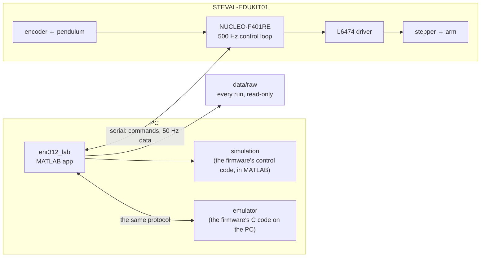

# STEVAL-EDUKIT01 rotary inverted pendulum

**The ST STEVAL-EDUKIT01 kit, from first principles to a balancing, swinging-up rig: bare-metal STM32 firmware, a MATLAB lab app, a Simulink model and every measurement.**

[](https://github.com/Samarth030312/steval-edukit/actions/workflows/ci.yml)


A pendulum hangs from the end of an arm. A stepper motor turns the arm, and a small
microcontroller decides, 500 times a second, how the arm should move. With the right
decisions the pendulum stops swinging, follows the arm, swings up on its own, and
balances upside down.

This repository is the whole of that:

- the physics, derived from first principles;
- the bare-metal firmware for the ST **STEVAL-EDUKIT01** kit;
- a MATLAB lab app whose simulation runs the firmware's own control code;
- every measurement from the real rig, with each disagreement between model and rig
  written down.

It covers the ten control tutorials of the ENR312 laboratory: from a single actuator
to sensitivity functions, MIMO control, an unstable plant, integral action, root locus,
state feedback and LQR, plus an energy-based swing-up.

<p align="center">
  
  <br><sub>Four swing-ups on the rig, four catches, 3.9–5.8 s; the simulation of the same
  firmware in grey. From <code>data/raw</code> by <code>matlab/plotting/plot_session_20261021d.m</code>.</sub>
</p>

## Get it running

Paste this into the MATLAB Command Window, on Windows, macOS or Linux:

```matlab
gitclone("https://github.com/Samarth030312/steval-edukit.git", Depth=1); cd steval-edukit; setup open
```

It downloads the repository, checks the computer, says what is missing, and opens
the lab. The simulator needs only MATLAB. Drivers, the board, flashing and computer
requirements for each system: **[install guide](docs/INSTALL.md)**. Then everything,
step by step: **[the sequence](docs/SEQUENCE.md)**.

## What we found

- **The simulation predicts the rig where the physics is modelled.** For the hanging
  tutorials, overshoot and settling agree within a few percent, and a load offset
  within half a microstep. The simulation is checked against the C code on every
  change ([results](docs/RESULTS.md)).
- **The textbook pendulum was not ours.** Six free swings gave a pendulum constant of
  ωg² = 48.0 ± 0.5, not the Tutorial's 57. The rod is the Tutorial's; the difference is
  most likely the small paper holder clipped at its tip. With the wrong value the swing-up caught 1
  of 3; with the measured one, 4 of 4.
- **The pivot has dry friction.** It explains, to 0.01°, arm offsets that had looked
  like controller errors.
- **The balance takes a push.** 15 of 17 hand pushes, up to 83 deg/s, were recovered,
  close to the simulated curve. Of the two lost, one hand kept pushing for 0.14 s, and
  one was a 115 deg/s push, beyond the predicted limit of 100.
- **Every result names its data and its code.** Runs are recorded automatically and
  raw data is read-only. Corrections are dated, not hidden: the evening report kept
  its first, wrong diagnosis in git history.

## Start here

| I want to … | Go to |
|---|---|
| run everything, in order | [the sequence](docs/SEQUENCE.md) |
| install it on Windows, macOS or Linux | [install guide](docs/INSTALL.md) |
| try the simulator, no hardware needed | [the simulator guide](docs/guide/README.md) |
| run the Simulink model, answer Assignment 3 (PEND) | [Simulink model](docs/SIMULINK.md) |
| build and run the rig myself | [from an empty bench to a balancing pendulum](docs/REPLICATE.md) |
| understand the physics | [rotary pendulum dynamics](docs/first_principles/ROTARY_PENDULUM_DYNAMICS.md) |
| know why it is built this way | [design: decisions, model, metrics, parameters](docs/DESIGN.md) |
| see how the pieces fit | [architecture](docs/ARCHITECTURE.md) |
| read the results | [results](docs/RESULTS.md) and [the session reports](results/reports/) |
| use the data | [data](data/README.md) |
| answer the ENR312 PEND questions | [PEND answer guide](docs/PEND_ANSWER_GUIDE.md) |
| see what comes next | [roadmap](ROADMAP.md): MPC, micro-ROS on Zephyr |

<p align="center"></p>

## How it fits together



The same control code runs in three places: on the board, in the emulator, and, line
for line, in the MATLAB simulation. Details in [architecture](docs/ARCHITECTURE.md).

## Status

- **On the rig:** all ten tutorials, the swing-up, the pendulum target and a push test
  (five sessions, 47 recorded runs, plus 8 records at 500 Hz).
- **Firmware 2.3.3** is on the board.
- **Not yet on the rig:** the on-off controller (EXP022), upright LQR from a hand
  release (EXP023), and stopping a plucked swing (EXP021).
- **Tested on:** Ubuntu 22.04. On Windows the app has been seen connecting to a board;
  flashing from Windows and anything on macOS have not been run yet.

## Repository layout

```
firmware/enr312/   bare-metal firmware: portable control cores, STM32 build, emulator, tests, pinned release
matlab/            lab app, simulation, identification, plotting, tests
experiments/       one folder per experiment: question, derivation, prediction, procedure (written before the rig)
data/              every rig run, raw and read-only, with metadata
results/           figures, tables and one report per rig session
docs/              guide, design, architecture, physics, hardware, troubleshooting
```

## License

MIT for the original work ([`LICENSE`](LICENSE)). The ST HAL (BSD-3-Clause) and Arm
CMSIS (Apache-2.0) under `Drivers/` keep their own licences ([`THIRD_PARTY.md`](THIRD_PARTY.md)).
Course tutorials, ST manuals and the UCLA reference project are cited, not
redistributed ([`docs/REFERENCES.md`](docs/REFERENCES.md)).
