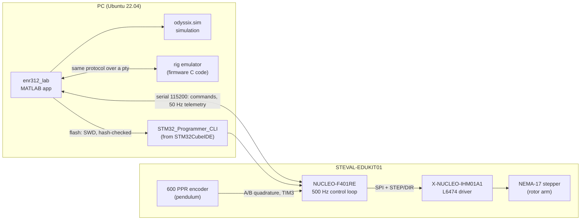

# Rotary Inverted Pendulum: STM32 firmware + MATLAB control lab

[](https://github.com/Samarth030312/enr312-rotary-inverted-pendulum/actions/workflows/ci.yml)


-orange)


Bare-metal STM32F401RE firmware and a MATLAB laboratory app for the ST
**STEVAL-EDUKIT01** rotary inverted pendulum. The project covers the whole chain:
a first-principles model, a MATLAB simulation that matches the firmware's
control code to floating-point rounding, a 500 Hz embedded controller, and measurements from the
physical rig compared against the predictions.

It implements the first five control tutorials of the **ENR312 Control
Engineering Laboratory** (Ahmedabad University, Monsoon 2026), which follow
W. J. Kaiser's Edukit tutorial series (UCLA): from digital-actuator tracking
through sensitivity functions and MIMO control to balancing the pendulum upright.

<p align="center">
  
  <br><sub>Measured on the rig, 2026-10-12. Left: rig (blue) over simulation (grey) for the
  same gains. Right: inverted pendulum under control for 78 s.
  Generated by <code>matlab/plotting/plot_rig_vs_sim.m</code> from <code>data/raw</code>.</sub>
</p>

## What is in it

| Part | What it does | Where |
|---|---|---|
| Firmware | 500 Hz control loop, L6474 stepper driver over SPI, quadrature encoder on TIM3, safety supervisor, serial command protocol | [`firmware/enr312/`](firmware/enr312/) |
| Lab app | One MATLAB window for all five tutorials: tune gains, simulate, run the same gains on the rig, overlay measurement on simulation | [`matlab/apps/enr312_lab.m`](matlab/apps/enr312_lab.m) |
| Simulation | Line-by-line port of the firmware control path driving a nonlinear pendulum model; tested equal to the C code | [`matlab/+odyssix/+sim/`](matlab/+odyssix/+sim/) |
| Emulator | The firmware's own C control code compiled for the PC behind the same serial protocol, so the app runs without hardware | [`firmware/enr312/host/`](firmware/enr312/host/) |
| Physics | Derivation of the pendulum equations, the sign change between hanging and upright, model audit | [`docs/first_principles/`](docs/first_principles/ROTARY_PENDULUM_DYNAMICS.md) |
| Experiments | EXP001–EXP005: objective, hypothesis, derivation, procedure, acceptance criteria (written before the rig runs) | [`experiments/`](experiments/) |
| Data | Raw rig measurements with metadata, and the serial transcripts of every hardware session | [`data/`](data/), [`results/evidence/`](results/evidence/rig_sessions/) |
| Results | Rig-vs-simulation comparison and discrepancy analysis | [`results/reports/`](results/reports/2026-10-12_rig_tutorials_1-5.md) |

## Results on the hardware (2026-10-12)

| Tutorial | Result on the rig |
|---|---|
| 1 Actuator & sensing | +5° command = 44 microsteps; protractor reads 5°. Arm and encoder sign conventions measured (encoder polarity −1). |
| 2 Sensitivity (rotor loop) | Overshoot 23.75 % on the rig and 23.75 % in simulation; load-disturbance offset 0.112° vs 0.113° (prediction D/Kp = 0.108°). |
| 3 MIMO control effort | Arm settles 0.5° off the reference. Explained quantitatively by a 0.3° pendulum rest offset (pivot friction) times Kpp/Kp. |
| 4 MIMO sensitivity | Same offset mechanism (predicted 3.00°, measured 3.04°); two external disturbances rejected. |
| 5 Inverted pendulum | Balanced in 4 of 4 runs on firmware 2.0.8 (0 of 3 before it), up to 78 s, pendulum 0.4–1.1° RMS from upright. The arm drifts by tens of degrees; cause identified, not yet fixed. |

Full analysis, including what does **not** yet match the model:
[`results/reports/2026-10-12_rig_tutorials_1-5.md`](results/reports/2026-10-12_rig_tutorials_1-5.md).

## Quick start

```matlab
% MATLAB, from the repository root
addpath(genpath('matlab'))
enr312_lab
```

No rig? Press **Use emulator** in the app. Simulation works on any MATLAB
installation; the emulator needs `gcc` and `make` (Linux or macOS).

With a rig: follow [`docs/GETTING_STARTED.md`](docs/GETTING_STARTED.md), then the
wiring check in [`docs/hardware/ENR312_WIRING.md`](docs/hardware/ENR312_WIRING.md) §4.
Students start at [`docs/STUDENT_QUICKSTART.md`](docs/STUDENT_QUICKSTART.md).

> **Platform.** Everything here was developed and tested on **Ubuntu 22.04.5 LTS
> (x86-64)** only. The code contains paths for Windows and macOS, but they have not
> been run. See [Getting started → other platforms](docs/GETTING_STARTED.md#macos-and-windows).

## Architecture



More diagrams (firmware state machine, Tutorial 5 sequence, flashing path) in
[`docs/ARCHITECTURE.md`](docs/ARCHITECTURE.md).

## Verification

`scripts/flash_ready_check.sh` runs every check that does not need the rig
(about 10 minutes with MATLAB, `--quick` skips the real-time tests):

* firmware builds with no warnings in project code, and is **byte-reproducible**;
  the committed release image must match its SHA-256 in `release/MANIFEST.txt`
* link-map check that the image contains no RTOS or middleware symbols
* 330+ host unit tests of the control cores, runner and command parser (C)
* physics-model validation, simulation-equals-firmware test, end-to-end tests of
  both apps against the emulator (MATLAB)

CI runs the C part on every push (see the badge above).

## Documentation

| Document | Contents |
|---|---|
| [Getting started](docs/GETTING_STARTED.md) | Tools and exact versions, setup, macOS/Windows notes |
| [Architecture](docs/ARCHITECTURE.md) | Firmware structure, protocol, state machines, diagrams |
| [MATLAB ↔ STM32 integration](docs/MATLAB_STM32_INTEGRATION.md) | How MATLAB builds, flashes and talks to the board through the STM32CubeIDE tools |
| [Troubleshooting](docs/TROUBLESHOOTING.md) | Every problem met during bring-up, its cause and its fix |
| [Wiring and electrical check](docs/hardware/ENR312_WIRING.md) | Pin plan, motor/encoder/supply wiring, staged power-up check |
| [Pendulum dynamics](docs/first_principles/ROTARY_PENDULUM_DYNAMICS.md) | Derivation and linearisation |
| [Engineering standards](docs/ENGINEERING_STANDARDS.md) | Rules the project follows: first principles, units, data provenance |
| [References](docs/REFERENCES.md) | Course material, datasheets and the reference implementation |
| [Changelog](CHANGELOG.md) | Firmware releases and what each one fixed |

## Repository layout

```
firmware/enr312/     bare-metal firmware: src/ (portable control cores), target/ (STM32 build),
                     host/ (emulator + plant model), test/ (host unit tests), release/ (pinned image)
Drivers/             ST STM32F4 HAL and CMSIS (vendor code, their own licences)
matlab/              lab app, simulation, models, identification, tests
experiments/         EXP001–EXP005 definitions (pre-registered before the rig runs)
shared/              parameters and experiment contracts shared by firmware and MATLAB
data/                raw rig data (read-only) + metadata
results/             figures, tables, reports, hardware session logs
docs/                documentation
scripts/             readiness check, release script, Python design scripts
```

## License

MIT for the original work in this repository ([`LICENSE`](LICENSE)). The ST HAL
(BSD-3-Clause) and Arm CMSIS (Apache-2.0) under `Drivers/` keep their own
licences; see [`THIRD_PARTY.md`](THIRD_PARTY.md). Course tutorials, ST manuals
and the UCLA reference project are **not** redistributed here; they are cited in
[`docs/REFERENCES.md`](docs/REFERENCES.md).
