# Rotary Inverted Pendulum: STM32 firmware + MATLAB control lab

[](https://github.com/Samarth030312/enr312-rotary-inverted-pendulum/actions/workflows/ci.yml)


-orange)


Bare-metal STM32F401RE firmware and a MATLAB laboratory app for the ST
**STEVAL-EDUKIT01** rotary inverted pendulum. The project covers the whole chain:
a first-principles model, a MATLAB simulation that matches the firmware's
control code to floating-point rounding, a 500 Hz embedded controller, and measurements from the
physical rig compared against the predictions.

It implements the ten control tutorials of the **ENR312 Control Engineering
Laboratory** (Ahmedabad University, Monsoon 2026), which follow W. J. Kaiser's
Edukit tutorial series (UCLA), plus the course's **PEND** lab questions: from
digital-actuator tracking, sensitivity functions and MIMO control to balancing the
pendulum upright, integral action, root locus, state feedback and LQR.

**Status.**
- **All ten tutorials have run on the rig**, along with the energy swing-up and a
  pendulum-height controller: 39 recorded runs over four sessions, all in [`data/`](data/).
- The swing-up caught the pendulum upright 3 of 3 times on firmware 2.2.0. On 2.3.0 it
  caught only 1 of 3. Identifying the pendulum from that day's data showed why: the
  firmware was given the pendulum constant ωg² = 57 from the Tutorial geometry, while the
  rig measures 48 ± 1
  ([evening report](results/reports/2026-10-21b_rig_session.md)). A free swing confirmed
  the value. Firmware 2.3.2, told the measured ωg², **caught the pendulum upright at the
  first try, in 3.9 s** ([late report](results/reports/2026-10-21c_rig_session.md)).
- Pushed by hand while balancing, it recovered from a push of about 50 deg/s, as the
  simulation predicts. A larger, sustained push ended the run.
- Numbers marked as predictions are predictions.

<p align="center">
  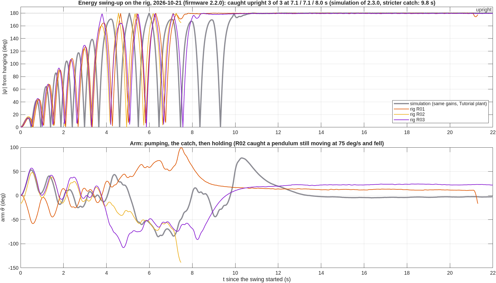
  <br><sub>Energy swing-up on the rig, 2026-10-21: the pendulum's height |ψ| (180° = upright) in three
  runs, over the simulation of the same gains (with the Tutorial pendulum constant, which
  later proved 15–20 % high; see the evening report). Generated by
  <code>matlab/plotting/plot_session_20261021.m</code> from <code>data/raw</code>.</sub>
</p>

<p align="center">
  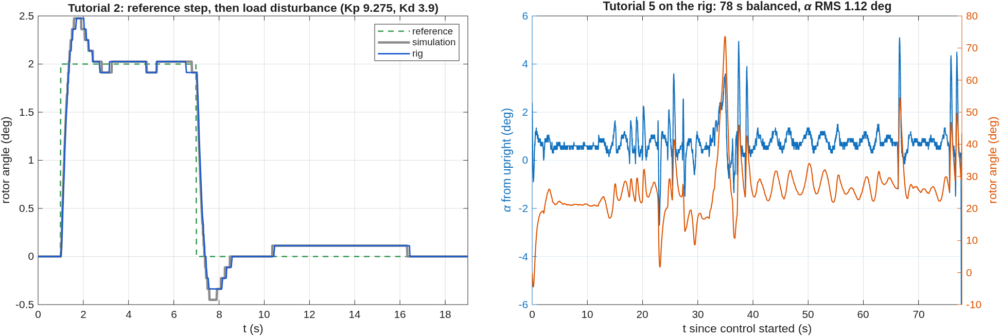
  <br><sub>Measured on the rig, 2026-10-12. Left: rig (blue) over simulation (grey) for the
  same gains. Right: inverted pendulum under control for 78 s.
  Generated by <code>matlab/plotting/plot_rig_vs_sim.m</code> from <code>data/raw</code>.</sub>
</p>

## What is in it

| Part | What it does | Where |
|---|---|---|
| Firmware | 500 Hz control loop, L6474 stepper driver over SPI, quadrature encoder on TIM3, safety supervisor, serial command protocol, a 500 Hz crash recorder for aborts and marked pushes | [`firmware/enr312/`](firmware/enr312/) |
| Lab app | One MATLAB window: missions T1–T10 and a free LAB mode (hanging or upright; PID, LQR, state feedback, on-off). Simulate, run the same configuration on the rig, drive it live (arm to any angle, pendulum swing height, swing-up, gains), with **every run recorded automatically**, overlaid on the simulation and played back on the 3-D rig (play, pause, scrub, speed) | [`matlab/apps/enr312_lab.m`](matlab/apps/enr312_lab.m) |
| Simulation | Line-by-line port of the firmware control path driving a nonlinear pendulum model; tested equal to the C code | [`matlab/+odyssix/+sim/`](matlab/+odyssix/+sim/) |
| Emulator | The firmware's own C control code compiled for the PC behind the same serial protocol, so the app runs without hardware | [`firmware/enr312/host/`](firmware/enr312/host/) |
| Physics | Derivation of the pendulum equations, the sign change between hanging and upright, model audit | [`docs/first_principles/`](docs/first_principles/ROTARY_PENDULUM_DYNAMICS.md) |
| Experiments | EXP001–EXP010 and PEND EXP021–EXP024 (incl. energy swing-up and pendulum target): objective, hypothesis, derivation, predictions, procedure, acceptance criteria (written before the rig runs) | [`experiments/`](experiments/) |
| PEND guide | Every task and question of the PEND lab handout mapped to the experiment, tool or data that answers it | [`docs/PEND_ANSWER_GUIDE.md`](docs/PEND_ANSWER_GUIDE.md) |
| Python client | Optional: the same serial protocol from Python (pyserial), for scripting runs | [`python/`](python/) |
| Data | Raw rig measurements with metadata, and the serial transcripts of every hardware session | [`data/`](data/), [`results/evidence/`](results/evidence/rig_sessions/) |
| Results | Rig-vs-simulation comparisons and discrepancy analysis, per session | [`results/reports/`](results/reports/) |

## Build one yourself

Everything needed to reproduce this rig from an empty bench is here:

- [parts, wiring and electrical check, flashing, first move, measuring your pendulum,
  balancing](docs/REPLICATE.md);
- [every bring-up problem we hit and its fix](docs/TROUBLESHOOTING.md).

What comes next (MPC, micro-ROS on Zephyr, other SDKs on the same control core):
[`ROADMAP.md`](ROADMAP.md).

## Results on the hardware (2026-10-12)

| Tutorial | Result on the rig |
|---|---|
| 1 Actuator & sensing | +5° command = 44 microsteps; protractor reads 5°. Arm and encoder sign conventions measured (encoder polarity −1). |
| 2 Sensitivity (rotor loop) | Overshoot 23.75 % on the rig and 23.75 % in simulation; load-disturbance offset 0.112° vs 0.113° (prediction D/Kp = 0.108°). |
| 3 MIMO control effort | Arm settles 0.5° off the reference. Explained quantitatively by a 0.3° pendulum rest offset (pivot friction) times Kpp/Kp. |
| 4 MIMO sensitivity | Same offset mechanism (predicted 3.00°, measured 3.04°); two external disturbances rejected. |
| 5 Inverted pendulum | Balanced in 4 of 4 runs on firmware 2.0.8 (0 of 3 before it), up to 78 s, pendulum 0.4–1.1° RMS from upright. The arm drifts by tens of degrees; cause identified, not yet fixed. |

Full analysis, including what does **not** yet match the model:
[`results/reports/2026-10-12_rig_tutorials_1-5.md`](results/reports/2026-10-12_rig_tutorials_1-5.md).

## Results on the hardware (2026-10-21)

| Experiment | Result on the rig |
|---|---|
| Energy swing-up | Caught upright **3 of 3** at 7.1 / 7.1 / 8.0 s; the swing builds up like the simulation. Balance later lost to external pushes. |
| Upright offset | Balancing, the mean pendulum angle was +0.63° and the arm sat at **+23.3°**. The LQR predicts −k₃/k₁·α = **+24.0°**: the encoder's "upright" is 0.6° off the balance point. Firmware 2.3.0 learns and removes it. In the evening it balanced 33 s with the same offset (α +0.68°) and the arm back home: −0.3° to −2.3° over the last 11 s. |
| Tutorial 7 | Impulse response (median over the impulses): pendulum −1.55° vs −1.35° simulated, arm 5.1° vs 4.7°. |
| LAB state feedback | Step to 90°: 89.66° on the rig, 89.77° in simulation, same trajectory. |

<p align="center">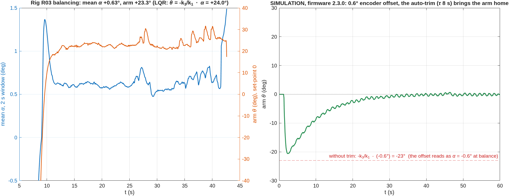</p>

Report: [`results/reports/2026-10-21_rig_session.md`](results/reports/2026-10-21_rig_session.md).

## Results on the hardware (2026-10-21, evening): all ten tutorials

| Experiment | Rig | Simulation |
|---|---|---|
| T2 overshoot · offset under a load | 20 % · 0.198° | 20 % · 0.153° (the gap is under half a microstep) |
| T3 overshoot | 35 % | 35 % |
| T3 / T4 arm offset | 2.25° / 3.49° | 2 + (Kpp/Kp)·ψ_rest = 2.25° / 3.50° |
| T8 load offset with Ki | 0.13° | 0 |
| T9 / T10 settling | 6.24 s / 4.58 s | 5.94 s / 4.39 s |
| T7 gain changed live | lost at pendulum Kd 146 and at rotor Kd 25 | gain sweep: unstable from Kd 150 and near rotor Kd 30 |
| Pendulum target 90° | swings to 91.8° | 91.8° |
| Swing-up, firmware 2.3.0 | 1 of 3 caught (38.9 s) | 8 of 36 on the identified pendulum (the app's own simulation said 5–11 s, see below) |

**Why the swing-up stopped catching.**

- *The catch rule.* In 2.3.0 I had tightened the catch to ≤ 60 deg/s after one catch at
  75 deg/s fell. The real pendulum went over the top at 75–120 deg/s, swing after swing,
  so the catch hardly ever fired.
- *The cause of the fast passes: the wrong pendulum constant.* The swing-up pumps until
  the pendulum's energy, E = ψ̇²/(2ωg²) + 1 − cos ψ, reaches that of standing upright. The
  firmware was told ωg² = 57.01, a value derived from the Tutorial geometry, but the rig
  measures 47.6–49.5. With ωg² too large, the firmware underestimates the energy near the
  bottom and keeps pumping. Its learnt correction could add energy but never take any
  back.
- *Why the simulation agreed with the mistake.* The app's simulation gave the simulated
  pendulum the same wrong constant, so the error could not show up in it.

<p align="center">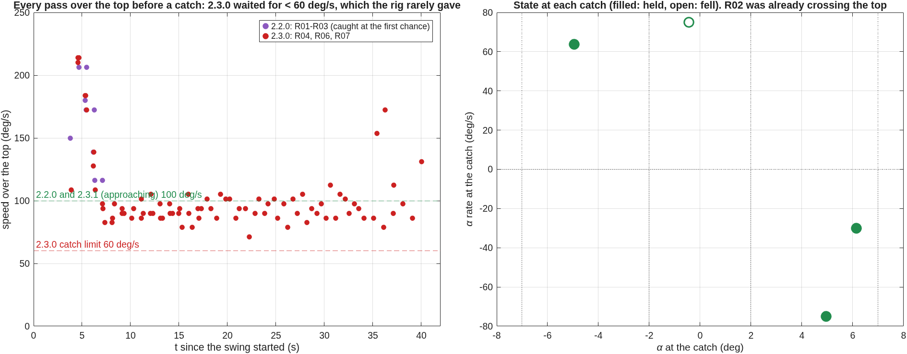</p>

**Identifying the pendulum from the data.** No dedicated free swing had been recorded,
so I used two stretches of the recorded runs instead.

- **A free decay inside T10.** The arm stood still, and a dry-friction model fits the
  decay twice as well as viscous damping (rms 0.33° against 0.73°). It gives ωg² 47.6 and
  friction 0.48 rad/s².
- **The 92° swings of the pendulum-target run.** Corrected for amplitude with the
  elliptic-integral period, they give ωg² 49.5. An energy balance over the same swings
  shows an extra speed-dependent loss, equivalent to a viscous Q ≈ 60.

<p align="center">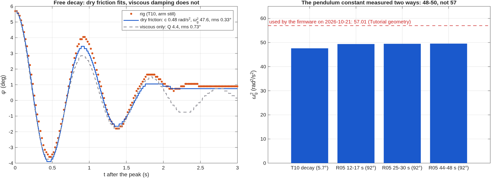</p>

**Replaying the four firmware versions on that pendulum.** With the wrong constant, the
model ranks 2.2.0 well above 2.3.0, as the rig did. Given the measured constant, every
version catches in all 36 cases. Firmware 2.3.2 lets the learnt correction go negative,
and it catches in 35 of 36 cases even with the wrong constant. That is still simulation
until it runs on the rig.

<p align="center">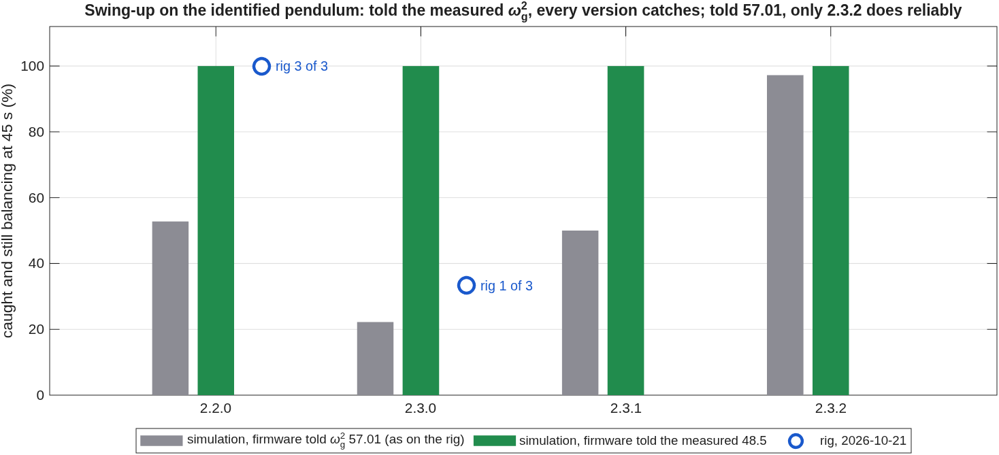</p>

**Friction explains the T3/T4 "errors".** Each run starts with the pendulum resting
slightly off the encoder's zero, held there by friction. The PD then holds the arm off
by (Kpp/Kp)·ψ_rest. That predicts the T3 and T4 arm offsets to within 0.01°, and it
shows that T4's "85.7 % overshoot" is not an overshoot.

<p align="center">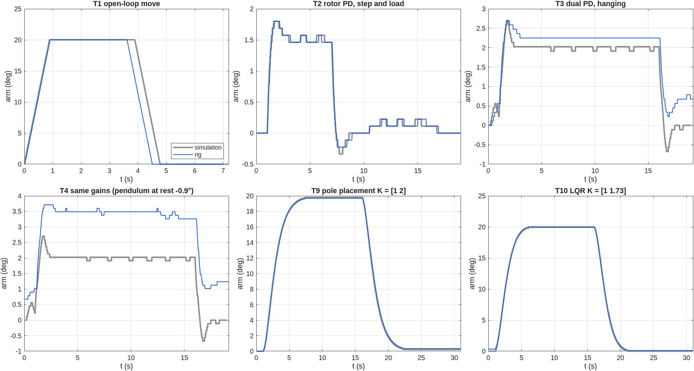</p>

Report, with what does not fit yet (T3 control effort, 22 against 48):
[`results/reports/2026-10-21b_rig_session.md`](results/reports/2026-10-21b_rig_session.md).

## Results on the hardware (2026-10-21, late): the prediction tested

The evening analysis predicted two things: that the pendulum constant is about 48, not
57, and that with the right value the swing-up would catch reliably. Both were tested
the same night.

| | Prediction | Rig |
|---|---|---|
| ωg² from a free swing, motor off | 48 ± 1.5 (from stretches of other runs) | **48.4 / 48.6** (period); 48 ± 1 over three methods |
| dry pivot friction | 0.48 rad/s² | 0.33 / 0.40 rad/s² |
| swing-up, firmware 2.3.2, ωg² 48.5 | caught in 4.23 s (simulation of this configuration) | **caught in 3.88 s, first try** |

<p align="center">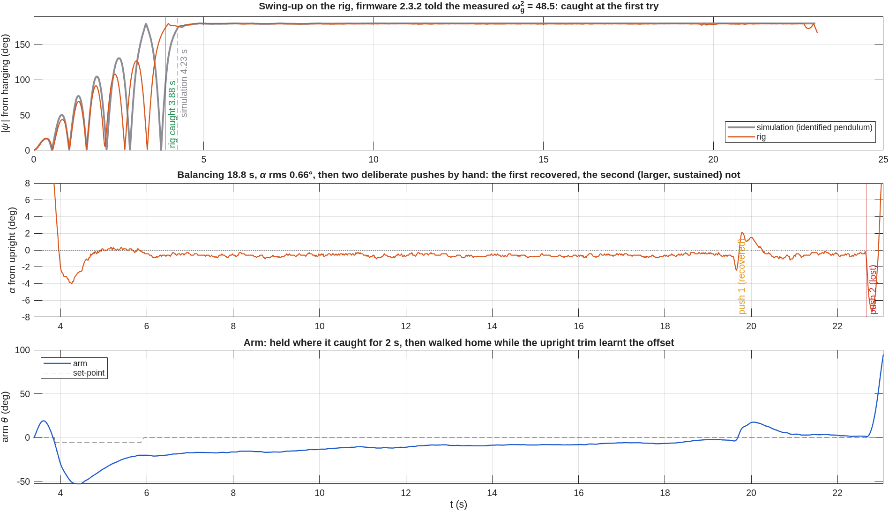</p>

It balanced for 18.8 s (α rms 0.66°). Then we pushed it by hand.

- The first push gave the pendulum 49 deg/s. It recovered with the peak angle and arm
  swing the simulation predicts for such a tap. The simulation says this controller
  takes taps up to 100 deg/s.
- The second push kept acting for 0.14 s and ended the run.

<p align="center">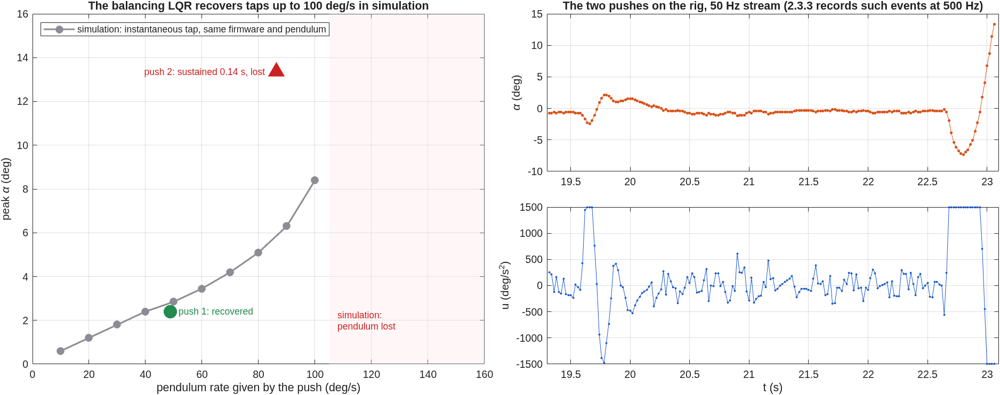</p>

To measure pushes properly, firmware 2.3.3 records the last 2 s at the full 500 Hz. The
app's **PUSH MARK** button logs the push and saves that record with the run.

The app's own free-swing fit failed on these real records at first: it assumed the
release was at the start and the damping was viscous. It now finds the release itself
and fits dry friction. Report:
[`results/reports/2026-10-21c_rig_session.md`](results/reports/2026-10-21c_rig_session.md).

## Predictions (simulation)

From the firmware-exact simulation with the Tutorial plant values
([`results/tables/`](results/tables/), `matlab/experiments/PEND/pend_predictions.m`).
Written before the rig runs. T7, T9, T10 and the pendulum target have since been
checked on the rig (above). The rest are still to be tested.

| Experiment | Prediction to test on the rig |
|---|---|
| 6 Integral action (inverted) | Linear model reproduces Tutorial 6 (overshoot 52.0 % vs 52.6 %, phase margin 31.42° vs 31.45°), but at the rig's 1500 deg/s² input limit the derivative kick of the 40° step saturates: **34 %** overshoot expected. |
| 7 Pendulum-loop design | A pendulum loop that is stable on its own (Kp 150, Kd 15) still loses balance in the full loop; 300/30 gives a 1.4° averaged impulse response. |
| 8 Load disturbance | Arm offset under a 60 deg/s² load: −4.1° without integral action (theory −D/Kp = −4.0°), −0.7° with it. |
| 9 / 10 State feedback, LQR | Tutorial 9 reference settles in 5.94 s (tutorial 5.8 s); LQR gains reproduce Tutorial 10 exactly. The stepper's minimum step rate parks the arm up to (k2 + b)·0.225/k1 degrees short. |
| LAB hanging, PID: stop a swing | 1.6 s with the pendulum D term, 21 s (free decay) without it; any commanded arm angle held to the microstep. |
| LAB hanging, on-off | Never settles: ±20° oscillation for a 20° step, pendulum shaken to 36°. |
| LAB upright, LQR | 2.3 % overshoot vs 34 % for the Tutorial 6 PID, pendulum error 0.17° vs 0.42° rms. A robust tuning study finds the best dual PID only 3 % better than Tutorial 6's gains; the LQR has 27 % less pendulum error. |
| Pendulum target | A pendulum rests only at 0° or 180°: holding it at ψ needs arm acceleration (ωg²/ωr²)·tan ψ. The target sets the swing height instead: 45/90/135° → 46/92/136°; 0 stops a 40° swing in 9 s (free decay 19 s). |
| PEND loop rate, taps | Balances down to a 16.7 Hz loop; recovers taps up to 100 deg/s of pendulum rate, falls at 120. |

## Quick start

```matlab
% MATLAB, from the repository root
addpath(genpath('matlab'))
enr312_lab
```

<p align="center">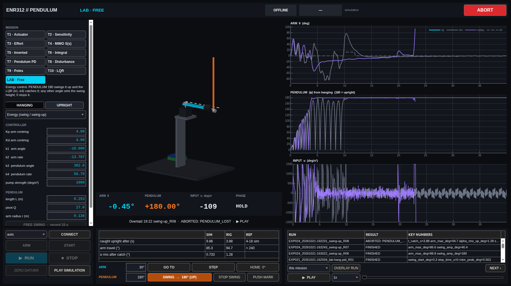</p>

No rig? **CONNECT** offers the emulator. Simulation works on any MATLAB
installation; the emulator needs `gcc` and `make` (Linux or macOS).

With a rig: follow [`docs/REPLICATE.md`](docs/REPLICATE.md) (setup details in [`docs/GETTING_STARTED.md`](docs/GETTING_STARTED.md)) and the
wiring check in [`docs/hardware/ENR312_WIRING.md`](docs/hardware/ENR312_WIRING.md) §4.
Students start at [`docs/STUDENT_QUICKSTART.md`](docs/STUDENT_QUICKSTART.md).

> **Platform.** Everything here was developed and tested on **Ubuntu 22.04.5 LTS
> (x86-64)** only. The code contains paths for Windows and macOS, but they have not
> been run. See [Getting started → other platforms](docs/GETTING_STARTED.md#macos-and-windows).

## Architecture

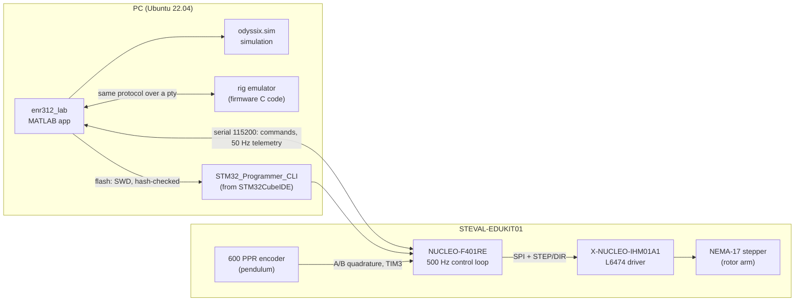

More diagrams (firmware state machine, Tutorial 5 sequence, flashing path) in
[`docs/ARCHITECTURE.md`](docs/ARCHITECTURE.md).

## Verification

`scripts/flash_ready_check.sh` runs every check that does not need the rig
(about 10 minutes with MATLAB, `--quick` skips the real-time tests):

* firmware builds with no warnings in project code and is reproducible: the
  flash image built from source must match the SHA-256 of the committed release
  in `release/MANIFEST.txt`
* link-map check that the image contains no RTOS or middleware symbols
* 457 host unit-test checks (C) of the control cores, runner and command parser, incl. the swing-up on 16 pendulum variants, 7 of them with dry pivot friction
* physics-model validation, simulation-equals-firmware test, a three-way parameter
  check (contract = MATLAB = firmware), end-to-end tests of the app for all
  experiments against the emulator (MATLAB), and the Python client against the
  emulator

CI runs the C part on every push (see the badge above).

## Documentation

| Document | Contents |
|---|---|
| [Build one yourself](docs/REPLICATE.md) | From an empty bench to a balancing pendulum, step by step |
| [Getting started](docs/GETTING_STARTED.md) | Tools and exact versions, setup, macOS/Windows notes |
| [Architecture](docs/ARCHITECTURE.md) | Firmware structure, protocol, state machines, diagrams |
| [MATLAB ↔ STM32 integration](docs/MATLAB_STM32_INTEGRATION.md) | How MATLAB builds, flashes and talks to the board through the STM32CubeIDE tools |
| [Troubleshooting](docs/TROUBLESHOOTING.md) | Every problem met during bring-up, its cause and its fix |
| [Wiring and electrical check](docs/hardware/ENR312_WIRING.md) | Pin plan, motor/encoder/supply wiring, staged power-up check |
| [Pendulum dynamics](docs/first_principles/ROTARY_PENDULUM_DYNAMICS.md) | Derivation and linearisation |
| [PEND answer guide](docs/PEND_ANSWER_GUIDE.md) | How to answer every PEND lab question with this rig |
| [Engineering standards](docs/ENGINEERING_STANDARDS.md) | Rules the project follows: first principles, units, data provenance |
| [References](docs/REFERENCES.md) | Course material, datasheets and the reference implementation |
| [Changelog](CHANGELOG.md) | Firmware releases and what each one fixed |
| [Roadmap](ROADMAP.md) | MPC, micro-ROS on Zephyr, more SDKs: why, how, and the pass criteria |

## Repository layout

```
firmware/enr312/     bare-metal firmware: src/ (portable control cores), target/ (STM32 build),
                     host/ (emulator + plant model), test/ (host unit tests), release/ (pinned image)
Drivers/             ST STM32F4 HAL and CMSIS (vendor code, their own licences)
matlab/              lab app, simulation, models, identification, tests
experiments/         EXP001–EXP010, EXP021–EXP024 definitions (pre-registered before the rig runs)
shared/              parameters and experiment contracts shared by firmware and MATLAB
data/                raw rig data (read-only) + metadata, indexed in data/README.md
results/             figures, tables, reports, hardware session logs
docs/                documentation
python/              optional Python client for the serial protocol
scripts/             readiness check, release script, Python design scripts
```

## License

MIT for the original work in this repository ([`LICENSE`](LICENSE)). The ST HAL
(BSD-3-Clause) and Arm CMSIS (Apache-2.0) under `Drivers/` keep their own
licences; see [`THIRD_PARTY.md`](THIRD_PARTY.md). Course tutorials, ST manuals
and the UCLA reference project are **not** redistributed here; they are cited in
[`docs/REFERENCES.md`](docs/REFERENCES.md).
