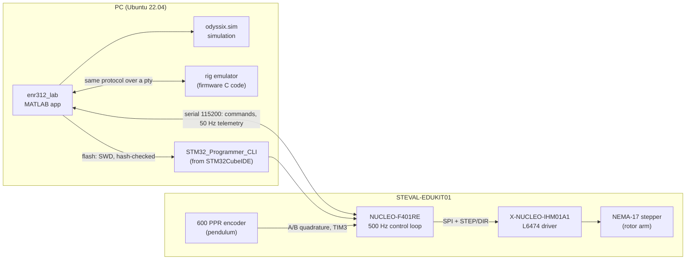

# Rotary Inverted Pendulum: STM32 firmware + MATLAB control lab

[](https://github.com/Samarth030312/enr312-rotary-inverted-pendulum/actions/workflows/ci.yml)


-orange)


Bare-metal STM32F401RE firmware and a MATLAB laboratory app for the ST
**STEVAL-EDUKIT01** rotary inverted pendulum. The project covers the whole chain:
a first-principles model, a MATLAB simulation that matches the firmware's
control code to floating-point rounding, a 500 Hz embedded controller, and measurements from the
physical rig compared against the predictions.

It implements the ten control tutorials of the **ENR312 Control Engineering
Laboratory** (Ahmedabad University, Monsoon 2026), which follow W. J. Kaiser's
Edukit tutorial series (UCLA), plus the course's **PEND** lab questions: from
digital-actuator tracking, sensitivity functions and MIMO control to balancing the
pendulum upright, integral action, root locus, state feedback and LQR.

**Status.**
- On the rig: Tutorials 1–5 (2026-10-12); then the **energy swing-up** (caught upright
  3 of 3), Tutorial 7 and a lab step (2026-10-21).
- Firmware 2.3.0 adds what that session showed was needed. Like the remaining tutorials,
  it is verified in unit tests, the rig emulator and the simulation, but not yet on the
  rig. Numbers marked as predictions are predictions.

<p align="center">
  
  <br><sub>Energy swing-up on the rig, 2026-10-21: the pendulum's height |ψ| (180° = upright) in three
  runs, over the simulation of the same gains. Generated by
  <code>matlab/plotting/plot_session_20261021.m</code> from <code>data/raw</code>.</sub>
</p>

<p align="center">
  
  <br><sub>Measured on the rig, 2026-10-12. Left: rig (blue) over simulation (grey) for the
  same gains. Right: inverted pendulum under control for 78 s.
  Generated by <code>matlab/plotting/plot_rig_vs_sim.m</code> from <code>data/raw</code>.</sub>
</p>

## What is in it

| Part | What it does | Where |
|---|---|---|
| Firmware | 500 Hz control loop, L6474 stepper driver over SPI, quadrature encoder on TIM3, safety supervisor, serial command protocol | [`firmware/enr312/`](firmware/enr312/) |
| Lab app | One MATLAB window: missions T1–T10 and a free LAB mode (hanging or upright; PID, LQR, state feedback, on-off). Simulate, run the same configuration on the rig, drive it live (arm to any angle, pendulum swing height, swing-up, gains), with **every run recorded automatically** and replayable | [`matlab/apps/enr312_lab.m`](matlab/apps/enr312_lab.m) |
| Simulation | Line-by-line port of the firmware control path driving a nonlinear pendulum model; tested equal to the C code | [`matlab/+odyssix/+sim/`](matlab/+odyssix/+sim/) |
| Emulator | The firmware's own C control code compiled for the PC behind the same serial protocol, so the app runs without hardware | [`firmware/enr312/host/`](firmware/enr312/host/) |
| Physics | Derivation of the pendulum equations, the sign change between hanging and upright, model audit | [`docs/first_principles/`](docs/first_principles/ROTARY_PENDULUM_DYNAMICS.md) |
| Experiments | EXP001–EXP010 and PEND EXP021–EXP024 (incl. energy swing-up): objective, hypothesis, derivation, predictions, procedure, acceptance criteria (written before the rig runs) | [`experiments/`](experiments/) |
| PEND guide | Every task and question of the PEND lab handout mapped to the experiment, tool or data that answers it | [`docs/PEND_ANSWER_GUIDE.md`](docs/PEND_ANSWER_GUIDE.md) |
| Python client | Optional: the same serial protocol from Python (pyserial), for scripting runs | [`python/`](python/) |
| Data | Raw rig measurements with metadata, and the serial transcripts of every hardware session | [`data/`](data/), [`results/evidence/`](results/evidence/rig_sessions/) |
| Results | Rig-vs-simulation comparisons and discrepancy analysis, per session | [`results/reports/`](results/reports/) |

## Results on the hardware (2026-10-12)

| Tutorial | Result on the rig |
|---|---|
| 1 Actuator & sensing | +5° command = 44 microsteps; protractor reads 5°. Arm and encoder sign conventions measured (encoder polarity −1). |
| 2 Sensitivity (rotor loop) | Overshoot 23.75 % on the rig and 23.75 % in simulation; load-disturbance offset 0.112° vs 0.113° (prediction D/Kp = 0.108°). |
| 3 MIMO control effort | Arm settles 0.5° off the reference. Explained quantitatively by a 0.3° pendulum rest offset (pivot friction) times Kpp/Kp. |
| 4 MIMO sensitivity | Same offset mechanism (predicted 3.00°, measured 3.04°); two external disturbances rejected. |
| 5 Inverted pendulum | Balanced in 4 of 4 runs on firmware 2.0.8 (0 of 3 before it), up to 78 s, pendulum 0.4–1.1° RMS from upright. The arm drifts by tens of degrees; cause identified, not yet fixed. |

Full analysis, including what does **not** yet match the model:
[`results/reports/2026-10-12_rig_tutorials_1-5.md`](results/reports/2026-10-12_rig_tutorials_1-5.md).

## Results on the hardware (2026-10-21)

| Experiment | Result on the rig |
|---|---|
| Energy swing-up | Caught upright **3 of 3** at 7.1 / 7.1 / 8.0 s; the swing builds up like the simulation. Balance later lost to sudden external kicks (cause open). |
| Upright offset | Balancing, the mean pendulum angle was +0.63° and the arm sat at **+23.3°**. The LQR predicts −k₃/k₁·α = **+24.0°**: the encoder's "upright" is 0.6° off the balance point. Firmware 2.3.0 learns and removes it. |
| Tutorial 7 | Impulse response (median over the impulses): pendulum −1.55° vs −1.35° simulated, arm 5.1° vs 4.7°. |
| LAB state feedback | Step to 90°: 89.66° on the rig, 89.77° in simulation, same trajectory. |

<p align="center"></p>

Report: [`results/reports/2026-10-21_rig_session.md`](results/reports/2026-10-21_rig_session.md).

## Predictions (simulation, not yet run on the rig)

From the firmware-exact simulation with the Tutorial plant values
([`results/tables/`](results/tables/), `matlab/experiments/PEND/pend_predictions.m`):

| Experiment | Prediction to test on the rig |
|---|---|
| 6 Integral action (inverted) | Linear model reproduces Tutorial 6 (overshoot 52.0 % vs 52.6 %, phase margin 31.42° vs 31.45°), but at the rig's 1500 deg/s² input limit the derivative kick of the 40° step saturates: **34 %** overshoot expected. |
| 7 Pendulum-loop design | A pendulum loop that is stable on its own (Kp 150, Kd 15) still loses balance in the full loop; 300/30 gives a 1.4° averaged impulse response. |
| 8 Load disturbance | Arm offset under a 60 deg/s² load: −4.1° without integral action (theory −D/Kp = −4.0°), −0.7° with it. |
| 9 / 10 State feedback, LQR | Tutorial 9 reference settles in 5.94 s (tutorial 5.8 s); LQR gains reproduce Tutorial 10 exactly. The stepper's minimum step rate parks the arm up to (k2 + b)·0.225/k1 degrees short. |
| LAB hanging, PID: stop a swing | 1.6 s with the pendulum D term, 21 s (free decay) without it; any commanded arm angle held to the microstep. |
| LAB hanging, on-off | Never settles: ±20° oscillation for a 20° step, pendulum shaken to 36°. |
| LAB upright, LQR | 2.3 % overshoot vs 34 % for the Tutorial 6 PID, pendulum error 0.17° vs 0.42° rms. A robust tuning study finds the best dual PID only 3 % better than Tutorial 6's gains; the LQR has 27 % less pendulum error. |
| Pendulum target | A pendulum rests only at 0° or 180°: holding it at ψ needs arm acceleration (ωg²/ωr²)·tan ψ. The target sets the swing height instead: 45/90/135° → 46/92/136°; 0 stops a 40° swing in 9 s (free decay 19 s). |
| PEND loop rate, taps | Balances down to a 16.7 Hz loop; recovers taps up to 100 deg/s of pendulum rate, falls at 120. |

## Quick start

```matlab
% MATLAB, from the repository root
addpath(genpath('matlab'))
enr312_lab
```

<p align="center"></p>

No rig? **CONNECT** offers the emulator. Simulation works on any MATLAB
installation; the emulator needs `gcc` and `make` (Linux or macOS).

With a rig: follow [`docs/GETTING_STARTED.md`](docs/GETTING_STARTED.md), then the
wiring check in [`docs/hardware/ENR312_WIRING.md`](docs/hardware/ENR312_WIRING.md) §4.
Students start at [`docs/STUDENT_QUICKSTART.md`](docs/STUDENT_QUICKSTART.md).

> **Platform.** Everything here was developed and tested on **Ubuntu 22.04.5 LTS
> (x86-64)** only. The code contains paths for Windows and macOS, but they have not
> been run. See [Getting started → other platforms](docs/GETTING_STARTED.md#macos-and-windows).

## Architecture



More diagrams (firmware state machine, Tutorial 5 sequence, flashing path) in
[`docs/ARCHITECTURE.md`](docs/ARCHITECTURE.md).

## Verification

`scripts/flash_ready_check.sh` runs every check that does not need the rig
(about 10 minutes with MATLAB, `--quick` skips the real-time tests):

* firmware builds with no warnings in project code and is reproducible: the
  flash image built from source must match the SHA-256 of the committed release
  in `release/MANIFEST.txt`
* link-map check that the image contains no RTOS or middleware symbols
* 450 host unit tests of the control cores, runner and command parser (C), incl. the swing-up on 9 pendulum variants
* physics-model validation, simulation-equals-firmware test, a three-way parameter
  check (contract = MATLAB = firmware), end-to-end tests of the app for all
  experiments against the emulator (MATLAB), and the Python client against the
  emulator

CI runs the C part on every push (see the badge above).

## Documentation

| Document | Contents |
|---|---|
| [Getting started](docs/GETTING_STARTED.md) | Tools and exact versions, setup, macOS/Windows notes |
| [Architecture](docs/ARCHITECTURE.md) | Firmware structure, protocol, state machines, diagrams |
| [MATLAB ↔ STM32 integration](docs/MATLAB_STM32_INTEGRATION.md) | How MATLAB builds, flashes and talks to the board through the STM32CubeIDE tools |
| [Troubleshooting](docs/TROUBLESHOOTING.md) | Every problem met during bring-up, its cause and its fix |
| [Wiring and electrical check](docs/hardware/ENR312_WIRING.md) | Pin plan, motor/encoder/supply wiring, staged power-up check |
| [Pendulum dynamics](docs/first_principles/ROTARY_PENDULUM_DYNAMICS.md) | Derivation and linearisation |
| [PEND answer guide](docs/PEND_ANSWER_GUIDE.md) | How to answer every PEND lab question with this rig |
| [Engineering standards](docs/ENGINEERING_STANDARDS.md) | Rules the project follows: first principles, units, data provenance |
| [References](docs/REFERENCES.md) | Course material, datasheets and the reference implementation |
| [Changelog](CHANGELOG.md) | Firmware releases and what each one fixed |

## Repository layout

```
firmware/enr312/     bare-metal firmware: src/ (portable control cores), target/ (STM32 build),
                     host/ (emulator + plant model), test/ (host unit tests), release/ (pinned image)
Drivers/             ST STM32F4 HAL and CMSIS (vendor code, their own licences)
matlab/              lab app, simulation, models, identification, tests
experiments/         EXP001–EXP010, EXP021–EXP023 definitions (pre-registered before the rig runs)
shared/              parameters and experiment contracts shared by firmware and MATLAB
data/                raw rig data (read-only) + metadata
results/             figures, tables, reports, hardware session logs
docs/                documentation
python/              optional Python client for the serial protocol
scripts/             readiness check, release script, Python design scripts
```

## License

MIT for the original work in this repository ([`LICENSE`](LICENSE)). The ST HAL
(BSD-3-Clause) and Arm CMSIS (Apache-2.0) under `Drivers/` keep their own
licences; see [`THIRD_PARTY.md`](THIRD_PARTY.md). Course tutorials, ST manuals
and the UCLA reference project are **not** redistributed here; they are cited in
[`docs/REFERENCES.md`](docs/REFERENCES.md).
