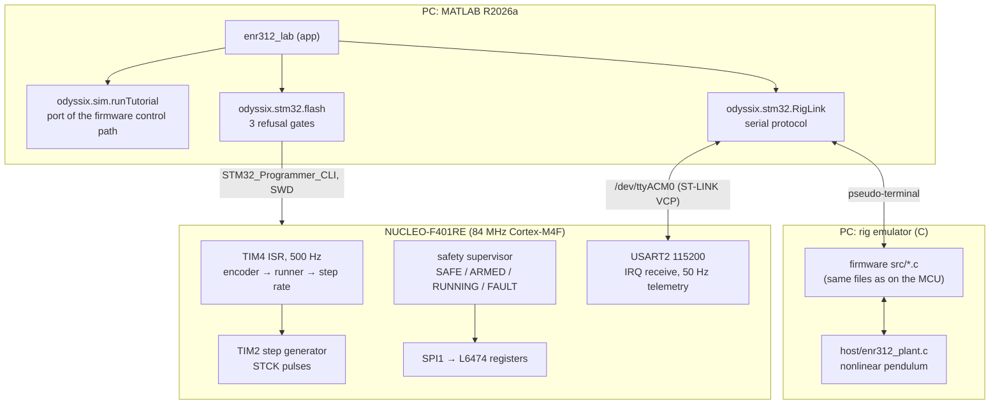
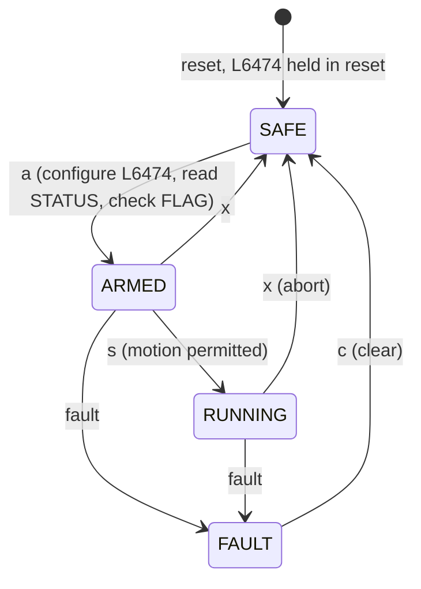
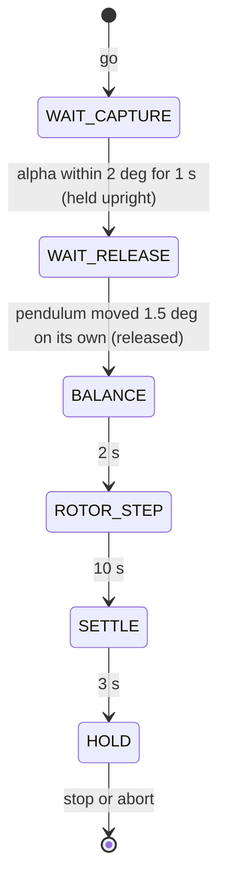
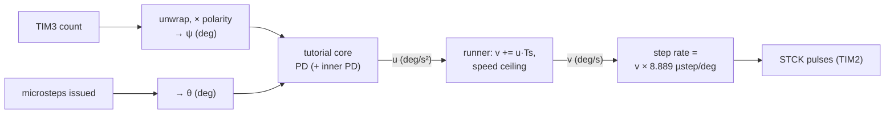

# Architecture

## System



## Firmware

The firmware is split so that every line of control logic can be compiled and
tested on the PC.

| Layer | Files | Runs on |
|---|---|---|
| Portable cores | `firmware/enr312/src/`: encoder unwrapping, rotor microstep accounting, PD with filtered derivative, one core per tutorial (`enr312_exp00N.c`), step metrics, the runner (acceleration → velocity → step rate, speed ceiling, aborts), `$` command parser | MCU, host tests, emulator |
| Board layer | `firmware/enr312/target/src/`: clock/GPIO/peripheral init, L6474 SPI driver, TIM3 encoder, TIM2 step generator, safety state machine, telemetry, `main` | MCU only |
| Host | `firmware/enr312/host/`: plant model and the emulator front end; `test/`: unit tests | PC only |

Peripheral use (STM32F401RE, Arduino pin names in brackets):

| Peripheral | Use |
|---|---|
| TIM4 | 500 Hz control interrupt (84 MHz / 8400 / 20) |
| TIM3 | quadrature encoder, ×4 decoding of the 600 PPR encoder = 2400 counts/rev (PB4 D5, PB5 D4) |
| TIM2 | paces the STCK step pulses on PC7 (D9) |
| SPI1 | L6474 registers, mode 3, 2.625 MHz (PA5 D13, PA6 D12, PA7 D11, CS PB6 D10) |
| GPIO | L6474 reset PA9 (D8), direction PA8 (D7), FLAG input PA10 (D2, EXTI) |
| USART2 | ST-LINK virtual COM port, 115200 8N1, interrupt-driven receive |
| DWT | cycle counter: worst-case control ISR time (`isr_max_us`) |

Image size (release 2.0.8): 44 084 B flash (8.4 %), 4 352 B static RAM (4.4 %).
No RTOS, no dynamic allocation in the control path.

### Safety state machine



Faults (bit in the `faults` field): `0x01` L6474 FLAG (over-current, thermal,
under-voltage), `0x02` SPI timeout, `0x04` register read-back mismatch, `0x08`
arm beyond ±240°, `0x10` pendulum beyond ±120° (suspended tutorials), `0x20`
encoder stuck, `0x40` operator abort or host watchdog, `0x80` control ISR overrun.

A run is also aborted when the host stays silent for 1 s (MATLAB sends `.` at
10 Hz), when the speed ceiling (default 360°/s) is held for 200 ms, and by each
tutorial core's own limits (actuator saturation; in Tutorial 5, the pendulum
more than 15° from upright).

### Tutorial 5 sequence (firmware 2.0.8)



`WAIT_RELEASE` is the first part of the firmware's `BALANCE` phase: the motor is
kept still (u = 0) until the operator has let go.

Why the release wait exists: the outer (arm) loop of the Tutorial 5 design pushes
the arm away from the reference unless the pendulum responds. A pendulum still
in the operator's hand cannot respond, so closing the loop at capture ran the arm
into saturation (see [`TROUBLESHOOTING.md`](TROUBLESHOOTING.md#tutorial-5-loses-the-pendulum-half-a-second-after-capture)).

## Control path, one 2 ms tick



The stepper is driven as an acceleration-controlled actuator: the controller
output `u` is an arm acceleration, integrated to a velocity and turned into a
step rate. 1/16 microstepping gives 3200 microsteps per revolution (0.1125°).
The arm angle is counted from the microsteps actually issued, not measured.

## Serial protocol

Single-byte commands: `t` status, `r` toggle the 50 Hz stream, `a` arm, `s` start,
`x` abort, `c` clear fault, `z` zero both datums, `+`/`-` move ±5°, `q` L6474
STATUS, `p` SPI probe (SAFE only), `P` CS/SCK routing scan, `M` electrical
self-test, `?` help, `.` keep-alive.

Line commands start with `$`: `exp=N`, `kp=`, `kd=`, `kpp=`, `kdp=`, `step=`,
`dist=`, `ulim=`, `vmax=`, `defaults`, `cfg` (echo the configuration), `go`,
`stop`, `move=DEG`.

Telemetry (50 Hz):

```
D,<tick (2 ms)>,<rotor mdeg>,<pendulum mdeg>,<encoder raw>,<faults>,<state>,<run exp>,<phase>,<u deg/s²>,<ref mdeg>,<isr_max_us>
C,<exp>,<kp>,<kd>,<kpp>,<kdp>,<step>,<dist>,<ulim>,<vmax>          (reply to $cfg)
```

Before every closed-loop run the app sends the configuration, asks for the
`C,` echo and starts only if every value matches: a corrupted byte on the
serial line can never silently change a gain.

## MATLAB side

| Package / file | Role |
|---|---|
| `matlab/apps/enr312_lab.m` | the lab app: tutorials, presets, sliders, plots, rig control |
| `matlab/+odyssix/+sim/` | `runTutorial` (firmware port), `plant`, `defaults`, `metrics` (same metrics for simulation and rig) |
| `matlab/+odyssix/+stm32/` | `tools` (find programmer, toolchain), `flash`, `build`, `listBoards`, `RigLink`, `emulatorBinary`, `sha256` |
| `matlab/models/` | pendulum parameters and equations of motion |
| `matlab/identification/` | free-swing fit for ωg² and Q |
| `matlab/tests/` | physics validation, simulation-equals-firmware, end-to-end app tests |

`test_sim_matches_firmware` runs the C emulator in batch mode and the MATLAB
port with the same configuration and requires the rotor trajectories of
Tutorials 2–4 to agree to floating-point rounding (4.4e-16° over 9500 samples),
and Tutorial 5 to be identical through capture, release and balance.
