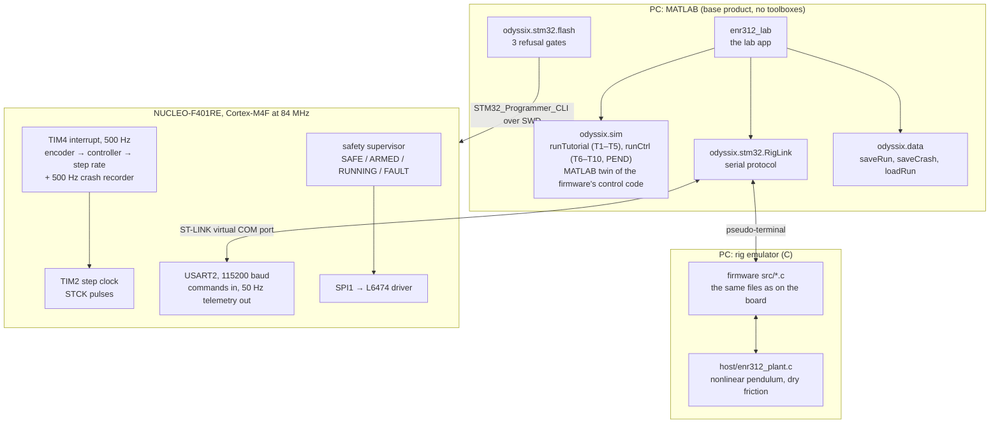
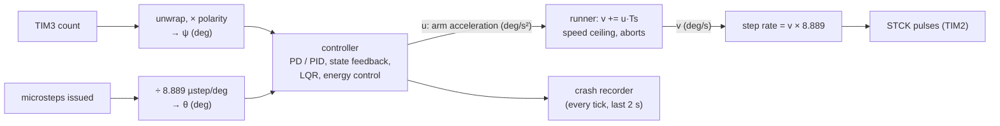
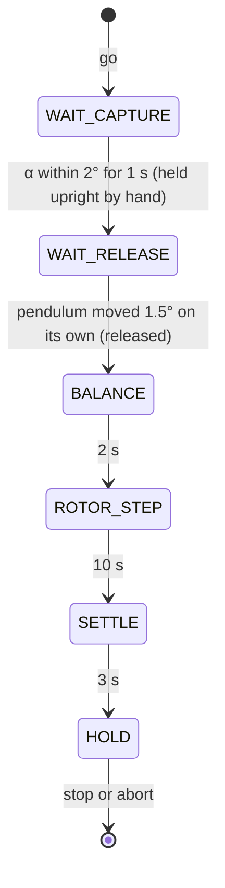
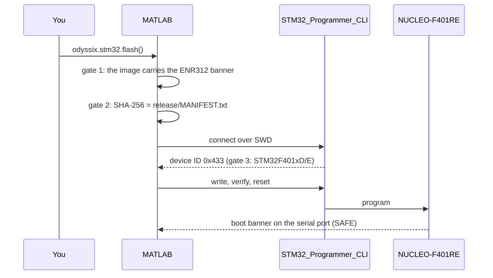
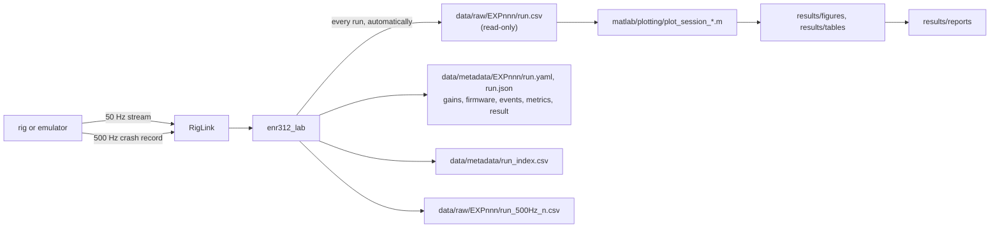

# Architecture

How the pieces fit: the firmware on the board, the same control code on the PC, the
MATLAB app and simulation, and the data that comes out. Why it is built this way is in
[DESIGN.md](DESIGN.md).

## System



The firmware is bare metal: no RTOS and no dynamic memory. The control law runs in one
500 Hz timer interrupt. The main loop only handles communication. Release 2.3.3 uses
60 876 B of flash (11.6 % of 512 kB) and 21 352 B of static RAM (21.7 % of 96 kB); 16 kB
of that RAM is the crash recorder.

## Firmware

Every line of control logic compiles and is tested on the PC.

| Layer | Files | Runs on |
|---|---|---|
| Portable cores | `firmware/enr312/src/`: encoder unwrapping, rotor microstep accounting, PD with filtered derivative, the Tutorial 1–5 sequences (`enr312_exp00N.c`), the general controller core for Tutorials 6–10 and PEND (`enr312_ctrl.c`: PID, state feedback, LQR, on-off, energy control, upright trim), the runner (acceleration → velocity → step rate, speed ceiling, aborts), step metrics, the `$` command parser, the crash recorder | board, host tests, emulator |
| Board layer | `firmware/enr312/target/src/`: clock, GPIO and peripheral setup, L6474 SPI driver, TIM3 encoder, TIM2 step generator, safety state machine, telemetry, `main` | board only |
| Host | `firmware/enr312/host/`: plant model and the emulator front end; `test/`: unit tests | PC only |

Peripherals (STM32F401RE; Arduino pin names in brackets):

| Peripheral | Use |
|---|---|
| TIM4 | 500 Hz control interrupt: 84 MHz / 8400 / 20 |
| TIM3 | quadrature encoder, ×4 decoding of the 600 PPR encoder = 2400 counts/rev, 0.15° (PB4 D5, PB5 D4) |
| TIM2 | paces the STCK step pulses on PC7 (D9) |
| SPI1 | L6474 registers, mode 3 (PA5 D13, PA6 D12, PA7 D11, CS PB6 D10) |
| GPIO | L6474 reset PA9 (D8), direction PA8 (D7), FLAG input PA10 (D2) |
| USART2 | ST-LINK virtual COM port, 115200 8N1, interrupt-driven receive |
| DWT | cycle counter: worst-case control interrupt time (`isr_max_us`) |

### One control tick (2 ms)



The arm has no sensor. Its angle is the count of microsteps issued, which is exact as
long as the stepper does not lose steps: 44 microsteps read 4.95° on a protractor
(EXP001). The controller's output is an arm *acceleration*. The runner integrates it to a
velocity, and the velocity sets the step rate. So the stepper behaves as an
acceleration source, which is the plant the models assume.

### Safety state machine


Fault bits (`faults` in the stream): `0x01` L6474 FLAG (over-current, thermal,
under-voltage), `0x02` SPI timeout, `0x04` register read-back mismatch, `0x08` arm beyond
±240°, `0x10` pendulum beyond ±120° from hanging (suspended runs), `0x20` encoder stuck,
`0x40` operator abort or host watchdog, `0x80` control interrupt overrun.

A run is also stopped:

- when the host sends nothing for 1 s (the app sends `.` every 0.1 s);
- when the speed ceiling (360 deg/s by default, 720 for the swing-up) is held for 200 ms;
- by the controller's own limits: the pendulum more than 15° from upright, or the
  plant input u held at its limit (200 ms in the tutorial sequences, 500 ms while
  holding the pendulum upright).

### Swing-up and balance (experiment 24)

```mermaid
stateDiagram-v2
    [*] --> SWINGUP: $go with amp ≥ 179
    SWINGUP --> HOLD: catch rule met (|α| ≤ 7°, slow or approaching, LQR demand feasible, E ≥ 1.8)
    SWINGUP --> DONE: 40 s without a catch
    HOLD --> HOLD: arm held 2 s where it caught, then walked home; upright trim learns the offset
    HOLD --> ABORTED: |α| > 15°, u saturated 500 ms, arm or speed limit
    HOLD --> DONE: $stop
```



In SWINGUP the arm pumps energy: u = u_on·sat(10(2 + δ − E))·sign(ψ̇ cos ψ), plus a PD
that keeps the arm near home. E is the pendulum's normalised energy, and δ is a learnt
correction. In HOLD the 4-state LQR balances. The full law is in
[`experiments/EXP024`](../experiments/EXP024/README.md).

### Tutorial 5 sequence



The motor stays still until the operator lets go. With the loop closed while the
pendulum was still in the hand, the outer loop drove the arm into saturation
([TROUBLESHOOTING](TROUBLESHOOTING.md#tutorial-5-loses-the-pendulum-half-a-second-after-capture)).

## Serial protocol

Single-byte commands:

| Key | Command |
|---|---|
| `t` | status |
| `r` | toggle the 50 Hz stream |
| `a` | arm |
| `s` | start |
| `x` | abort |
| `c` | clear a fault |
| `z` | zero both datums |
| `+` / `-` | move ±5° |
| `q` | L6474 STATUS |
| `p` | SPI probe (SAFE only) |
| `P` | CS/SCK routing scan |
| `M` | electrical self-test |
| `?` | help |
| `.` | keep-alive |
| `k` | crash record (2.3.3) |

Line commands start with `$`, one version at a time:

- **Protocol 2:** `exp=N`, `kp=`, `kd=`, `kpp=`, `kdp=`, `step=`, `dist=`, `ulim=`, `vmax=`,
  `defaults`, `cfg` (echo the configuration), `go`, `stop`, `move=DEG`.
- **Protocol 3** (2.1.0) adds `ki= fdr= fdp= k1= k2= k3= k4= bv= imp= uon= db= rrate= div= ma=`,
  and `ref=DEG`, a live arm set-point. A gain line sent during a run is applied at once.
- **Protocol 4** (2.2.0) adds `seq=0|1` (0: lab mode, no tutorial sequence) and `wg2=` (the
  pendulum constant), and experiment 24.
- **Protocol 5** (2.3.0) adds `amp=`: 0 stops a swing, 0–179 swings to ±amp, ≥ 179 swings
  up and balances.

The version line, and with it the protocol, is printed at boot and again by `?`.

Telemetry:

```
D,<tick (2 ms)>,<rotor mdeg>,<pendulum mdeg>,<encoder raw>,<faults>,<state>,<run exp>,<phase>,<u deg/s²>,<ref mdeg>,<isr_max_us>
C,<exp>,<kp>,<kd>,<kpp>,<kdp>,<step>,<dist>,<ulim>,<vmax>          (reply to $cfg, protocol 2)
   ...,<ki>,<fdr>,<fdp>,<k1>,<k2>,<k3>,<k4>,<bv>,<imp>,<uon>,<db>,<rrate>,<div>,<ma>   (protocol 3)
   ...,<seq>,<wg2>   (protocol 4)   ...,<amp>   (protocol 5: 26 values)
REF <deg>                                                           (reply to $ref)
K,BEGIN,<reason>,<n>,<trigger tick>,500                             (crash record, 2.3.3)
k,<tick>,<rotor mdeg>,<pendulum mdeg>,<u deg/s²>,<phase>             (n lines, oldest first)
K,END
```

Before every closed-loop run the app sends the configuration, asks for the `C,` echo,
and starts only if every value matches. A corrupted byte on the line can never
silently change a gain.

The crash recorder keeps every tick of the last 2 s. A run abort, or `k`, freezes it
0.5 s later, and the main loop sends it a few lines at a time. While one record is being
sent (about 2.2 s), new requests are ignored.

## Flashing



The committed image in `firmware/enr312/release/` is byte-reproducible from the source.
`scripts/flash_ready_check.sh` rebuilds it and compares the hash.

## MATLAB side

| Package / file | Role |
|---|---|
| `matlab/apps/enr312_lab.m` | the lab app: missions, live control, recording, replay |
| `matlab/+odyssix/+sim/` | `runTutorial` and `runCtrl` (the firmware twins), `plant`, `defaults`, `loop` (linear analysis), `metrics` (the same metrics for simulation and rig), `impulseAverage` |
| `matlab/+odyssix/+ctrl/` | `lqr` (toolbox-free Riccati solver), `pendulumModel` (linearised state space) |
| `matlab/+odyssix/+pend/` | PEND analyses: `freeSwing`, `recovery`, `gainSweep`, `derivativeNoise`, `unstablePole` |
| `matlab/+odyssix/+data/` | `saveRun`, `saveCrash`, `loadRun`, `listRuns`: automatic run records |
| `matlab/+odyssix/+stm32/` | `flash`, `build`, `listBoards`, `RigLink`, `emulatorBinary`, `tools`, `sha256` |
| `matlab/identification/` | free-swing fit (ωg², dry and viscous friction), identification from other runs |
| `matlab/plotting/` | one script per rig session: every published figure |
| `matlab/tests/` | physics validation, simulation equals firmware, end-to-end app tests |

`test_sim_matches_firmware` runs the C emulator and the MATLAB twin with the same
configuration and pendulum (33 checks):

- **Tutorials 2–4, and 9, 10, 21, 22:** identical to floating-point rounding (below
  10⁻¹⁴ deg over 10 000–15 000 samples).
- **Upright runs (5–8, 23):** identical through capture, release and the start of
  balancing. The inverted pendulum then amplifies rounding differences, and the test
  requires that both still balance in the same phase.
- **Swing-up:** identical while pumping; both catch at the same instant.

## Data flow



Emulator runs are written to `matlab/data/synthetic/` and are kept out of the
repository.
