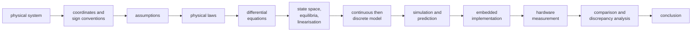

# Engineering standards

The rules this project was developed under. Other documents refer to them as
"ENGINEERING_STANDARDS §N".

## 1. First principles

Work in this order and do not skip steps:

Explain the reasoning before implementing new control or physical behaviour.

## 2. Repository structure

Firmware, MATLAB, experiment definitions, data and results are versioned
together but kept in separate directories. The firmware must build without
MATLAB, and the MATLAB code must run on a machine without the firmware toolchain
(it uses the committed release image).

## 3. Development environment

Record the tools and versions that produced a result. Do not claim that MATLAB
code or a hardware test ran unless it did. A file existing in the repository is
not evidence that it was executed.

## 4. Hardware safety

Flashing, energising the motor and moving the mechanism are deliberate operator
actions. Before any hardware step, write down the expected behaviour, the safe
initial condition, the limits, the stop condition and how to roll back. The
firmware boots into a state in which the motor cannot move.

## 5. Experiment scope

Experiments are numbered after the course tutorials (Tutorial N = EXP00N).
Each experiment builds on the ones before it; EXP005 depends on EXP001–EXP004.
A new experiment starts only when the previous ones are understood and validated.

## 6. Definition of done for an experiment

Objective, physical question, hypothesis, coordinates and sign conventions,
variables and units, parameters, assumptions, derivation, model, simulation,
expected behaviour, hardware-facing prediction, implementation, measurement
procedure, acceptance criteria, measured data, comparison of model, simulation
and hardware, discrepancy analysis, conclusion.

"It compiled", "the simulation ran" and "the controller moved" are not validation.

## 7. Authoritative information

* The firmware is authoritative for what the MCU actually does: clocks, pins,
  peripherals, timing.
* Measured data is authoritative for how the physical system behaves.
* The models and simulations are authoritative for derivations and predictions.

Reference documents are not automatically right. When a reference conflicts with
the hardware, record the conflict. Never replace a measured value with a reference
value silently.

## 8. Units and coordinates

State the unit of every quantity. Never change a sign convention, angle origin,
angle wrapping, coordinate frame or actuator/sensor direction silently.

## 9. Model complexity

Start with the simplest physically defensible model. Add friction, actuator
dynamics, delay, saturation, noise or quantisation only with a stated reason.

## 10. MATLAB code

Lives under `matlab/`. No absolute machine paths: derive paths from the
repository root. Every experiment script has inputs, parameters, model,
simulation, expected outputs and validation checks. Base MATLAB only, unless a
toolbox is justified and recorded.

## 11. Data provenance

Raw data is never overwritten (`data/raw/` files are written read-only). Every
dataset records experiment ID, date, source revision, parameters, hardware
configuration, sampling rate, units and acquisition conditions. Synthetic data
(emulator, self-tests) is kept apart from hardware data and never committed next
to it.

## 12. Results

Generated figures, tables and reports go under `results/`, separate from raw data.

## 13. Shared contracts

Parameters used by both the simulation and the firmware are versioned and checked
for agreement (`exp001_check_parameter_consistency`). Never keep two copies of a
parameter with different values.

## 14. Reference material

Course material, manuals and reference code are cited, not modified to agree with
this implementation, and not redistributed (see [`REFERENCES.md`](REFERENCES.md)).

## 15. The reference implementation

The UCLA Edukit project is a reference, not this firmware. Before reusing
anything, compare MCU family, startup code, HAL, clock tree, peripherals, pins and
compiler settings. Never copy MCU-specific configuration just because it exists
there.
