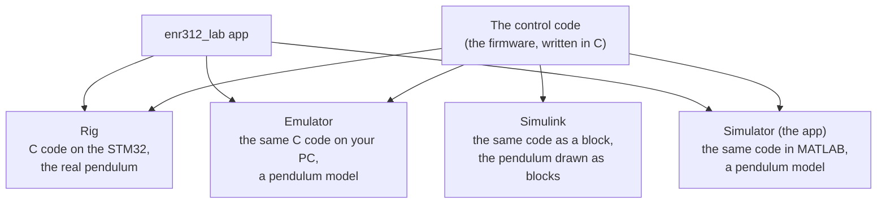

# How it works: simulator, Simulink, emulator, rig

If the lab app and the Simulink model look confusing, start here. There are four
ways to run the same experiment, and they are built on one idea: **the control code
is the same everywhere; only the pendulum underneath changes.**

## The four, in one picture



| | What runs the control | What plays the pendulum | What you need |
|---|---|---|---|
| **Rig** | the C firmware on the STM32 | the real pendulum | the kit, USB, 12 V |
| **Emulator** | the same C firmware, compiled for your PC | a model of the pendulum, in C | Linux or macOS, a C compiler |
| **Simulator** (inside the app) | the firmware's code, rewritten line by line in MATLAB | a model of the pendulum, in MATLAB | MATLAB only |
| **Simulink** | the same MATLAB copy of the firmware, as one block | the pendulum equation, drawn as blocks | MATLAB and Simulink |

Why four? The rig is the truth, but it is slow and it can fall. The simulator lets you
try a gain in a second. The emulator proves the C code itself does what the simulator
says. Simulink shows the same thing as a block diagram, which is how the course and
most textbooks draw control systems.

The four are checked against each other by tests, so a number from one should match
the others:

- the C code against the MATLAB copy: `test_sim_matches_firmware`;
- the MATLAB copy against Simulink: `test_simulink_matches_runctrl`, every experiment;
- the simulation against the rig: the RIG and SIM columns in the app, and
  [the results](RESULTS.md).

## What "the pendulum model" is

One equation, derived in [pendulum dynamics](first_principles/ROTARY_PENDULUM_DYNAMICS.md):

    ψ̈ = −ωg² sin ψ + ωr² cos ψ · θ̈ + θ̇² sin ψ cos ψ − (friction)

In words: gravity pulls the pendulum down (ωg² says how hard), and when the arm
speeds up (θ̈), the pendulum is pushed sideways (ωr² says how hard). Two numbers
describe your pendulum: **ωg²**, measured by a free swing, and **ωr²**, which follows
from the arm's length. Our rig measured ωg² = 48.0; the Tutorials use 57. The app
starts with our measured value. After a free swing it offers to use yours for the rest
of the session, and the top bar always says which one is in use.

## What "the control code" does, every 2 ms

1. Read the arm angle θ (counted in microsteps) and the pendulum angle ψ (from the encoder).
2. Work out the error: how far the arm is from where it should be, and how far the
   pendulum is from hanging or from upright.
3. Compute u, the arm acceleration, from the gains (PD, PID, state feedback, LQR,
   on-off or energy, depending on the experiment).
4. Turn u into a speed for the stepper motor, for the next 2 ms.
5. Check the safety rules (pendulum lost, arm too far, motor saturated) and stop if needed.

Every experiment, T1 to T10 and the PEND ones, is this loop with different gains and
a different sequence of set-points.

## First try: the simulator (5 minutes, no rig)

1. Start it: `cd` into the repository in MATLAB and type `setup open`.
2. Press **NEXT EXPERIMENT ›** (the wide button under the missions) to go through the
   experiments in order, or press a mission yourself, for example **T9 · Poles** (the
   pendulum hangs, the arm makes a 20° step).
3. Press **PLAY SIMULATION**. The grey lines on the right are the simulation: the
   arm angle on top, the pendulum in the middle.
4. Press **▶ PLAY** (bottom right) to watch it move in 3-D. Drag the time bar to scrub.
5. Change one gain on the left, for example **k2 arm rate** from 2 to 0.5, press Enter,
   and press **PLAY SIMULATION** again. The arm now overshoots the step by about 45 %.
   The theory says why: the arm obeys θ̈ = −k1(θ − r) − k2 θ̇, so its damping ratio is
   k2 / (2√k1), 1 before and 0.25 after.
6. The table under the 3-D view lists the numbers that matter for that mission:
   SIM is the simulation, RIG fills in when you run it on the rig, REF is what the
   Tutorial says.

When the rig is connected, the same mission runs on the real pendulum with
**ARM → START → RUN**, and its lines appear in colour over the grey simulation.

## First try: Simulink (5 minutes)

```matlab
enr312_simulink              % lists the experiments
enr312_simulink(5)           % Tutorial 5: upright balancing
```

This opens the model, runs Tutorial 5 and draws the arm, the pendulum and the input
u. The model has four parts, left to right:

- **Firmware**: the control code, called every 2 ms;
- **arm angle**: the arm turns at the speed the firmware asks for;
- **Pendulum dynamics** and its two integrators: the equation above;
- **microsteps** and **encoder**: the sensors, with the rig's resolution.

Now change something and run again:

```matlab
P = enr312_simulink_params(5);   % Tutorial 5 settings, this rig's pendulum
P.kpp = 150;                     % softer pendulum loop (default 300)
enr312_simulink(P)
```

Every field of `P` is listed by `help enr312_simulink_params`. The gains have the same
names as in the app. To push the pendulum while it balances, set `P.tapTime` and
`P.tapRate`; to slow the controller down, `P.div`; to switch the controller off,
`P.closedLoop = false`.

You can also open the model and press **Run** yourself:
`P = enr312_simulink_params(9); open_system('enr312_pendulum')`, then double-click the
scopes.

## Which one should I use?

| I want to … | Use |
|---|---|
| see what a gain does, quickly | the simulator (app) |
| prepare a rig session | the simulator, then the rig |
| answer the Simulink assignment, show a block diagram | Simulink ([Simulink page](SIMULINK.md)) |
| check that the C code is right | the emulator, or `scripts/flash_ready_check.sh` |
| get real data | the rig |

## Words used in the app

| Word | Meaning |
|---|---|
| mission | one experiment: T1–T10, or LAB (free choice) |
| SIM / RIG / REF | simulation / measured on the rig / the Tutorial's value |
| datum | the zero of an angle. ZERO DATUMS sets the arm and the hanging pendulum to 0 |
| u | the arm acceleration the controller asks for, deg/s² |
| α, ψ | pendulum angle from upright, from hanging (α = 180° − ψ) |
| phase | where the experiment is in its sequence: capture, balance, step, hold, done |
| 500 Hz record | every control tick of the last 2 s, sent by the firmware after a push or a fall |
