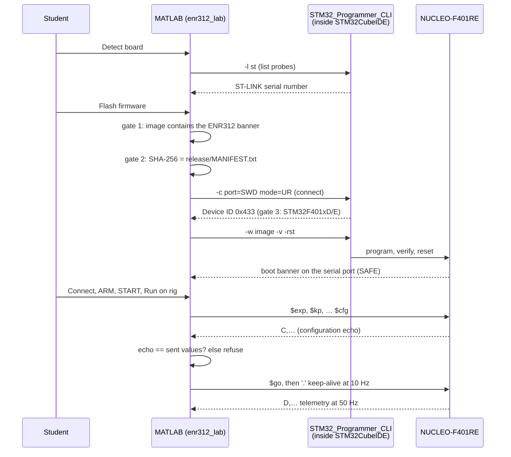

# How MATLAB and the STM32 tools work together

The goal was one MATLAB window in which a student can design a controller,
simulate it, flash the board and run the same controller on the rig, without
opening STM32CubeIDE or a terminal. Nothing here needs a MATLAB toolbox, Simulink
or MATLAB's embedded-coder support for STM32: MATLAB drives the ST command-line
tools and talks to the firmware over the ST-LINK's serial port.



## 1. Where STM32CubeIDE fits

STM32CubeIDE is used for two things only:

1. **Its bundled programmer.** STM32CubeIDE 1.17.0 ships `STM32_Programmer_CLI`
   (STM32CubeProgrammer v2.18.0) inside its plugin folder:
   ```
   /opt/st/stm32cubeide_1.17.0/plugins/
     com.st.stm32cube.ide.mcu.externaltools.cubeprogrammer.linux64_2.2.0.202409170845/
       tools/bin/STM32_Programmer_CLI
   ```
   `odyssix.stm32.tools` finds it by globbing that pattern (any IDE version,
   newest first), so no PATH setup is needed. Search order: the environment
   variable `ODYSSIX_STM32_PROGRAMMER`, `PATH`, the CubeIDE plugin, a standalone
   STM32CubeProgrammer, then the Windows and macOS equivalents (untested).
   `st-flash` from the open-source stlink tools is a last-resort fallback without
   the device-ID check.
2. **Its CubeMX**, to check that the pin configuration `firmware/enr312/target/enr312.ioc`
   matches the hand-written initialisation (`make -C firmware/enr312/target ioc-check`),
   and to give students a CubeMX-generated starting point
   (`firmware/enr312/cubemx/generated/`).

The firmware itself is **not** an STM32CubeIDE project: it builds with a plain
Makefile and the Arm GNU Toolchain, so the build is scriptable, byte-reproducible
and runs in CI.

## 2. Building

`odyssix.stm32.build()` (or `make -C firmware/enr312/target`) compiles with
`arm-none-eabi-gcc` 13.2.1. The build passes `-ffile-prefix-map` and
`-fdebug-prefix-map` so that the absolute checkout path never enters the ELF.
The flash image (`.bin`) is therefore identical on any machine with the same
compiler (CI checks this against the release). The `.elf` additionally contains
the toolchain's install path in its debug information, so its hash matches only
where the toolchain is unpacked at the same path. `scripts/stm32/make_release.sh` builds from a clean tree, runs the
link-map isolation check and the IOC check, and writes the image with its hashes
to `firmware/enr312/release/MANIFEST.txt`.

Students never need the toolchain: `flash()` uses the committed release image.

## 3. Flashing safely

`odyssix.stm32.flash()` refuses before the board is touched unless:

1. the image contains the marker string `THIS IS NOT THE VEHICLE FIRMWARE`
   (the same Nucleo board was used for a different application whose image
   drives PA9, the L6474 reset line, as a UART; flashing that onto the rig would
   toggle the driver's reset continuously);
2. for the release image, its SHA-256 equals the one in `MANIFEST.txt`;
3. the connected MCU reports device ID `0x433` (STM32F401xD/E).

Every flash writes a transcript to `results/evidence/logs/flash_*.log`. The
firmware boots into SAFE (driver in reset), so flashing never moves the motor.
For automated tests, `flash('GatesOnly', true)` checks gates 1–2 without
touching the probe.

## 4. Talking to the firmware

`odyssix.stm32.RigLink` wraps MATLAB's `serialport` at 115200 baud on the
ST-LINK virtual COM port (`/dev/ttyACM0` on Linux). It:

* parses the 50 Hz `D,` telemetry into preallocated arrays and keeps every
  received line in a raw log (`results/evidence/logs/rig_*.log`);
* sends single-byte commands and `$` lines (protocol in [`ARCHITECTURE.md`](ARCHITECTURE.md#serial-protocol));
* guards against re-entrancy: the app polls from a 10 Hz `timer`, and a timer
  callback firing in the middle of another serial call made MATLAB's serial
  read/write throw. `poll` and `keepAlive` skip a tick while another call is in
  progress; commands, including abort, are never skipped.

The app's timer sends `.` every 100 ms during a run. If MATLAB stops (crash,
breakpoint, closed laptop) the firmware aborts the run after 1 s on its own.

## 5. The emulator: the firmware without a board

`firmware/enr312/host/enr312_host_rig.c` links the **same** `src/*.c` files the
MCU runs against a nonlinear pendulum plant and serves them on a POSIX
pseudo-terminal with the firmware's console protocol. `enr312_lab` → *Use
emulator* builds it with the host `gcc` if needed, starts it and connects to the
pty exactly as to `/dev/ttyACM0`. The emulator exits when the MATLAB process
that started it ends, and drops output instead of blocking when MATLAB is busy
(as the MCU's UART would). It also has a batch mode used by the tests:

```bash
firmware/enr312/build/enr312_host_rig --batch exp=5 kp=9 seconds=20 release=0.5
```

## 6. Keeping simulation and firmware identical

`odyssix.sim.runTutorial` is a line-by-line MATLAB port of the firmware control
path (PD with a 10 Hz derivative filter, tutorial sequences, actuator clip, speed
ceiling, step quantisation) driving the same plant equations as the emulator.
`matlab/tests/test_sim_matches_firmware.m` runs both and fails if they diverge,
so any change to the C control code must be mirrored in MATLAB. This is what
lets the app put a rig measurement on top of a simulation and compare them with
the same metric code (`odyssix.sim.metrics`).

## 7. Shared parameters

Sign conventions, scales and limits live in three places that must agree:
`firmware/enr312/inc/enr312_rig_config.h`, `matlab/+odyssix/rigParams.m` and
`shared/parameters/edukit01_rig.yaml`.
`matlab/validation/exp001_check_parameter_consistency.m` compares the C header
with the MATLAB values and fails on any difference.
