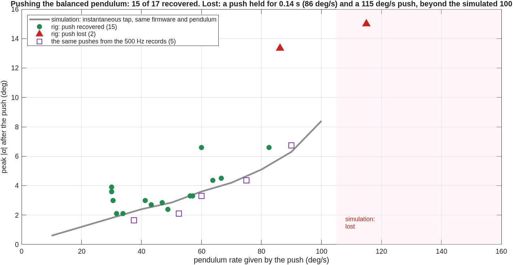
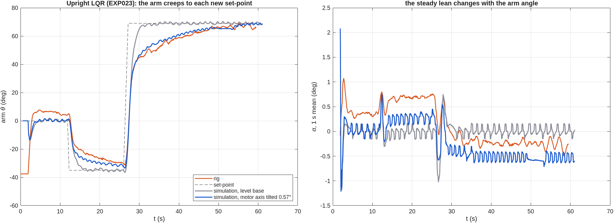

# Results

Everything measured on the rig, session by session, next to what the simulation
predicted. The full analysis of each session, with what does not fit, is in
[`results/reports/`](../results/reports/). The raw data is in [`data/`](../data/README.md).
Numbers marked as predictions are predictions.

**In short**

| | Rig | Simulation or prediction |
|---|---|---|
| T2 overshoot, load offset | 20 %, 0.198° | 20 %, 0.153° |
| T3 / T4 arm offset | 2.25° / 3.49° | 2.25° / 3.50° (friction rest angle × Kpp/Kp) |
| T3 / T4 arm offset, 24 Oct (pendulum rested on the other side) | 1.25° / 1.52° | 1.25° / 1.51° |
| T9 / T10 settling | 6.24 s / 4.58 s; 24 Oct: 6.24 s / 4.50 s | 5.94 s / 4.39 s |
| pendulum constant ωg² | 48.0 ± 0.5 (six free swings); 24 Oct: 48.2 | Tutorial: 57.01 |
| swing-up with the measured ωg² | 5 of 5, caught in 3.9–5.8 s | 4.2–7.6 s |
| pushes while balancing | 15 of 17 recovered (30–83 deg/s); lost at 115 deg/s | recoverable up to 100 deg/s |
| pendulum target 90° | 91.8° | 91.8° |
| on-off control (first rig run, 24 Oct) | never settles; pendulum up to 18.0° | never settles; 17.9° |
| upright LQR from a hand release (first, 24 Oct) | balanced 59 s, 0.47° rms | 0.43° rms (with the measured base tilt) |
| motor axis tilt (24 Oct) | 0.57°, from the steady lean against arm angle | explains the arm's slow creep and the smaller step overshoot |

## On the rig (2026-10-12)

| Tutorial | Result on the rig |
|---|---|
| 1 Actuator & sensing | +5° command = 44 microsteps; protractor reads 5°. Arm and encoder sign conventions measured (encoder polarity −1). |
| 2 Sensitivity (rotor loop) | Overshoot 23.75 % on the rig and 23.75 % in simulation; load-disturbance offset 0.112° vs 0.113° (prediction D/Kp = 0.108°). |
| 3 MIMO control effort | Arm settles 0.5° off the reference. Explained quantitatively by a 0.3° pendulum rest offset (pivot friction) times Kpp/Kp. |
| 4 MIMO sensitivity | Same offset mechanism (predicted 3.00°, measured 3.04°); two external disturbances rejected. |
| 5 Inverted pendulum | Balanced in 4 of 4 runs on firmware 2.0.8 (0 of 3 before it), up to 78 s, pendulum 0.4–1.1° RMS from upright. The arm drifts by tens of degrees; cause identified, not yet fixed. |

Full analysis, including what does **not** yet match the model:
[`results/reports/2026-10-12_rig_tutorials_1-5.md`](../results/reports/2026-10-12_rig_tutorials_1-5.md).

## On the rig (2026-10-21)

| Experiment | Result on the rig |
|---|---|
| Energy swing-up | Caught upright **3 of 3** at 7.1 / 7.1 / 8.0 s; the swing builds up like the simulation. Balance later lost to external pushes. |
| Upright offset | Balancing, the mean pendulum angle was +0.63° and the arm sat at **+23.3°**. The LQR predicts −k₃/k₁·α = **+24.0°**: the encoder's "upright" is 0.6° off the balance point. Firmware 2.3.0 learns and removes it. In the evening it balanced 33 s with the same offset (α +0.68°) and the arm back home: −0.3° to −2.3° over the last 11 s. |
| Tutorial 7 | Impulse response (median over the impulses): pendulum −1.55° vs −1.35° simulated, arm 5.1° vs 4.7°. |
| LAB state feedback | Step to 90°: 89.66° on the rig, 89.77° in simulation, same trajectory. |

Report: [`results/reports/2026-10-21_rig_session.md`](../results/reports/2026-10-21_rig_session.md).

## On the rig (2026-10-21, evening): all ten tutorials

| Experiment | Rig | Simulation |
|---|---|---|
| T2 overshoot · offset under a load | 20 % · 0.198° | 20 % · 0.153° (the gap is under half a microstep) |
| T3 overshoot | 35 % | 35 % |
| T3 / T4 arm offset | 2.25° / 3.49° | 2 + (Kpp/Kp)·ψ_rest = 2.25° / 3.50° |
| T8 load offset with Ki | 0.13° | 0 |
| T3 / T4 arm offset, 24 Oct (pendulum rested on the other side) | 1.25° / 1.52° | 1.25° / 1.51° |
| T9 / T10 settling | 6.24 s / 4.58 s; 24 Oct: 6.24 s / 4.50 s | 5.94 s / 4.39 s |
| T7 gain changed live | lost at pendulum Kd 146 and at rotor Kd 25 | gain sweep: unstable from Kd 150 and near rotor Kd 30 |
| Pendulum target 90° | swings to 91.8° | 91.8° |
| Swing-up, firmware 2.3.0 | 1 of 3 caught (38.9 s) | 8 of 36 on the identified pendulum (the app's own simulation said 5–11 s, see below) |

**Why the swing-up stopped catching.**

- *The catch rule.* In 2.3.0 I had tightened the catch to ≤ 60 deg/s after one catch at
  75 deg/s fell. The real pendulum went over the top at 75–120 deg/s, swing after swing,
  so the catch hardly ever fired.
- *The cause of the fast passes: the wrong pendulum constant.* The swing-up pumps until
  the pendulum's energy, E = ψ̇²/(2ωg²) + 1 − cos ψ, reaches that of standing upright. The
  firmware was told ωg² = 57.01, a value derived from the Tutorial geometry, but the rig
  measures 47.6–49.5. With ωg² too large, the firmware underestimates the energy near the
  bottom and keeps pumping. Its learnt correction could add energy but never take any
  back.
- *Why the simulation agreed with the mistake.* The app's simulation gave the simulated
  pendulum the same wrong constant, so the error could not show up in it.

**Identifying the pendulum from the data.** No dedicated free swing had been recorded,
so I used two stretches of the recorded runs instead.

- **A free decay inside T10.** The arm stood still, and a dry-friction model fits the
  decay twice as well as viscous damping (rms 0.33° against 0.73°). It gives ωg² 47.6 and
  friction 0.48 rad/s².
- **The 92° swings of the pendulum-target run.** Corrected for amplitude with the
  elliptic-integral period, they give ωg² 49.5. An energy balance over the same swings
  shows an extra speed-dependent loss, equivalent to a viscous Q ≈ 60.

**Replaying the four firmware versions on that pendulum.** With the wrong constant, the
model ranks 2.2.0 well above 2.3.0, as the rig did. Given the measured constant, every
version catches in all 36 cases. Firmware 2.3.2 lets the learnt correction go negative,
and it catches in 35 of 36 cases even with the wrong constant. That is still simulation
until it runs on the rig.

**Friction explains the T3/T4 "errors".** Each run starts with the pendulum resting
slightly off the encoder's zero, held there by friction. The PD then holds the arm off
by (Kpp/Kp)·ψ_rest. That predicts the T3 and T4 arm offsets to within 0.01°, and it
shows that T4's "85.7 % overshoot" is not an overshoot.

Report, with what does not fit yet (T3 control effort, 22 against 48):
[`results/reports/2026-10-21b_rig_session.md`](../results/reports/2026-10-21b_rig_session.md).

## On the rig (2026-10-21, late): the prediction tested

The evening analysis predicted two things: that the pendulum constant is about 48, not
57, and that with the right value the swing-up would catch reliably. Both were tested
the same night.

| | Prediction | Rig |
|---|---|---|
| ωg² from a free swing, motor off | 48 ± 1.5 (from stretches of other runs) | **48.4 / 48.6** (period); 48 ± 1 over three methods |
| dry pivot friction | 0.48 rad/s² | 0.33 / 0.40 rad/s² |
| swing-up, firmware 2.3.2, ωg² 48.5 | caught in 4.23 s (simulation of this configuration) | **caught in 3.88 s, first try** |

It balanced for 18.8 s (α rms 0.66°). Then we pushed it by hand.

- The first push gave the pendulum 49 deg/s. It recovered with the peak angle and arm
  swing the simulation predicts for such a tap. The simulation says this controller
  takes taps up to 100 deg/s.
- The second push kept acting for 0.14 s and ended the run.

To measure pushes properly, firmware 2.3.3 records the last 2 s at the full 500 Hz. The
app's **PUSH MARK** button logs the push and saves that record with the run.

The app's own free-swing fit failed on these real records at first: it assumed the
release was at the start and the damping was viscous. It now finds the release itself
and fits dry friction. Report:
[`results/reports/2026-10-21c_rig_session.md`](../results/reports/2026-10-21c_rig_session.md).

## On the rig (2026-10-21, last session)

Six free swings give **ωg² = 48.0 ± 0.5**. With it the swing-up caught **4 of 4** (3.9–5.8 s).
Pushed by hand, the balance recovered 15 of 17 pushes of 30–83 deg/s, following the
simulated curve; it was lost to a push held for 0.14 s and to a 115 deg/s push, beyond
the simulated 100 deg/s limit. Report:
[`results/reports/2026-10-21d_rig_session.md`](../results/reports/2026-10-21d_rig_session.md).

## On the rig (2026-10-24)

Every experiment in one sitting, two on the rig for the first time: on-off control, which
never settles as predicted, and the LQR balancing from a hand release. The pendulum
constant, the tutorial settling times, the friction offsets and the swing-up repeated.
The data showed three things the simulation had wrong:
- balancing feels about 0.12 rad/s² of pivot friction, not the 0.37 of a free swing;
- the motor axis leans 0.57°, which makes the arm creep to a new set-point while
  balancing (fix: level the base);
- a free swing with the motor off loses 7–10° in its first cycle, with the motor on 2°.

The app's faults found on the way are fixed (it used the textbook pendulum by default;
the free-swing fit kept the textbook arm coupling; saved settings were those at the end
of a run). Report:
[`results/reports/2026-10-24_rig_session.md`](../results/reports/2026-10-24_rig_session.md).

## Predictions (simulation)

From the firmware-exact simulation with the Tutorial plant values
([`results/tables/`](../results/tables/), `matlab/experiments/PEND/pend_predictions.m`).
Written before the rig runs. T6–T10, on-off, the upright LQR and the pendulum target have
since been run on the rig (above); stopping a plucked swing (EXP021) has not been recorded.

| Experiment | Prediction to test on the rig |
|---|---|
| 6 Integral action (inverted) | Linear model reproduces Tutorial 6 (overshoot 52.0 % vs 52.6 %, phase margin 31.42° vs 31.45°), but at the rig's 1500 deg/s² input limit the derivative kick of the 40° step saturates: **34 %** overshoot expected. |
| 7 Pendulum-loop design | A pendulum loop that is stable on its own (Kp 150, Kd 15) still loses balance in the full loop; 300/30 gives a 1.4° averaged impulse response. |
| 8 Load disturbance | Arm offset under a 60 deg/s² load: −4.1° without integral action (theory −D/Kp = −4.0°), −0.7° with it. |
| 9 / 10 State feedback, LQR | Tutorial 9 reference settles in 5.94 s (tutorial 5.8 s); LQR gains reproduce Tutorial 10 exactly. The stepper's minimum step rate parks the arm up to (k2 + b)·0.225/k1 degrees short. |
| LAB hanging, PID: stop a swing | 1.6 s with the pendulum D term, 21 s (free decay) without it; any commanded arm angle held to the microstep. |
| LAB hanging, on-off | Never settles: ±20° oscillation for a 20° step, pendulum shaken to 36°. |
| LAB upright, LQR | 2.3 % overshoot vs 34 % for the Tutorial 6 PID, pendulum error 0.17° vs 0.42° rms. A robust tuning study finds the best dual PID only 3 % better than Tutorial 6's gains; the LQR has 27 % less pendulum error. |
| Pendulum target | A pendulum rests only at 0° or 180°: holding it at ψ needs arm acceleration (ωg²/ωr²)·tan ψ. The target sets the swing height instead: 45/90/135° → 46/92/136°; 0 stops a 40° swing in 9 s (free decay 19 s). |
| PEND loop rate, taps | Balances down to a 16.7 Hz loop; recovers taps up to 100 deg/s of pendulum rate, falls at 120. |

## How the software is checked

`scripts/flash_ready_check.sh` runs every check that does not need the rig
(about 10 minutes with MATLAB, `--quick` skips the real-time tests):

* firmware builds with no warnings in project code and is reproducible: the
  flash image built from source must match the SHA-256 of the committed release
  in `release/MANIFEST.txt`
* link-map check that the image contains no RTOS or middleware symbols
* 479 host unit-test checks (C) of the control cores, runner, command parser and crash recorder, incl. the swing-up on 20 pendulum variants, 11 of them with dry pivot friction
* physics-model validation, simulation-equals-firmware test, a three-way parameter
  check (contract = MATLAB = firmware), end-to-end tests of the app for all
  experiments against the emulator (MATLAB), and the Python client against the
  emulator

CI runs the C part on every push (see the badge above).

