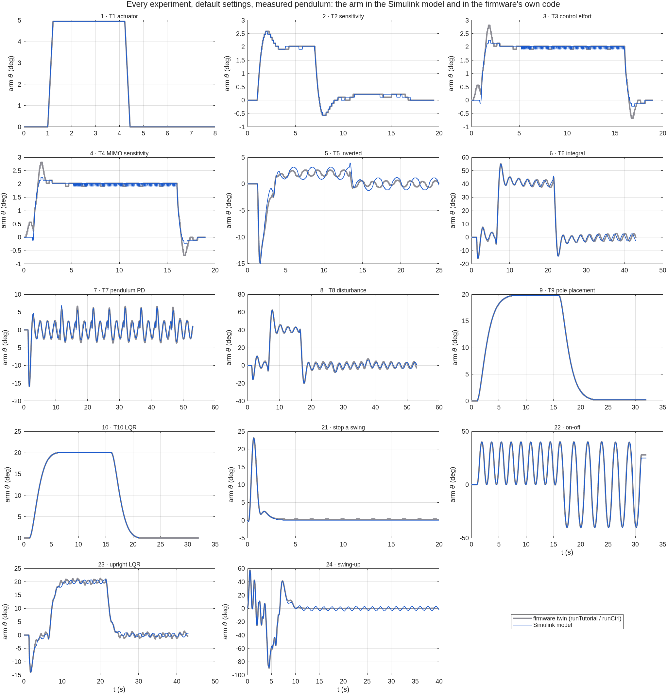

# The Simulink model, and Assignment 3 (PEND)

A Simulink model of the rig. Every experiment of the lab runs in it: Tutorials 1–10, and
the PEND ones (stop a swing, on-off, upright LQR, swing-up). The control is the
firmware's own code; the pendulum, the stepper's microsteps and the encoder's counts are
blocks. It answers the five PEND questions of ENR312 Assignment 3, and it is checked
against the firmware's code for every experiment.

New to this? [How it works](HOW_IT_WORKS.md) explains in two pages how Simulink, the
simulator app, the emulator and the rig relate.

<p align="center"></p>

- [Run it](#run-it)
- [What is in the model](#what-is-in-the-model)
- [Parameters](#parameters)
- [Is it right? Checked against the firmware](#is-it-right-checked-against-the-firmware)
- [Assignment 3, PEND: the five questions](#assignment-3-pend-the-five-questions)
- [Things to change during the demonstration](#things-to-change-during-the-demonstration)
- [Writing the report](#writing-the-report)
- [What the model leaves out](#what-the-model-leaves-out)

## Run it

Simulink is needed (MATLAB alone runs the [simulator app](guide/README.md)).
From the repository folder, after `setup`:

```matlab
enr312_simulink          % lists the experiments
enr312_simulink(9)       % runs Tutorial 9: opens the model, runs it, plots arm, pendulum and u
```

To change something, take the settings, change a field, run again:

```matlab
P = enr312_simulink_params(5);    % Tutorial 5 settings, this rig's pendulum
P.kpp = 200;                      % the same names as the app's fields
enr312_simulink(P)
enr312_simulink(23, 'animate')    % the upright LQR, then the rig in 3-D
```

Or open the model and press **Run** yourself:

```matlab
P = enr312_simulink_params(9); open_system('enr312_pendulum')   % double-click the scopes
```

Every figure on this page comes from one command, in about 10 minutes:

```matlab
run_enr312_simulink()      % writes results/figures/simulink_*.png and results/tables/SIMULINK_*.csv
```

The `.slx` file is generated by `build_enr312_simulink.m`, so the model can be read
and reviewed as code. If the committed `.slx` will not open in an older MATLAB, run
`build_enr312_simulink` once: it rebuilds the model in your release.

| File (`matlab/simulink/`) | What it does |
|---|---|
| `enr312_simulink.m` | run one experiment and plot it; no argument lists them |
| `enr312_pendulum.slx` | the model |
| `build_enr312_simulink.m` | builds the model from scratch |
| `enr312_simulink_params.m` | every parameter, with its unit and source |
| `Enr312Firmware.m`, `enr312_fw_tick.m` | the firmware's control loop, one 2 ms tick per call |
| `run_enr312_simulink.m` | the PEND situations and every experiment against the firmware's code |
| `animate_enr312_simulink.m` | 3-D animation of a run, or an animated GIF |
| `matlab/tests/test_simulink_matches_runctrl.m` | the check against the firmware's control code |

## What is in the model

| Block | Type | What it is |
|---|---|---|
| **Firmware** | MATLAB Function, discrete, every 2 ms | the firmware's control loop for the chosen experiment, from the sensor readings to the arm velocity the step generator runs: the controller (PD, PID, state feedback, LQR, on-off, energy swing-up), its filters, the input limit, the set-point sequence, the operator's hand at an upright start, and the stop rules. The same arithmetic as the firmware's MATLAB copy (`odyssix.sim.runTutorial` / `runCtrl`), which is checked against the C code |
| **arm angle** | Integrator | the arm angle is the integral of the velocity the firmware asks for |
| **Pendulum dynamics** | MATLAB Function, continuous | the nonlinear equation of motion below, in rad. It is integrated in ψ and w = ψ̇ − ωr² cos ψ θ̇, so that the arm's velocity steps every 2 ms act on the pendulum exactly as on the rig |
| **Tap** | MATLAB Function of the clock | a push: `P.tapRate` deg/s added to the pendulum's rate over `P.tapWidth` = 10 ms |
| **microsteps**, **encoder zero**, **encoder** | Quantizer, Bias, Quantizer | what the firmware sees: the arm in 0.1125° microsteps, the pendulum in 0.15° counts, with an optional encoder offset |
| scopes and **log** blocks | Scope, To Workspace | θ, ψ, u, v, the set-point and the phase, saved as timeseries in `out` |

## Parameters

`P = enr312_simulink_params(exp)` takes the experiment's default settings from
`odyssix.sim.defaults(exp)`, the same as the app. The pendulum:

| Symbol | Value | Unit | Source |
|---|---|---|---|
| ωg² | 48.0 ± 0.5 | rad²/s² | six free swings on this rig ([results](RESULTS.md)); the Tutorial's value with `enr312_simulink_params(exp, 'tutorial')` |
| ωr² | 0.685 | – | ωg²·r/g with the arm radius r = 0.14 m (STEVAL-EDUKIT01 manual) |
| Q | 60 (57–63) | – | energy balance of a 92° swing on the rig; γ = √ωg²/Q = 0.115 1/s |
| c, hanging and swing-up | 0.37 | rad/s² | dry pivot friction from free swings, smoothed as c·tanh(ψ̇/0.01) |
| c, balancing (5, 6, 7, 8, 23) | 0.12 | rad/s² | the friction that reproduces balancing on the rig ([2026-10-24 report](../results/reports/2026-10-24_rig_session.md), section 4) |
| encoder | 0.15 | deg/count | 600 lines × 4 |
| microstep | 0.1125 | deg | 200 steps × 16 |
| T_s | 2 | ms | firmware control period (500 Hz); `P.div` slows it |

Every controller setting has the app's name: `kp kd ki kpp kdp fdr fdp k1 k2 k3 k4 uon db
step dist imp rrate div ma seq ulim vmax amp`. The scenario: `psi0` (start angle, 180 =
upright), `stopTime`, `closedLoop`, `safety` (the firmware's stop rules), `tapTime`,
`tapRate`, `refEvents` (set-points during the run).

## Is it right? Checked against the firmware

The firmware's control code also runs in MATLAB (`odyssix.sim.runTutorial` and
`runCtrl`), and that copy is checked against the C code itself on every change
(`test_sim_matches_firmware`). The Simulink model is checked against that copy, for
every experiment, by `test_simulink_matches_runctrl`:

<p align="center"></p>

| | Arm, rms difference | |
|---|---|---|
| T1, T2, T9, T10 | 0.02–0.06° | the same within a microstep |
| T3, T4 | 0.15° | the firmware's code overshoots to 2.8° in the first 2 s, Simulink to 2.25°; the same after that |
| stop a swing | 0.24° | |
| T5, T7, T23 (upright) | 0.5–0.9° | the same peaks within 2 % |
| T6, T8, on-off, swing-up | 1.4–2.0° | peaks of 40–90° within 1 % |

(`results/tables/SIMULINK_all_experiments.csv`.) Every experiment ends in the same
phase in both. The one visible difference, the start of T3 and T4, has a known cause:
the firmware's copy models the pivot's dry friction as stick-slip (the pendulum stops
dead, then breaks free), Simulink smooths it (c·tanh(ψ̇/0.01)), so the two treat the
moment the pendulum starts to move a little differently.

A tap while the LQR balances (the test also checks this):

| Tap | Firmware's code (peak tilt / arm swing) | Simulink |
|---|---|---|
| 30 deg/s | 2.55° / 20.0° | 2.40° / 18.6° |
| 60 deg/s | 5.25° / 42.2° | 5.10° / 41.6° |
| 90 deg/s | lost | lost |

## Assignment 3, PEND: the five questions

### 1. Equations of motion, and linearisation about upright

The full derivation, with every assumption, is in
[rotary pendulum dynamics](first_principles/ROTARY_PENDULUM_DYNAMICS.md) §4–5. In short:
the arm turns about a vertical axis by θ; the pendulum hangs from the arm's tip, a
radius r from that axis, and swings by ψ (0 = hanging) in the plane at right angles
to the arm. Taking moments about the pivot in the frame that turns with the arm:

    J ψ̈ = −m g l_c sin ψ  +  m r l_c cos ψ θ̈  +  J θ̇² sin ψ cos ψ  −  b ψ̇  −  friction

and, divided by J,

    ψ̈ = −ωg² sin ψ + ωr² cos ψ θ̈ + θ̇² sin ψ cos ψ − γ ψ̇ − c sgn ψ̇
    ωg² = m g l_c / J,   ωr² = m r l_c / J = ωg² r / g,   γ = ωg / Q

The stepper imposes the arm's motion, so the input is the arm's acceleration,
θ̈ = u. This is the **Pendulum dynamics** block.

**About upright**, with α = π − ψ the tilt from upright, sin ψ ≈ α, cos ψ ≈ −1,
and θ̇² terms of second order:

    α̈ = ωg² α − γ α̇ + ωr² u

With the state x = [θ, θ̇, α, α̇] and input u = θ̈:

    A = | 0  1   0     0 |     B = | 0   |
        | 0  0   0     0 |         | 1   |
        | 0  0   0     1 |         | 0   |
        | 0  0  ωg²   −γ |         | ωr² |

The eigenvalues of A are 0, 0, +6.87 and −6.99 rad/s with this rig's numbers. One is
positive: upright is unstable, and a tilt grows by e every 0.15 s. About hanging,
the same steps give ψ̈ + γψ̇ + ωg²ψ = ωr²u, with poles −0.06 ± 6.93j: a lightly
damped swing of period 2π/6.93 = 0.91 s.

### 2. Open loop: hanging is stable, upright is not

<p align="center"></p>

Controller off (`P.closedLoop = false`). Hanging, released at 10°: it swings with
the 0.91 s period and comes to rest. The decay is linear in time rather than
exponential, which is what dry friction does, and it stops at about 4.5 s when the
swing can no longer overcome the friction. Upright, released at only 1°: the tilt
grows like the linear model (dashed) for the first few degrees, then more slowly than
it, because sin α < α and the pivot's friction take some of the push away. The
pendulum passes hanging (180°) at 1.0 s and swings up the other side to 325°, 35° short
of upright.

### 3. A controller that balances the nonlinear model

<p align="center"></p>

Both of the firmware's controllers, released 5° from upright:

- **LQR** (experiments 23/24): u = −(k₁(θ − θ_ref) + k₂θ̇ + k₃α + k₄α̇). On the
  linear model above its closed-loop poles are −8.0 ± 7.3j, −4.1 and −1.0 rad/s, all
  stable. It catches the pendulum in about 0.5 s and then holds it within about 0.2°.
- **Dual PID** (Tutorial 6): a PD on the pendulum (Kpp 300, Kdp 30) and a PID on
  the arm (Kp 15, Ki 3, Kd 7.5), u = −u_arm + u_pendulum. The arm loop's sign is
  flipped because, upright, moving the arm one way tips the pendulum the other way.
  It balances, but keeps hunting: about ±0.3° on the pendulum and ±3° on the arm,
  period 2.3 s. The cause is the dry friction of the pivot: with `P.coulomb = 0` it
  almost disappears, and with the 0.37 of a free swing it is three times larger. The
  rig balanced with 0.55° rms and a few degrees of arm motion on 2026-10-24, which is
  why balancing uses 0.12 ([report](../results/reports/2026-10-24_rig_session.md), section 4).

The first 0.1 s shows u at its ±1500 deg/s² limit: a 5° release is already a large
disturbance for this rig.

### 4. A tap while balanced

<p align="center"></p>

A tap is an impulse: it changes the pendulum's rate, not its angle, so the model
adds `P.tapRate` deg/s over 10 ms (`P.tapTime` = 3 s here).

| Tap | LQR: peak tilt | LQR: back within 1.5° | dual PID: peak tilt | dual PID: back within 1.5° |
|---|---|---|---|---|
| 20 deg/s | 1.50° | never left | 1.65° | 0.37 s |
| 40 deg/s | 3.15° | 0.49 s | 3.45° | 0.63 s |
| 60 deg/s | 5.10° | 0.61 s | 5.40° | 0.73 s |

(`results/tables/SIMULINK_taps.csv`.)

The peak tilt is nearly proportional to the tap: 0.075–0.09° per deg/s. The
controller's first reaction is to move the arm hard enough to throw the pendulum
back past upright, which is why the plots overshoot to the other side. On the rig,
15 of 17 hand pushes up to 83 deg/s were recovered ([results](RESULTS.md)), and the
simulation of the same firmware puts the limit at 100 deg/s.

### 5. The largest initial angle

Released at rest at a growing tilt, each controller recovers up to:

| Controller | Largest tilt recovered | the control law alone (`P.safety = false`) |
|---|---|---|
| LQR | 12° | 12° |
| dual PID | 12° | 12° |

(`results/tables/SIMULINK_max_tilt.csv`: released at rest, 1° steps; recovered means
within 3° after 6 s with the arm inside its 240° limit. The firmware's stop rules do not
change the answer.)

The limit is the actuator, not the gains. At 12° the input sits at its ±1500 deg/s²
clamp for half of the first second and the arm reaches 338 of its 360 deg/s; at 13° the
input stays at the clamp for the whole first second and the pendulum falls. The animation
of a recovery from the largest angle:

```matlab
P = enr312_simulink_params(23); P.startBalancing = true; P.seq = 0; P.psi0 = 168; P.stopTime = 6;
out = enr312_simulink(P, 'animate');
animate_enr312_simulink(out, 'recovery.gif')     % or save it as an animated GIF
```

### Also asked in the PEND handout (S3-8): the slowest loop rate

`P.div` runs the controller every `div` ticks of 2 ms. The dual PID still balances
at **16.7 Hz** (div 30) and falls at 14.3 Hz (see `results/tables/SIMULINK_loop_rate.csv`). The rule of thumb
from the unstable pole: a tilt grows by e in 1/6.87 = 0.15 s, so a few samples
within that time are needed, which is 20–30 Hz.

## Things to change during the demonstration

| Ask | Do |
|---|---|
| another experiment | `enr312_simulink(9)` (any of 1–10, 21–24) |
| a bigger step | `P = enr312_simulink_params(9); P.step = 40; enr312_simulink(P)` |
| a set-point during the run | `P.refEvents = [5 30; 12 -20];` (at 5 s go to 30°, at 12 s to −20°) |
| a tap, now and bigger | `P.tapTime = 4; P.tapRate = 80;` |
| a different gain | `P.kpp = 200;` or `P.k2 = 0.5;` (the app's names) |
| the textbook pendulum | `P = enr312_simulink_params(5, 'tutorial');` |
| no friction | `P.coulomb = 0;` |
| a slower controller | `P.div = 10;` (50 Hz) |
| the open loop | `P.closedLoop = false;` |
| the control law without the firmware's stop rules | `P.safety = false;` |

`P` is read when the simulation starts: change it, then `enr312_simulink(P)` or Run.

## Writing the report

- **Model screenshot:** `print('-senr312_pendulum', '-dpng', '-r150', 'model.png')`,
  and double-click the **Firmware** and **Pendulum dynamics** blocks to show the
  code inside them. Add your name and enrolment number as a text annotation:
  double-click an empty part of the canvas and type.
- **Inputs:** a screenshot of `P` in the workspace, or of the Tap block, is the
  block parameters the assignment asks for.
- **Outputs:** the figures on this page are made by `run_enr312_simulink`; all have
  labelled axes with units and a legend.
- Cite the course's PEND guidelines, the STEVAL-EDUKIT01 manual for r, and this
  repository for the measured ωg² and friction.

## What the model leaves out

- the stepper can lose steps if it is asked for too much torque; here the arm
  always follows;
- the tilt of the motor axis found on the rig (0.57°): the model is a level rig;
  `odyssix.sim.runCtrl` has it as the plant option `tiltDeg`;
- the extra loss in the first cycle of a free swing with the motor off;
- the 50 Hz data stream that the app sees: the model logs every step.

The firmware's stop rules and the encoder's offset (`P.bias`) are in the model.
