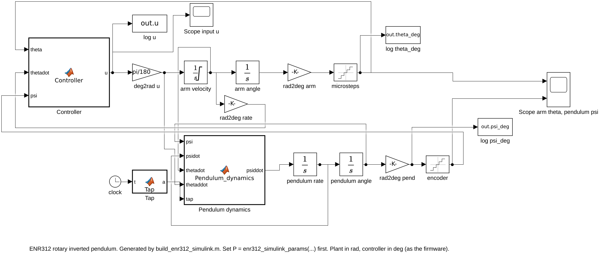
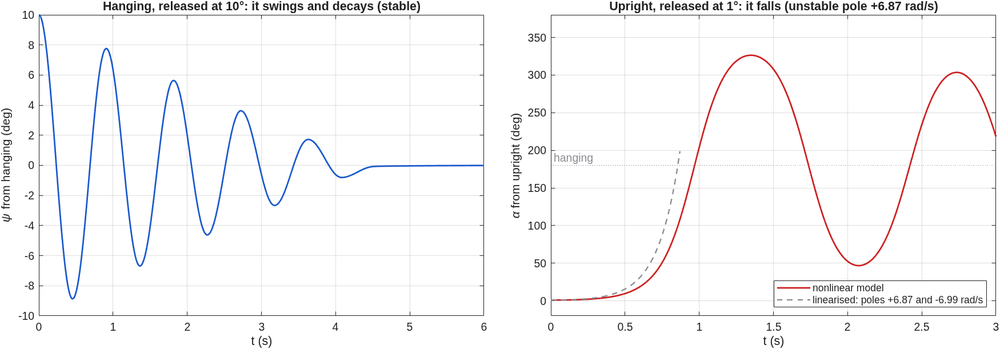
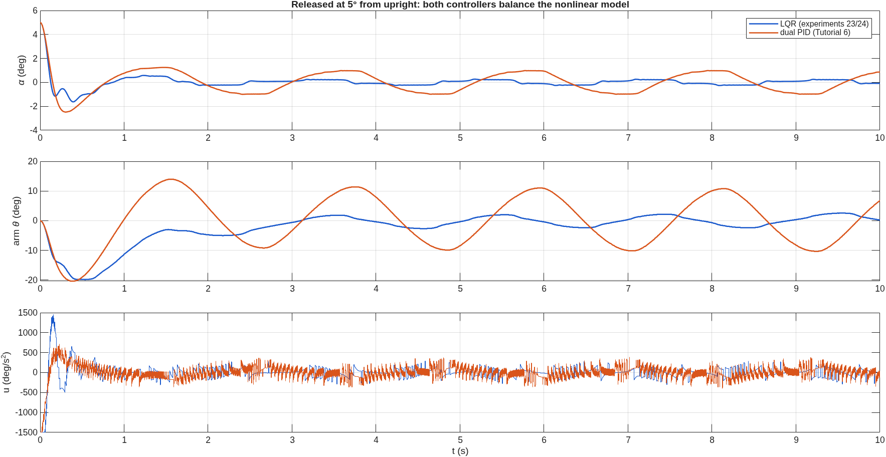
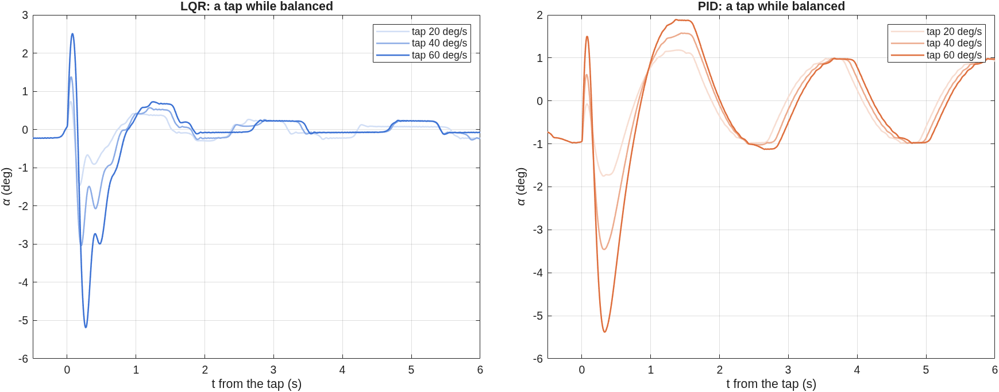

# The Simulink model, and Assignment 3 (PEND)

A Simulink model of the rig: the nonlinear pendulum on its rotating arm, the
firmware's two balancing controllers, the stepper's microsteps and the encoder's
counts. It answers the five PEND questions of ENR312 Assignment 3 and is checked
against the firmware's own control code.

<p align="center"></p>

- [Run it](#run-it)
- [What is in the model](#what-is-in-the-model)
- [Parameters](#parameters)
- [Is it right? Checked against the firmware](#is-it-right-checked-against-the-firmware)
- [Assignment 3, PEND: the five questions](#assignment-3-pend-the-five-questions)
- [Things to change during the demonstration](#things-to-change-during-the-demonstration)
- [Writing the report](#writing-the-report)
- [What the model leaves out](#what-the-model-leaves-out)

## Run it

Simulink is needed (MATLAB alone runs the [simulator app](guide/README.md)).
From the repository folder, after `setup`:

```matlab
P = enr312_simulink_params();          % measured pendulum, LQR
open_system('enr312_pendulum')         % then press Run; double-click the scopes
```

Or from the command line:

```matlab
P = enr312_simulink_params('measured', 'pid');    % or 'tutorial' pendulum, 'lqr' controller
P.alpha0 = 5;                                     % released 5 deg from upright
out = sim('enr312_pendulum');
plot(out.psi_deg.Time, 180 - out.psi_deg.Data)    % tilt from upright, deg
animate_enr312_simulink(out)                      % the rig in 3-D
```

Every figure on this page comes from one command, in about 7 minutes:

```matlab
run_enr312_simulink()      % writes results/figures/simulink_*.png and results/tables/SIMULINK_*.csv
```

The `.slx` file is generated by `build_enr312_simulink.m`, so the model can be read
and reviewed as code. If the committed `.slx` will not open in an older MATLAB, run
`build_enr312_simulink` once: it rebuilds the model in your release.

| File (`matlab/simulink/`) | What it does |
|---|---|
| `enr312_pendulum.slx` | the model |
| `build_enr312_simulink.m` | builds the model from scratch |
| `enr312_simulink_params.m` | every parameter, with its unit and source |
| `run_enr312_simulink.m` | the five PEND situations, figures and tables |
| `animate_enr312_simulink.m` | 3-D animation of a run, or an animated GIF |
| `matlab/tests/test_simulink_matches_runctrl.m` | the check against the firmware's control code |

## What is in the model

| Block | Type | What it is |
|---|---|---|
| **Controller** | MATLAB Function, discrete, every `P.Ts·P.div` s | the firmware's control law, line for line from `firmware/enr312/src/enr312_ctrl.c`: the LQR of experiments 23/24 or the dual PID of Tutorial 6, with the same derivative filters, input clamp and anti-windup. Degrees in, deg/s² out, as on the board |
| **deg2rad u** → **arm velocity** → **arm angle** | Gain, Integrator (limited), Integrator | the stepper: the firmware commands the arm's acceleration u; the arm's speed is limited to `P.vMax` |
| **Pendulum dynamics** | MATLAB Function, continuous | the nonlinear equation of motion below, in rad |
| **pendulum rate**, **pendulum angle** | Integrators | ψ̇ and ψ; the initial angle sets hanging or upright |
| **Tap** | MATLAB Function of the clock | a push: `P.tapRate` deg/s added to the pendulum's rate over `P.tapWidth` = 10 ms |
| **microsteps**, **encoder** | Quantizers | what the controller sees: the arm in 0.1125° microsteps, the pendulum in 0.15° counts |
| scopes and **log** blocks | Scope, To Workspace | θ, ψ and u, saved as timeseries in `out` |

The two halves run at different rates on purpose, as on the rig: the pendulum and
the arm are continuous (ode45, 1 ms maximum step), the controller samples them at
500 Hz and holds its output in between.

## Parameters

| Symbol | Value | Unit | Source |
|---|---|---|---|
| ωg² | 48.0 ± 0.5 | rad²/s² | six free swings on this rig ([results](RESULTS.md)); the Tutorial's 57.01 with `'tutorial'` |
| ωr² | 0.685 | – | ωg²·r/g with the arm radius r = 0.14 m (STEVAL-EDUKIT01 manual) |
| Q | 60 (57–63) | – | energy balance of a 92° swing on the rig; γ = √ωg²/Q = 0.115 1/s |
| c | 0.37 | rad/s² | dry pivot friction from 10° free swings, smoothed as c·tanh(ψ̇/0.01) |
| encoder | 0.15 | deg/count | 600 lines × 4 |
| microstep | 0.1125 | deg | 200 steps × 16 |
| T_s | 2 | ms | firmware control period (500 Hz); `P.div` slows it |
| u limit | ±1500 | deg/s² | firmware clamp |
| v_max | 360 | deg/s | firmware arm speed ceiling |
| LQR k | [−10, −13.787, 382.789, 50.787] | deg units | firmware, experiments 23/24 |
| PID | Kp 15, Ki 3, Kd 7.5; Kpp 300, Kdp 30 | deg units | firmware, Tutorial 6 |
| filters | 50 Hz (arm D), 10 Hz (pendulum D), 5 Hz for the LQR | Hz | firmware |

## Is it right? Checked against the firmware

The firmware's control code also runs in MATLAB (`odyssix.sim.runCtrl`), and that
copy is checked against the C code itself on every change
(`test_sim_matches_firmware`). The Simulink model is checked against that copy by
`test_simulink_matches_runctrl`: the LQR on the measured pendulum, a tap while
balanced.

| Tap | Firmware's code (peak tilt / arm swing) | Simulink |
|---|---|---|
| 30 deg/s | 2.40° / 19.8° | 2.77° / 20.2° |
| 60 deg/s | 5.10° / 42.9° | 5.65° / 40.4° |
| 90 deg/s | lost | lost |

The outcomes agree, the arm swing within 6 % and the peak within 15 %. The
remaining difference has a known cause: in the firmware the arm's velocity changes
in 2 ms steps, in Simulink it is integrated continuously. The test passes when the
outcomes match, the peaks agree within 25 % and the arm swings within 20 %.

## Assignment 3, PEND: the five questions

### 1. Equations of motion, and linearisation about upright

The full derivation, with every assumption, is in
[rotary pendulum dynamics](first_principles/ROTARY_PENDULUM_DYNAMICS.md) §4–5. In short:
the arm turns about a vertical axis by θ; the pendulum hangs from the arm's tip, a
radius r from that axis, and swings by ψ (0 = hanging) in the plane at right angles
to the arm. Taking moments about the pivot in the frame that turns with the arm:

    J ψ̈ = −m g l_c sin ψ  +  m r l_c cos ψ θ̈  +  J θ̇² sin ψ cos ψ  −  b ψ̇  −  friction

and, divided by J,

    ψ̈ = −ωg² sin ψ + ωr² cos ψ θ̈ + θ̇² sin ψ cos ψ − γ ψ̇ − c sgn ψ̇
    ωg² = m g l_c / J,   ωr² = m r l_c / J = ωg² r / g,   γ = ωg / Q

The stepper imposes the arm's motion, so the input is the arm's acceleration,
θ̈ = u. This is the **Pendulum dynamics** block.

**About upright**, with α = π − ψ the tilt from upright, sin ψ ≈ α, cos ψ ≈ −1,
and θ̇² terms of second order:

    α̈ = ωg² α − γ α̇ + ωr² u

With the state x = [θ, θ̇, α, α̇] and input u = θ̈:

    A = | 0  1   0     0 |     B = | 0   |
        | 0  0   0     0 |         | 1   |
        | 0  0   0     1 |         | 0   |
        | 0  0  ωg²   −γ |         | ωr² |

The eigenvalues of A are 0, 0, +6.87 and −6.99 rad/s with this rig's numbers. One is
positive: upright is unstable, and a tilt grows by e every 0.15 s. About hanging,
the same steps give ψ̈ + γψ̇ + ωg²ψ = ωr²u, with poles −0.06 ± 6.93j: a lightly
damped swing of period 2π/6.93 = 0.91 s.

### 2. Open loop: hanging is stable, upright is not

<p align="center"></p>

Controller off (`P.closedLoop = false`). Hanging, released at 10°: it swings with
the 0.91 s period and comes to rest. The decay is linear in time rather than
exponential, which is what dry friction does, and it stops at about 4.5 s when the
swing can no longer overcome the friction. Upright, released at only 1°: the tilt
grows like the linear model (dashed) for the first few degrees, then more slowly than
it, because sin α < α and the pivot's friction take some of the push away. The
pendulum passes hanging (180°) at 1.0 s and swings up the other side to 325°, 35° short
of upright.

### 3. A controller that balances the nonlinear model

<p align="center"></p>

Both of the firmware's controllers, released 5° from upright:

- **LQR** (experiments 23/24): u = −(k₁(θ − θ_ref) + k₂θ̇ + k₃α + k₄α̇). On the
  linear model above its closed-loop poles are −8.0 ± 7.3j, −4.1 and −1.0 rad/s, all
  stable. It catches the pendulum in about 0.5 s and then holds it within 0.3°.
- **Dual PID** (Tutorial 6): a PD on the pendulum (Kpp 300, Kdp 30) and a PID on
  the arm (Kp 15, Ki 3, Kd 7.5), u = −u_arm + u_pendulum. The arm loop's sign is
  flipped because, upright, moving the arm one way tips the pendulum the other way.
  It balances, but keeps hunting: about ±1° on the pendulum and ±10° on the arm,
  period 2.3 s. The cause is the dry friction of the pivot: with `P.coulomb = 0` the
  hunting shrinks to 0.2° peak to peak, and the firmware's own code shows the same
  (2.4° with friction, 0.3° without). The rig's Tutorial 5 runs drifted the same way.

The first 0.1 s shows u at its ±1500 deg/s² limit: a 5° release is already a large
disturbance for this rig.

### 4. A tap while balanced

<p align="center"></p>

A tap is an impulse: it changes the pendulum's rate, not its angle, so the model
adds `P.tapRate` deg/s over 10 ms (`P.tapTime` = 3 s here).

| Tap | LQR: peak tilt | LQR: back within 1.5° | dual PID: peak tilt | dual PID: back within 1.5° |
|---|---|---|---|---|
| 20 deg/s | 1.46° | never left | 1.75° | 0.49 s |
| 40 deg/s | 3.04° | 0.49 s | 3.46° | 1.61 s |
| 60 deg/s | 5.19° | 0.61 s | 5.38° | 1.68 s |

(`results/tables/SIMULINK_taps.csv`; the PID's band is 1.5° because it hunts by
about 1° even without a tap.)

The peak tilt is nearly proportional to the tap: 0.07–0.09° per deg/s. The
controller's first reaction is to move the arm hard enough to throw the pendulum
back past upright, which is why the plots overshoot to the other side. On the rig,
15 of 17 hand pushes up to 83 deg/s were recovered ([results](RESULTS.md)), and the
simulation of the same firmware puts the limit at 100 deg/s.

### 5. The largest initial angle

Released at rest at a growing tilt, each controller recovers up to:

| Controller | Largest tilt recovered |
|---|---|
| LQR | 12° |
| dual PID | 12° |

(`results/tables/SIMULINK_max_tilt.csv`: released at rest, 1° steps; recovered means
within 3° after 6 s with the arm inside its 240° limit.)

The limit is the actuator, not the gains. At 12° the input sits at its ±1500 deg/s²
clamp for half of the first second and the arm reaches 338 of its 360 deg/s; at 13° the
input stays at the clamp for the whole first second and the pendulum falls. On the rig the firmware gives up at 15°
from upright anyway, so this limit cannot be reached there. The animation of a
recovery from the largest angle:

```matlab
P = enr312_simulink_params('measured', 'lqr'); P.alpha0 = 12; P.stopTime = 6;
out = sim('enr312_pendulum');
animate_enr312_simulink(out, 'recovery.gif')
```

### Also asked in the PEND handout (S3-8): the slowest loop rate

`P.div` runs the controller every `div` ticks of 2 ms. The dual PID still balances
at **14.3 Hz** (div 35) and falls at 12.5 Hz (see `results/tables/SIMULINK_loop_rate.csv`). The rule of thumb
from the unstable pole: a tilt grows by e in 1/6.87 = 0.15 s, so a few samples
within that time are needed, which is 20–30 Hz.

## Things to change during the demonstration

| Ask | Do |
|---|---|
| a new arm set-point | `P.ref = 30;` (deg), then Run |
| a tap, now and bigger | `P.tapTime = 4; P.tapRate = 80;` |
| the other controller | `P = enr312_simulink_params('measured', 'pid');` |
| the textbook pendulum | `P = enr312_simulink_params('tutorial');` |
| no friction | `P.coulomb = 0;` |
| a slower controller | `P.div = 10;` (50 Hz) |
| the open loop | `P.closedLoop = false;` |
| start hanging | `P.upright = false; P.alpha0 = 10;` (from hanging) |

`P` is read when the simulation starts, so change it, then Run.

## Writing the report

- **Model screenshot:** `print('-senr312_pendulum', '-dpng', '-r150', 'model.png')`,
  and double-click the **Controller** and **Pendulum dynamics** blocks to show the
  code inside them. Add your name and enrolment number as a text annotation:
  double-click an empty part of the canvas and type.
- **Inputs:** a screenshot of `P` in the workspace, or of the Tap block, is the
  block parameters the assignment asks for.
- **Outputs:** the figures on this page are made by `run_enr312_simulink`; all have
  labelled axes with units and a legend.
- Cite the course's PEND guidelines, the STEVAL-EDUKIT01 manual for r, and this
  repository for the measured ωg² and friction.

## What the model leaves out

- the stepper can lose steps if it is asked for too much torque; here the arm
  always follows;
- the firmware's safety stops (15° from upright, 240° of arm, sustained
  saturation);
- the encoder's offset from true upright (0.6° on the rig, which firmware 2.3.0
  learns);
- the 50 Hz data stream that the app sees: the model logs every step.

Each of these is in the firmware's own simulation (`odyssix.sim.runCtrl`), which the
lab app uses.
