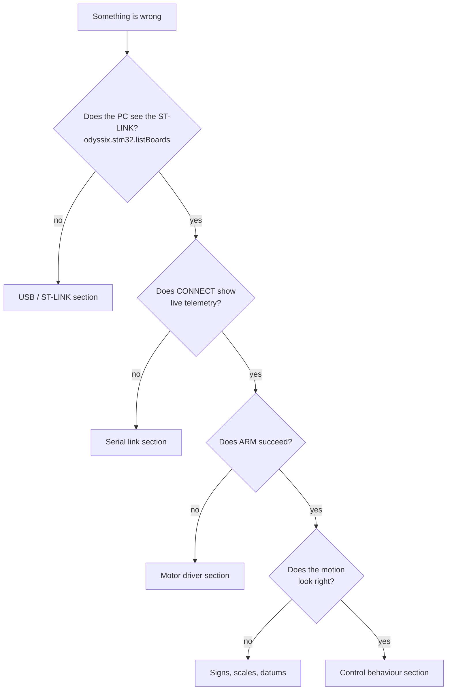

# Troubleshooting

Every entry below happened during bring-up of this rig (October 2026), with the
cause that was found and the fix. Firmware versions are listed in
[`CHANGELOG.md`](../CHANGELOG.md); session transcripts are in
[`results/evidence/rig_sessions/`](../results/evidence/rig_sessions/).

## USB and ST-LINK

### The board is not found; `/dev/ttyACM0` is missing; flashing says `DEV_CONNECT_ERR`
* **Seen:** twice, on the same board. `lsusb` lists `0483:374b STMicroelectronics
  ST-LINK/V2.1`, but there is no serial port and `STM32_Programmer_CLI` cannot connect.
  The kernel log showed `error -71` the first time.
* **Cause:** the ST-LINK enumerated but never received a USB configuration
  (`/sys/bus/usb/devices/<port>/bConfigurationValue` is empty), so it exposes no
  interfaces.
* **Fix:** unplug the Nucleo's USB cable, wait 5 s, plug it back in. `usbreset 0483:374b`
  fixed it once; another time it did not and only the replug worked. `odyssix.stm32.listBoards()`
  reports this state explicitly ("ST-LINK is on USB but not configured").
* Also check: the cable carries data, and the CN2 jumpers on the Nucleo are fitted.

### Permission denied on `/dev/ttyACM0`
Add yourself to `dialout` (`sudo usermod -aG dialout $USER`) and log in again.

## Serial link

### Garbled telemetry, missing lines, the configuration echo does not match
* **Cause found:** two programs had the port open at the same time (an Arduino IDE
  serial monitor and a second MATLAB session). Bytes go to whichever reads first.
  This was first blamed on the ST-LINK at 460800 baud; the firmware now uses
  115200, the rate the kit manual uses, and the real cause was the port sharing.
* **Fix:** close every other program that might hold the port (`fuser -v /dev/ttyACM0`
  shows them). The app refuses to start a closed-loop run unless the board echoes
  the exact configuration it was sent, so corruption cannot silently change a gain.

### The display freezes on "RUNNING" while the rig has stopped
* **Seen:** after a Tutorial 5 abort, the app showed "experiment active" with no
  new data; ABORT clicks were sent but no replies appeared.
* **Cause:** the metrics function threw on a run that aborted before any balancing
  sample (`max([])` used in a comparison). In MATLAB an error inside a `timer`
  callback stops the timer permanently, so the app stopped reading and stopped
  sending keep-alives.
* **Fix:** metrics handle empty runs; the timer callback catches its own errors;
  after 2 s without data the status box shows **NO DATA FROM BOARD**. If you see
  it: ABORT, Disconnect, Connect; replug USB if it stays silent.

### "Error writing data to the serial port" although the command arrived
* **Cause:** re-entrant serial calls. The app's 10 Hz timer could run while the main
  code was inside another `serialport` call; MATLAB's serial I/O then throws.
* **Fix:** `RigLink` sets a busy flag around every call; the timer's poll and
  keep-alive skip a tick while it is set. One failed keep-alive no longer closes
  the link (five in a row do).

## Motor driver (L6474 on X-NUCLEO-IHM01A1)

### ARM fails with fault 0x05 although the driver is powered
* **Cause (fixed in 2.0.5):** the L6474 holds its FLAG output low for a while after
  reset is released. The firmware treated FLAG low as a fault, and raising a fault
  re-asserts reset within microseconds, so the driver never answered SPI.
* **Fix:** FLAG is only monitored while the bridges can be energised. ARM releases
  reset, reads STATUS over SPI, checks FLAG, clears the pending interrupt and only
  then enables FLAG monitoring.

### SPI reads 0x0000 / "NO ANSWER"
In order of likelihood:
1. **12 V is off.** The L6474 runs from the motor supply: its internal regulator,
   which also lights the shield's green LED, is fed from VS. Without 12 V it does
   not answer SPI, so ARM needs 12 V on.
2. **Chip-select / clock routing.** The shield can route CS and SCK to different
   pins with solder resistors; this firmware expects the factory default
   (**R25 and R23 fitted, R15 and R24 empty**: CS on D10, SCK on D13). Key `P` scans
   all four routings without energising anything.
3. **Shield seating.** Key `M` runs an electrical self-test: reset line, MISO
   (sampled with chip-select asserted, since the L6474's output floats while CS is
   high) and FLAG.

A healthy probe (`p`, SAFE only, 12 V on) reads
`status=0xFC03 step_mode=0x8F config=0x2E88`.

### The motor buzzes but does not turn
Coil pairs are crossed between terminals. Measure the four motor leads: exactly
two pairs read a few ohms. Wire each pair to one bridge (terminals 1–2 and 3–4).

## Signs, scales and datums

### Wiring: which wire goes where
The kit manual's Figure 15 (ST UM2717) is the authority:
* encoder: red → 5V, black → GND, white → DIR3 (D5), green → DIR2 (D4); E1–E4 in
  the figure are **header pins** on the shield, not separate terminals;
* motor terminal block, left to right: red, yellow, blue, orange;
* supply: the **black wire with the white stripe is +12 V**, the plain black is ground.

Details and a staged power-up check: [`hardware/ENR312_WIRING.md`](hardware/ENR312_WIRING.md).

### Is the arm scale 8.889 or 17.778 microsteps per degree?
The kit manual implies 17.778, the reference code 8.889. Measured: a +5° command
(44 microsteps) turns the arm 5° on a protractor, so **8.889** (1/16 microstepping,
3200 microsteps per revolution) is correct for this firmware.

### The pendulum swings the "wrong" way
* **Convention:** when the arm accelerates in +θ, the hanging pendulum first swings in
  +ψ (ψ̈ = +ωr²θ̈ near hanging).
* **Measured:** with encoder polarity +1, the first swing was opposite to the move in
  8 of 8 moves, so this rig needs `ENR312_ENCODER_POLARITY = −1` (firmware 2.0.7).
  After the change the swing has the same sign in 4 of 4 starts and stops.
* A white/green encoder wire swap only flips this sign. Change the constant, not the
  wiring, and keep `matlab/+odyssix/rigParams.m` in step (a test checks it).

### FAULT 0x10 the moment a run starts, pendulum reads e.g. 1439°
The pendulum datum was not zeroed: the encoder counts every turn made by hand. Let
the pendulum hang still and press **Zero datums**. The app now refuses to run
unless the pendulum has read within 10° of its datum for half a second.

## Control behaviour

### "There are no gains" / nothing happens in closed loop
Tutorial 1 has no controller: RUN makes open-loop arm moves. Pick another mission:
its gains appear under CONTROLLER. Tutorials 2–5 have no Ki by design: they use PD
controllers, and Tutorial 2's steady disturbance offset D/Kp is the point of the
exercise. Integral action comes in T6 and T8.

### Tutorials 3 and 4: the arm settles 0.5–1° away from the reference
* **Not a fault.** The pendulum came to rest 0.3–0.6° off vertical (pivot friction;
  the model has none). The inner loop turns that into a constant command that the
  outer loop balances at θ = θref + Kpp·ψrest/Kp.
* **Numbers:** predicted 2.50° and 3.00°, measured 2.48–2.59° and 3.04°.

### Tutorial 5 aborts immediately with PENDULUM_LOST
The run was started with the pendulum hanging. Tutorial 5 aborts whenever the
pendulum is more than 15° from upright, including while waiting to capture it.
Zero the datums with the pendulum hanging, **then** lift it upright and hold it
still, then press Run. The app refuses to start otherwise.

### Tutorial 5 loses the pendulum half a second after capture
* **Seen** on firmware ≤ 2.0.7, 3 of 3 attempts: after capture the arm drifted, then
  hit full acceleration with the pendulum still almost upright, and the pendulum was
  flung over the 15° limit.
* **Cause:** the operator was still holding the pendulum (the instructions said to hold
  it until the arm balanced). The Tutorial 5 outer loop pushes the arm away unless the
  pendulum responds, and a held pendulum cannot respond. The emulator reproduces it:
  any hold of 0.4 s or more after capture loses the pendulum.
* **Fix (2.0.8):** after capture the motor stays still until the pendulum moves 1.5° on
  its own, which only happens once it is released. The app shows LET GO NOW and beeps.
* **Result:** in the four rig runs that followed, operators held on for 0.7–3.6 s and
  all four balanced.

Why not just widen the 15° limit? With the 1500 deg/s² actuator limit the arm cannot
even hold the pendulum still beyond about 20° (it would need θ̈ ≥ (g/r)·tan α), and at
the abort the pendulum was already falling at about 200°/s. The reference project
uses ±120°, but as a crash stop, not as a recovery margin.

### Tutorial 5 balances, but the arm wanders by tens of degrees
* **Cause (identified, not fixed):** the upright reference is the hanging datum + 180°,
  and the hanging rest position is itself 0.3–0.8° off true vertical because of pivot
  friction. With a reference bias b the loops settle at θ ≈ Kpp·b/Kp (≈ 27° for b = 0.8°).
* **Remedy, not yet implemented:** estimate the upright offset slowly while balancing,
  as the reference implementation does.

### Tutorial 5 balancing ends with a sudden 3–7° jump
* **Seen** three times: a jump in one 60 ms sample, from a steady ±0.3°. A pendulum at
  rest cannot move that fast under gravity alone.
* **Not an encoder error:** after each run the hanging reading was back within 0.6°
  of its datum.
* **Likely cause:** external contact, from a hand or the encoder cable dragging.
  Secure the cable, keep hands clear, and film the rig if it recurs.

## Development environment

### The emulator keeps running after MATLAB crashed / the emulator freezes
* **Cause:** it held its own end of the pseudo-terminal open, so it never noticed MATLAB
  was gone, and its writes blocked once MATLAB stopped reading.
* **Fix:** it now exits when its parent MATLAB process ends (`--parent PID`) and drops
  output instead of blocking, like a UART.

### A header change did not affect the emulator
The emulator's Makefile rule listed only `.c` files, so changing a `#define` did
not trigger a rebuild. It now depends on the headers too.

### Headless CubeMX regeneration hangs
`firmware/enr312/cubemx/generate.sh` (CubeMX 6.13.0 from STM32CubeIDE 1.17.0) did
not finish once after 10 minutes. Regenerate from the CubeMX GUI instead; the
generated folder is only an example and is not what gets flashed.

### MATLAB itself crashed during a test run
MATLAB R2026a reported a segmentation fault once, inside a built-in string
function, during an emulator test. It happened before the serial re-entrancy guard
existed and has not recurred. Cause not established.

### Running the Python scripts changed committed figures
The design scripts in `scripts/` write their figures into `results/figures/`.
Run them only when you mean to regenerate those figures.
