# The simulator guide

A practical guide to `enr312_lab`, the one window in which you simulate, run and
replay every experiment of this rotary inverted pendulum. It starts from zero: if you
know what a transfer function is, or are about to learn, this is enough to work
through all ten tutorials.

**Contents**

1. [What the simulator is, and what it is not](#1-what-the-simulator-is-and-what-it-is-not)
2. [Start in two minutes](#2-start-in-two-minutes)
3. [A tour of the screen](#3-a-tour-of-the-screen)
4. [Your first simulation: T1](#4-your-first-simulation-t1)
5. [Reading the plots and the numbers](#5-reading-the-plots-and-the-numbers)
6. [The missions, one by one](#6-the-missions-one-by-one)
7. [LAB: drive it yourself](#7-lab-drive-it-yourself)
8. [Energy: swing-up and pendulum height](#8-energy-swing-up-and-pendulum-height)
9. [Your pendulum is not the textbook's](#9-your-pendulum-is-not-the-textbooks)
10. [From simulation to emulator to rig](#10-from-simulation-to-emulator-to-rig)
11. [Recording, replay and PUSH MARK](#11-recording-replay-and-push-mark)
12. [Working with the data in MATLAB](#12-working-with-the-data-in-matlab)
13. [What each physical parameter does](#13-what-each-physical-parameter-does)
14. [Simulink](#14-simulink)
15. [Questions and problems](#15-questions-and-problems)
16. [Symbols](#16-symbols)

---

## 1. What the simulator is, and what it is not

The rig is a pendulum hanging from the end of an arm. A stepper motor turns the arm.
An encoder at the end of the arm measures the pendulum's angle. A small
microcontroller closes the loop 500 times a second. Everything you do in the ten
tutorials comes down to one question: *how should the arm move so that the pendulum
does what we want?*

The simulator answers that question on your PC, and it is built to answer it
**honestly**:

- **It runs the firmware's own control code.** The MATLAB simulation is a line-by-line
  twin of the C code on the microcontroller: the same arithmetic in the same order,
  checked against the C code to 10⁻¹⁴ degrees. When you change a gain here, you
  are simulating exactly the controller that the board would run, with its filters,
  limits and safety rules.
- **It simulates the full nonlinear pendulum**, with the encoder's 0.15° steps and the
  stepper's 0.1125° microsteps, not the textbook's linear model. That is why the
  plots look slightly staircase-shaped.
- **What it cannot know is your pendulum.** The pendulum's constants (how fast it
  swings, how much friction its pivot has) come from the Tutorials until you measure
  your own ([section 9](#9-your-pendulum-is-not-the-textbooks)). On our rig, the
  Tutorial value was 19 % off. Measuring it is the single most important step before
  trusting a prediction.

Every number the simulator shows on the left of a table has a twin on the right: the
same metric computed from the real rig, when you run it.

## 2. Start in two minutes

You need MATLAB (the base product; no toolboxes). Paste this into the Command
Window; it downloads the repository, checks the computer and opens the app:

```matlab
gitclone("https://github.com/Samarth030312/steval-edukit.git", Depth=1); cd steval-edukit; setup open
```

Next time, `cd` into the folder and run `setup open`. Windows, macOS and drivers:
[install guide](../INSTALL.md).

The window opens on **T5 · Inverted** with a simulation already run. Nothing is
connected and nothing moves: the top bar says **OFFLINE** and **simulation**.

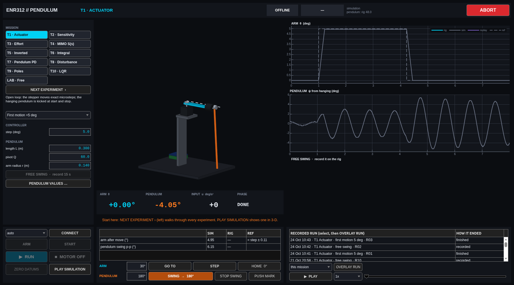

## 3. A tour of the screen

**Top bar.** It shows the mission, the link state (OFFLINE, EMULATOR or RIG), the
board's state (SAFE, ARMED, RUNNING) and the **ABORT** button. ABORT, the Esc key and
the space bar all stop everything at once.


<table><tr><td width="38%">

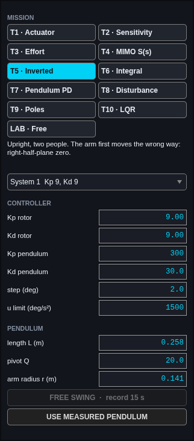

</td><td>

**Left panel: what you are simulating.**

- **MISSION:** the ten tutorials and LAB. The line under them says, in one sentence,
  what the mission is about.
- **Preset:** the designs from the tutorial. Choosing one fills in the gains.
- **CONTROLLER:** the gains of this mission's controller. Type a number and press
  Enter. The simulation reruns a quarter of a second after your last change, so you
  can type several in a row.
- **PENDULUM:** the physical pendulum. Length L, pivot quality factor Q and arm
  radius r set the model's ωg² and ωr² ([section 13](#13-what-each-physical-parameter-does)).
- **FREE SWING** and **USE MEASURED PENDULUM:** measure your own pendulum
  ([section 9](#9-your-pendulum-is-not-the-textbooks)).

</td></tr></table>

**Centre: the rig in 3-D**, with the four live numbers: arm angle θ, pendulum angle,
the controller's output u (an arm acceleration, in deg/s²) and the controller's phase.
Under it, one line tells you what the app is doing or what to do next.

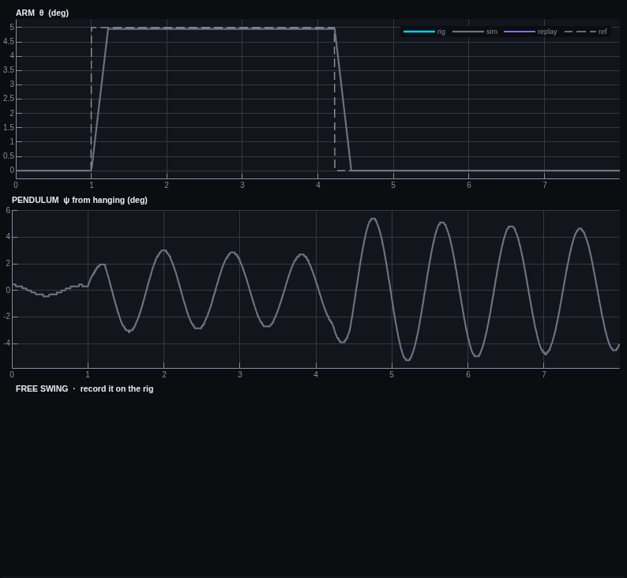

**Right: three plots.**

- **Top:** the arm θ (deg).
- **Middle:** the pendulum, either ψ from hanging or α from upright, depending on the
  mission.
- **Bottom:** one analysis plot chosen for the mission: sensitivity functions, a
  Nyquist plot, control effort, an impulse response, closed-loop poles or the input u.

Colours, everywhere:

- **grey:** simulation;
- **cyan and orange:** the live rig;
- **violet:** a recorded run you replay;
- **dashed:** the reference.

**Bottom row.**

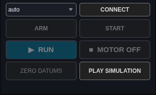

- **Bottom left: the rig controls.** Port, CONNECT, ARM, START, RUN, STOP, ZERO DATUMS,
  PLAY SIMULATION. Without a rig, only CONNECT and PLAY SIMULATION matter.

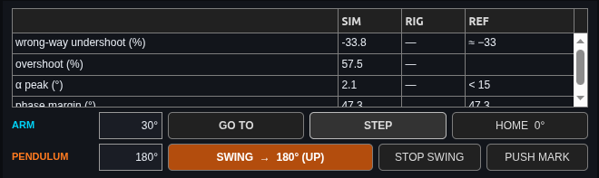

- **Bottom centre: the numbers and the live controls.** The table compares SIM (the
  simulation), RIG (the last rig run) and REF (the Tutorial's value, where there is
  one). Under it are the live controls for the arm and the pendulum, used while a run
  is going ([section 7](#7-lab-drive-it-yourself)).

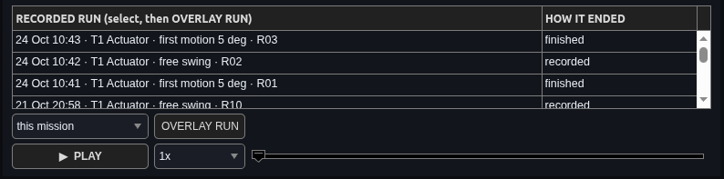

- **Bottom right: every recorded run.**
  - Rig runs are listed first; emulator runs are marked EMULATOR.
  - Select a run, press **OVERLAY RUN** to draw it over the simulation, and **PLAY** to
    watch it move the 3-D rig.
  - **NEXT ›** walks through all experiments in a sensible order.

## 4. Your first simulation: T1

Click **T1 · Actuator**. Choose the preset *Larger move +20 deg* and press **PLAY
SIMULATION**.

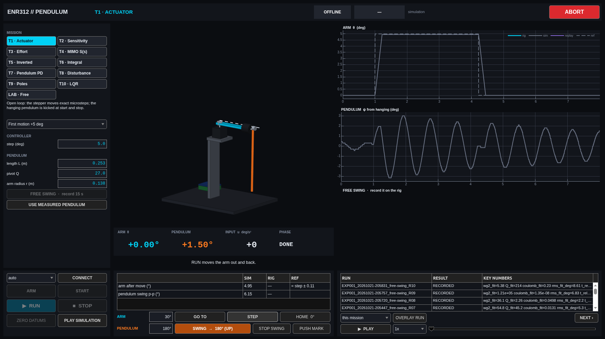

What happens:

- **The arm.** It moves out to 20° at a constant step rate and comes back. It is
  driven open loop, step by step: 20° is 178 microsteps of 0.1125°. The table checks
  that the arm ends within one microstep of the target.
- **The pendulum.** It swings a little when the arm starts and stops. The arm's
  acceleration pushes the pendulum's pivot sideways: that is the coupling ωr² in the
  model. Every controller later on uses exactly this effect, on purpose.

**Try:** all three presets and read *pendulum swing p-p*. The simulation gives:

| Move | Duration | Pendulum swing |
|---|---|---|
| 1° | 0.04 s | 1.8° |
| 5° | 0.22 s | 6.2° |
| 20° | 0.89 s | 2.1° |

The middle one swings most. Why? The arm starts and stops at a fixed step rate, so
each start and each stop is a sudden change of arm speed, and each kicks the pendulum,
in opposite directions. Two opposite kicks a time T apart leave a swing of
2A·|sin(ωg·T/2)|, where A is the swing one kick alone would cause. With the Tutorial
pendulum (period 0.83 s):
- **1°, 0.04 s:** the two kicks come almost together and nearly cancel.
- **5°, 0.22 s:** about a quarter period. The kicks add to 1.4 A; the most would be 2A,
  at half a period (0.42 s).
- **20°, 0.89 s:** about one period. The second kick undoes most of the first.

## 5. Reading the plots and the numbers

**The time axes** start where the run starts: 0 s is the moment of RUN or PLAY
SIMULATION.

**The staircase.** The pendulum trace moves in steps of 0.15° (one encoder count), the
arm in steps of 0.1125° (one microstep). Those are the rig's real resolutions, and the
simulation includes them on purpose. A controller that works only with infinite
resolution would not work on the rig.

**The metrics table** is computed by one function, `odyssix.sim.metrics`, for the
simulation and for the rig. The simulation is scored on every 10th sample, like the
rig's 50 Hz data, so the two columns are directly comparable. The definitions of every
metric (overshoot, settling, control effort, …) are in
[DESIGN.md §3](../DESIGN.md#3-metrics).

## 6. The missions, one by one

Each mission is one Tutorial. For each, here is the question, what to try, and what
you should see. Rig results for every mission are in
[`results/reports`](../../results/reports).

### T2 · Sensitivity: how does a loop reject a load?

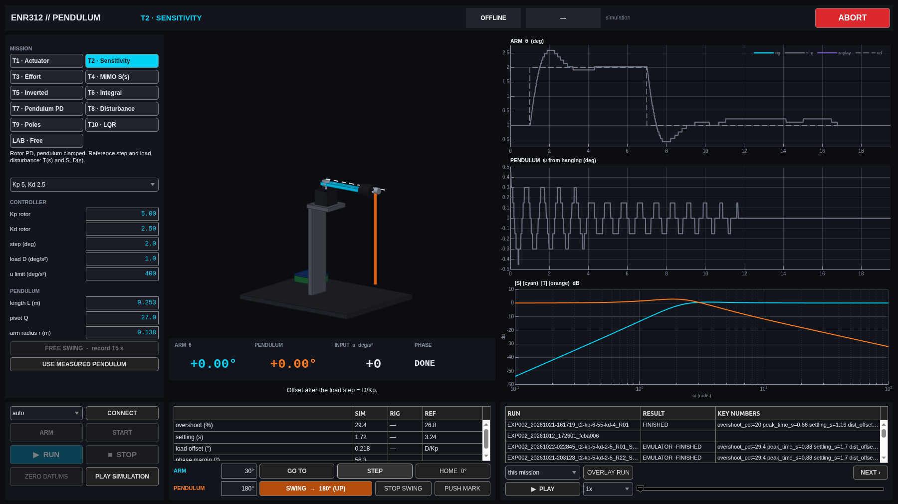

- **Setup:** the pendulum is clamped. The arm alone, under a PD controller, follows a
  2° step, and then a constant load acceleration D pushes on it.
- **Bottom plot:** the two sensitivity functions. |S| (cyan) says how much of a
  disturbance gets through, |T| (orange) how well the reference is followed. Where
  one is small, the other is near 1: S + T = 1.
- **Watch:** the offset under the load is D/Kp. Double Kp and the offset halves; the
  table's REF column says *D/Kp*.
- **Try:** all three presets. Low gains (*Kp 1, Kd 1*) are slow and let the load push
  the arm further.

### T3 · Effort: what does a fast response cost?

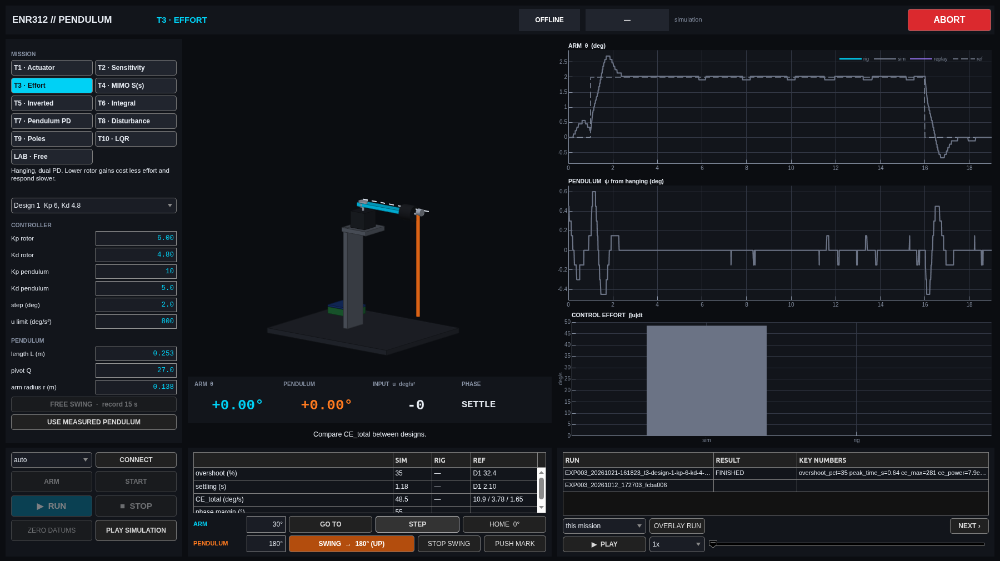

- **Setup:** the pendulum hangs, and two loops act on the arm, one on the arm angle,
  one on the pendulum.
- **Bottom plot:** the control effort ∫|u|dt, the total arm acceleration spent on the
  step.
- **Try:** Design 1, 2 and 3. Lower arm gains respond more slowly and spend much less
  effort (Tutorial: 10.9, 3.78 and 1.65 deg/s).

### T4 · MIMO S(s): how close to instability?

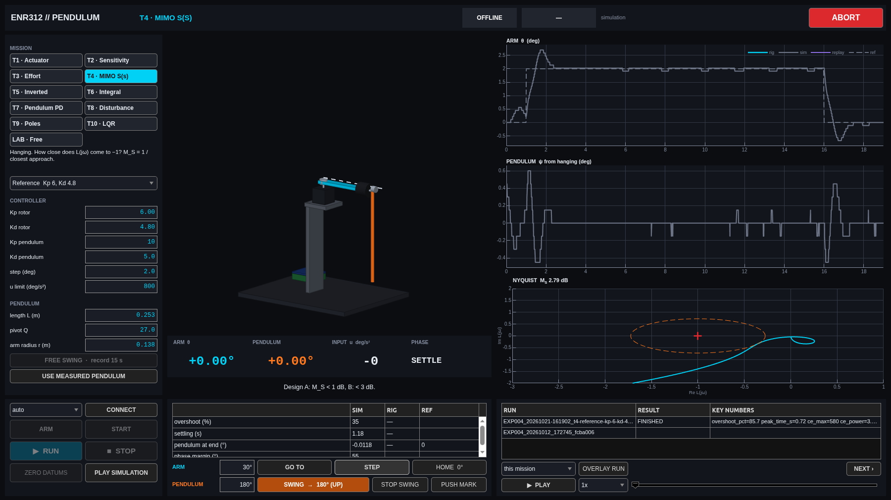

- **Bottom plot:** the Nyquist plot of the loop L(jω). The red cross is −1. The
  dashed circle shows the closest approach: M_S = 1/(that distance). The larger M_S,
  the closer the loop is to instability and the more it amplifies disturbances.
- **Try:** Designs A and B. The REF line says A should keep M_S under 1 dB and B
  under 3 dB.

### T5 · Inverted: balancing

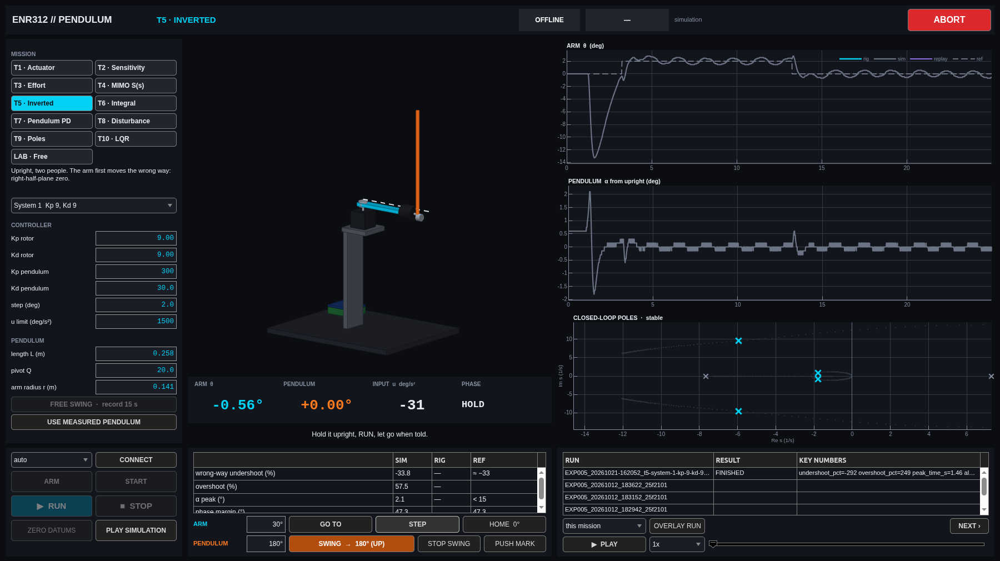

- **Setup:** the pendulum is upright, and the same two loops now balance it. On the
  rig one person holds the pendulum up, the controller takes over, and the
  person lets go.
- **Watch the arm plot:** for a 2° step the arm first moves the *wrong* way, about
  33 % of the step, before going the right way. To move the arm right while keeping
  the pendulum up, the controller must first tip the pendulum the right way, which
  means moving the arm the opposite way first. This is a right-half-plane zero, and
  no controller can remove it.
- **Bottom plot:** the closed-loop poles. All must sit left of the vertical line for
  the loop to be stable.

### T6 · Integral: removing the last offset

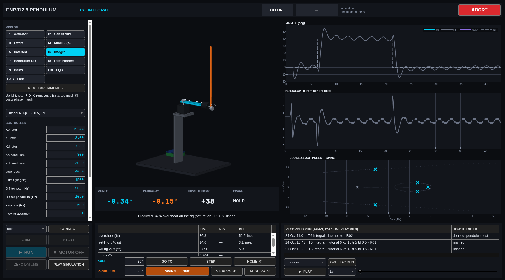

- **Setup:** an integral term added to the arm loop.
- **Try:** *No integral* against *Tutorial 6*. The integral removes the steady offset
  and costs phase margin (the table's last row).
- **Note:** the hint line says that on the rig the 40° step saturates the arm's
  1500 deg/s² limit. The linear model's 52.6 % overshoot then becomes about 34 %.
  Saturation changes the response, which the linear theory does not show.

### T7 · Pendulum PD: designing the inner loop

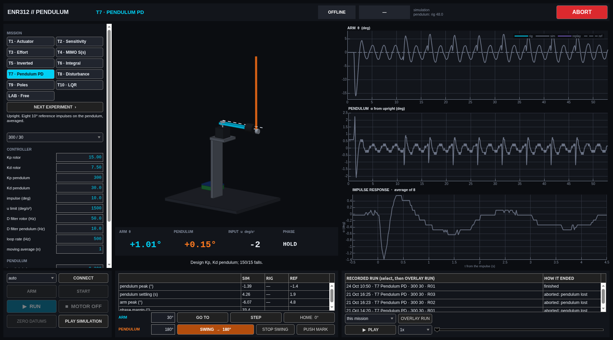

- **Setup:** eight 10° impulses on the pendulum's reference. The bottom plot shows
  their average (the median, sample by sample, so that one disturbed window cannot
  pull it).
- **Try:** *150 / 15 (falls)*. A pendulum loop that is stable on its own can still
  lose the pendulum in the full loop. On the rig, raising the pendulum Kd live to 146,
  at the edge the simulated gain sweep predicts (about 150), lost it.

### T8 · Disturbance: the integral at work

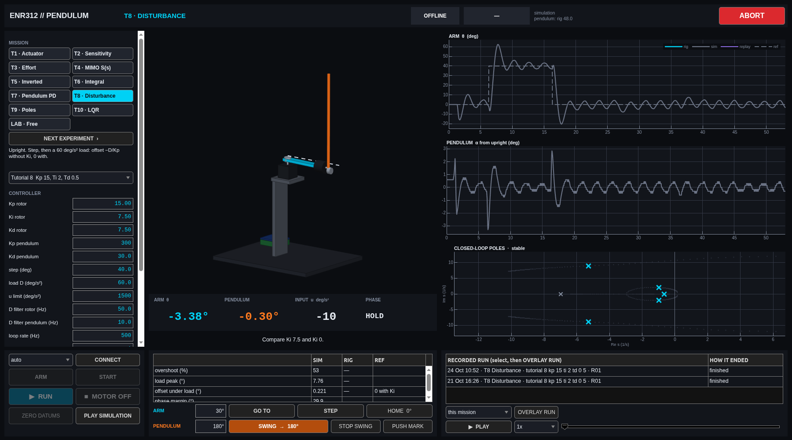

- **Setup:** after a 40° step, a constant 60 deg/s² load pushes the arm.
- **Watch:** without the integral term the arm sits at −D/Kp. With it, the offset goes
  to zero (table: *offset under load*).
- **Try:** *No integral* and *Load 90*.

### T9 · Poles: state feedback by hand

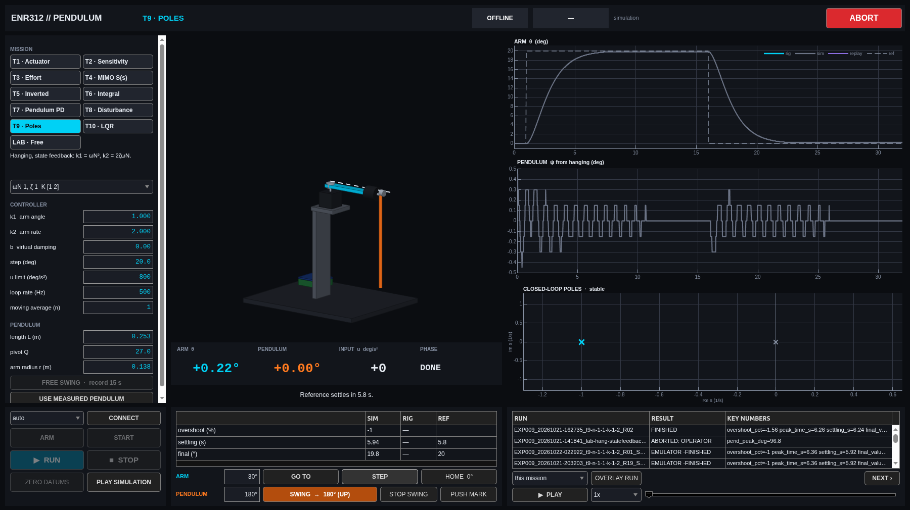

- **Setup:** the pendulum hangs, and the arm is controlled by state feedback,
  u = −k1(θ − r) − k2 θ̇. Choosing the closed-loop natural frequency ωN and damping ζ
  gives k1 = ωN² and k2 = 2ζωN.
- **Bottom plot:** the two closed-loop poles.
- **Try:** *ωN 2, ζ 0.2*: the poles move towards the imaginary axis and the arm
  overshoots.

### T10 · LQR: let the optimiser choose

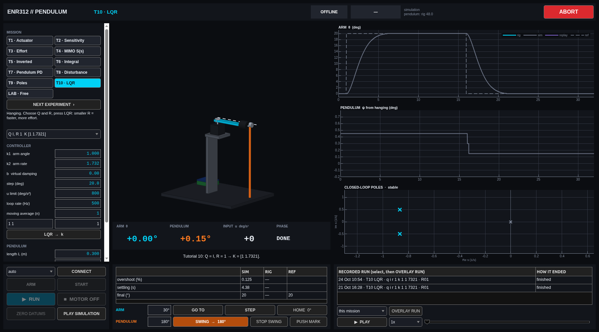

- **Setup:** instead of placing poles, you say how much you care about the error (Q)
  and about the effort (R). The LQR finds the best gains for that trade.
- **Use:** type Q (one weight per state) and R in the two fields, press **LQR → k**,
  and the gains appear above.
- **Try:** R 0.1. Faster, at the cost of more effort. Tutorial 10's Q = I, R = 1 gives
  K = [1 1.7321].

## 7. LAB: drive it yourself

LAB has no fixed sequence. Choose **HANGING** or **UPRIGHT** and a controller, press
RUN (on the rig) or PLAY SIMULATION, and drive.

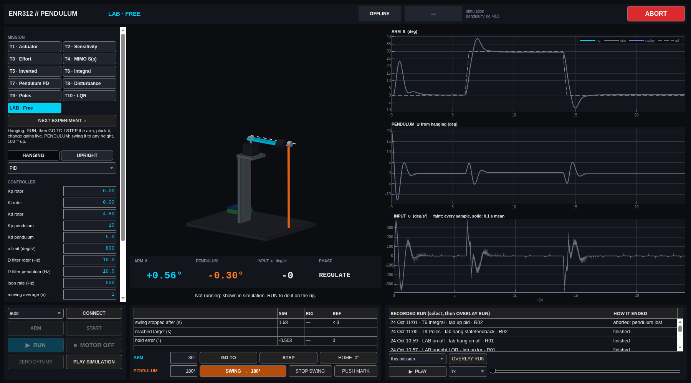

The live controls under the table:

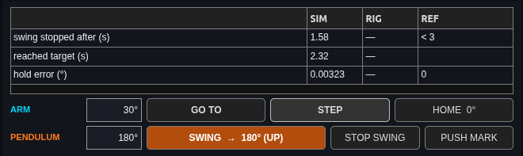

- **ARM [angle] GO TO** moves the arm smoothly to the angle. **STEP** jumps the
  set-point. **HOME 0°** brings it back. Hanging, these work at any time; upright,
  once the pendulum balances.
- **Gains** typed during a run act on the running controller at once. Each change is
  logged with its time.
- **PENDULUM [angle] SWING:** see [section 8](#8-energy-swing-up-and-pendulum-height).

In simulation, LAB plays a scripted operator. The pendulum starts plucked to 20°, the
controller stops the swing, the arm goes to your GO TO angle at 6 s and comes home 8 s
later. The table shows how fast the swing stopped and how well the angle was held.

Upright, **LQR** is the default: in a robust tuning study it had 27 % less pendulum
error than the best dual PID.

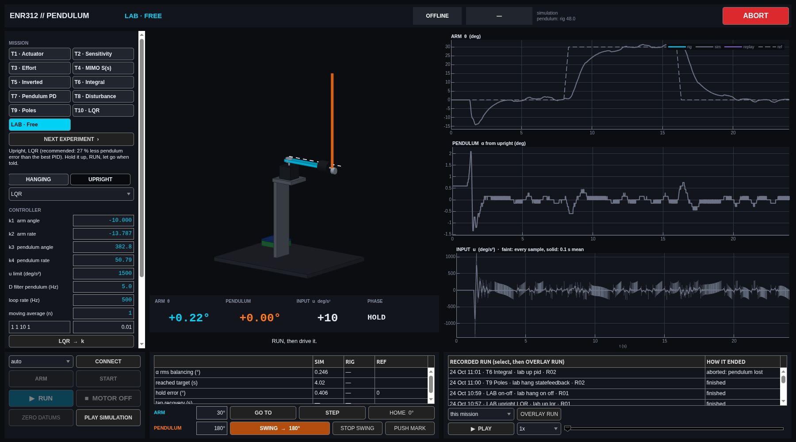

## 8. Energy: swing-up and pendulum height

A linear controller cannot bring a hanging pendulum upright:

- **The sign problem.** The arm changes the pendulum's energy in proportion to
  ψ̇ cos ψ, and cos ψ changes sign as the pendulum passes the horizontal. A fixed
  linear law pushes the wrong way for half of every swing.
- **The swing-up's answer.** The swing-up controller works with the pendulum's
  energy, E = ψ̇²/(2ωg²) + 1 − cos ψ: 0 hanging still, 2 upright still. It pumps until
  E reaches 2, and when the pendulum comes slowly enough near the top, the LQR catches
  it.

In LAB → HANGING → **Energy (swing / swing-up)**, set PENDULUM to **180** and press
**SWING**:

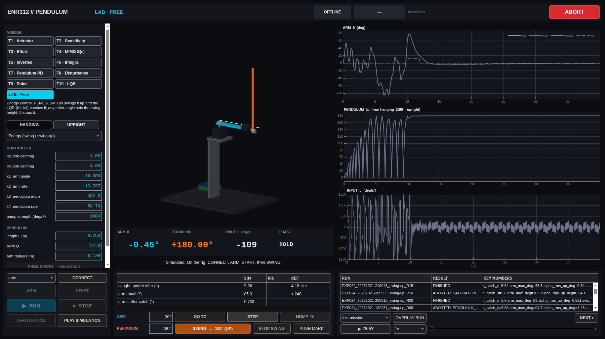

Any other angle is a *swing height*: the controller swings the pendulum to exactly ±a
and keeps it there. **0** stops a swing.

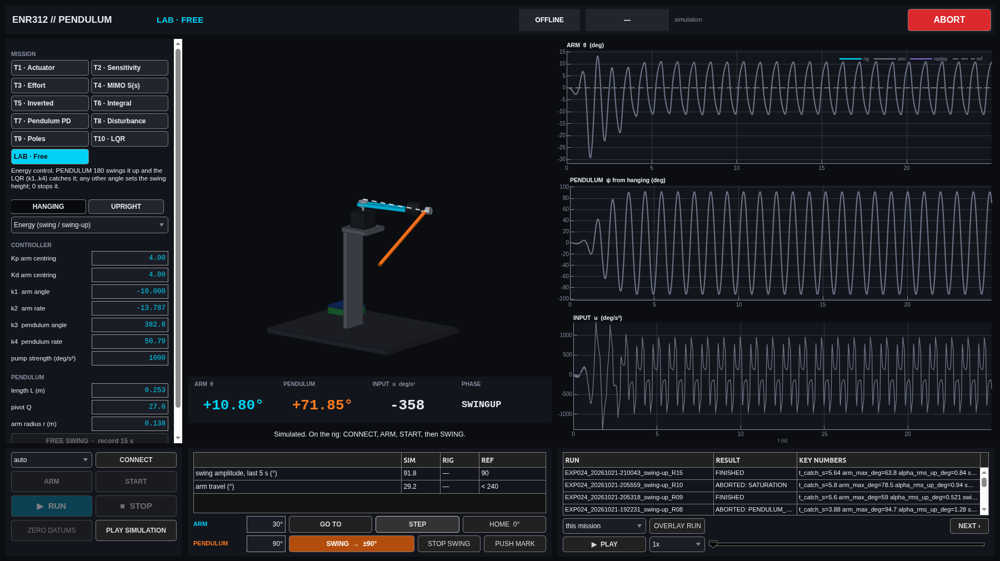

**Why not "stand still at 90°"?** A pendulum held still at angle ψ needs a constant arm
acceleration of (ωg²/ωr²)·tan ψ: forever, and infinite at 90°. Only 0° and 180° are
places where the pendulum can rest. That is physics, not a limitation of the
controller.

The energy uses ωg², so a wrong ωg² makes the pump overshoot. On our rig, with the
Tutorial's value, the swing-up caught one try in three; with the measured value it
caught four in four ([report](../../results/reports/2026-10-21b_rig_session.md)).

## 9. Your pendulum is not the textbook's

The Tutorials' pendulum constants came from their rig. Yours is different.

**Measure it:**

1. T1, motor off. Press **FREE SWING · record 15 s**.
2. Lift the pendulum 10–20° and let go. Don't touch it for the rest of the recording.
3. The bottom plot shows the swing and the fitted model: ωg² and the pivot's dry
   friction.
4. Press **USE MEASURED PENDULUM**. From then on every simulation, in every mission,
   uses your pendulum.

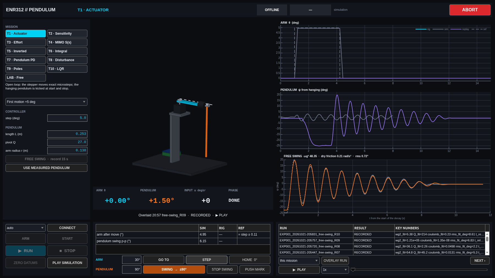

The fit finds the moment you let go by itself, even if you held the pendulum at the top
for a second first. On our rig six free swings gave ωg² = 48.0 ± 0.5, against the
Tutorial's 57.01.

Without a fresh free swing, USE MEASURED PENDULUM applies the values measured on
the rig this repository was built on (`odyssix.rigParams`).

## 10. From simulation to emulator to rig

There are three levels, and the same buttons work for all three:

| | What runs the control code | What plays the pendulum | Safe to experiment |
|---|---|---|---|
| **Simulation** | MATLAB twin of the firmware | MATLAB nonlinear model | yes |
| **Emulator** | the firmware's own C files, compiled for your PC | C nonlinear model | yes |
| **Rig** | the firmware on the board | the real pendulum | carefully |

**CONNECT** without a board offers the emulator: you then practise ARM, START, RUN,
live gains and recording exactly as on the rig. The emulator needs `gcc` and `make`.

**On the rig:**

1. Read [`docs/REPLICATE.md`](../REPLICATE.md) first.
2. **ARM** energises the motor; it holds and does not move.
3. **START** permits motion.
4. Nothing moves until **RUN** or **SWING**.

The firmware stops by itself if:

- the arm passes 240°;
- the pendulum leaves its safe range;
- the controller stays saturated;
- MATLAB goes silent for 1 s.

ABORT, Esc and space always work, and pulling the 12 V plug always works.

## 11. Recording, replay and PUSH MARK

Every rig run is saved automatically, aborted ones included:

- the 50 Hz data as a read-only CSV;
- the gains;
- the firmware version;
- every live action with its time;
- the metrics and the result.

Emulator runs are saved separately and never mix with real data.

To look at a run again, select it in RUNS, press **OVERLAY RUN**, then **PLAY**. The
3-D rig replays it; pause, drag the time bar, or choose 0.5×–4×.

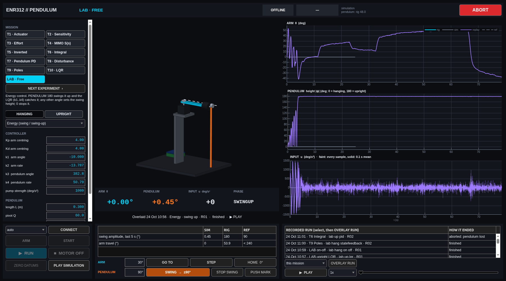

**PUSH MARK** is for disturbance tests:

1. Push the pendulum on purpose.
2. Press PUSH MARK within about a second.

The push is logged in the run, and the firmware sends the last 1.5 s and the next 0.5 s
at the full 500 Hz. That record is saved next to the run. When you overlay the run
later, its 500 Hz records appear as dots on the pendulum plot, in their place in the
run, and the status line says how many there are. In MATLAB:
`K = odyssix.data.loadRecords('<run id>')`.

## 12. Working with the data in MATLAB

```matlab
odyssix.data.listRuns()                                     % every run, as a table
[D, M] = odyssix.data.loadRun('EXP024_20261021-210043_swing-up_R15');
plot(D.t, D.psi), xlabel('t (s)'), ylabel('\psi (deg)')
M.config.wg2, M.firmware, M.events                          % what the run used and did
m = odyssix.sim.metrics(D, M.config)                        % the same metrics as the app
```

Columns: `t` (s), `rotor` (deg), `psi` (deg from hanging), `alpha` (deg from upright),
`u` (deg/s²), `ref` (deg), `phase`. The full description is in
[`data/README.md`](../../data/README.md).

To simulate without the app:

```matlab
c = odyssix.sim.defaults(24);      % experiment 24: energy swing-up
p = odyssix.sim.plant(5);          % Tutorial pendulum ...
p.wg2 = 48; p.coulomb = 0.37;      % ... or your measured one
S = odyssix.sim.runCtrl(c, p);
plot(S.t, abs(mod(S.psi + 180, 360) - 180))
```

## 13. What each physical parameter does

| Field | Model constant | Effect |
|---|---|---|
| length L | ωg² = g / (0.6805 L) | how fast the pendulum swings: period 2π/√ωg². Shorter = faster, harder to balance (the unstable pole √ωg² grows) |
| pivot Q | γ = √ωg² / Q | how long a free swing lasts. Q 27 rings for about 20 s; our real pivot behaves more like dry friction (section 9) |
| arm radius r | ωr² = ωg² · r / g | how strongly the arm's acceleration moves the pendulum |

The factor 0.6805 is the Tutorial's rod shape. With a free-swing measurement you don't
need it: ωg² is measured directly, and ωr² follows from the arm length.

## 14. Simulink

The app needs only MATLAB. If you have Simulink, the same pendulum and the same two
balancing controllers are also a Simulink model, checked against the firmware's
code. It answers the five PEND questions of Assignment 3 (equations, open loop,
balancing, a tap, the largest angle) with figures:

```matlab
P = enr312_simulink_params();       % measured pendulum, LQR
open_system('enr312_pendulum')      % press Run
```

Everything about it: [Simulink model](../SIMULINK.md).

## 15. Questions and problems

**The simulation and the rig disagree.** In this order:

1. Did you measure the pendulum (section 9)?
2. Is the base level and the pendulum zeroed while hanging still?
3. Read the rig reports. Every known disagreement on our rig is listed with its cause
   or as open.

**The board is not found.** Unplug the USB, wait 5 s, plug it back in. Close other
programs on the serial port. Details:
[TROUBLESHOOTING.md](../TROUBLESHOOTING.md).

**A run stops by itself.** The status line and the RESULT column give the reason, for
example PENDULUM_LOST or SATURATION. [ARCHITECTURE.md](../ARCHITECTURE.md#safety-state-machine)
lists every stop rule.

**The pendulum reads 360° or 720°.** It was turned by hand since the datums were zeroed.
Let it hang still and press ZERO DATUMS.

## 16. Symbols

| Symbol | Meaning | Unit |
|---|---|---|
| θ | arm angle | deg |
| ψ | pendulum angle from hanging | deg |
| α | pendulum angle from upright, 180° − ψ | deg |
| u | arm acceleration commanded by the controller | deg/s² |
| ωg² | pendulum gravity constant | rad²/s² |
| ωr² | arm-to-pendulum coupling | – (rad/s² of pendulum per rad/s² of arm) |
| Q | pivot quality factor (viscous loss) | — |
| E | normalised pendulum energy | — |
| Kp, Ki, Kd | arm-loop gains | — |
| Kpp, Kdp | pendulum-loop gains | — |
| k1 … k4 | state-feedback gains on θ, θ̇, α, α̇ | — |
| S, T | sensitivity and complementary sensitivity | — |
| M_S | peak of \|S\| | dB |

More: the physics in [first_principles](../first_principles/ROTARY_PENDULUM_DYNAMICS.md),
the decisions behind the design in [DESIGN.md](../DESIGN.md), and the results in
[results/reports](../../results/reports).
