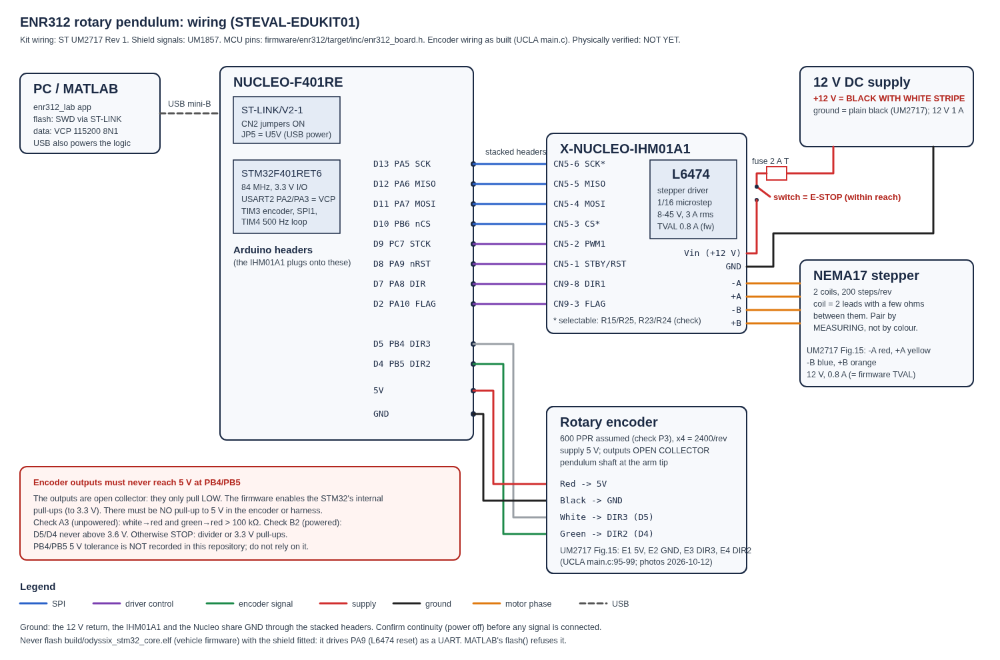
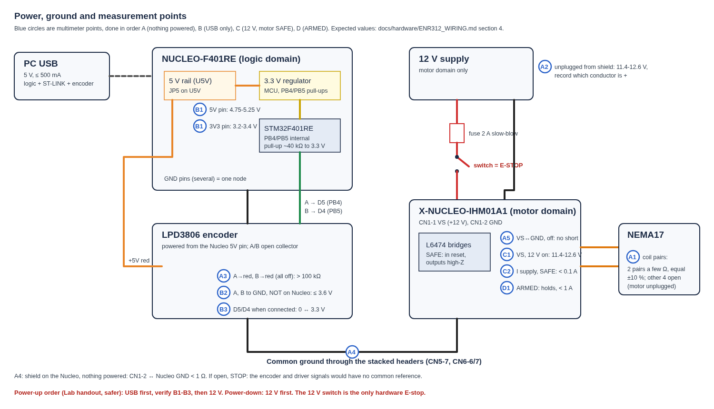

# ENR312 pendulum: wiring and electrical check

Hardware: STEVAL-EDUKIT01, i.e. NUCLEO-F401RE + X-NUCLEO-IHM01A1 (L6474) + NEMA17
stepper + LPD3806-600BM-G5-24C encoder + 12 V supply.
Firmware: `firmware/enr312/` (flashed from MATLAB with `enr312_rig`, see `matlab/README.md`).

> **Status: used on the rig, 2026-10-12** (two NUCLEO-F401RE boards): flashing, SPI
> to the L6474 (`status=0xFC03`), encoder, motion and all five tutorials worked with
> this wiring. Sources, in order of authority: **ST UM2717 Rev 1** (*Getting started
> with the STEVAL-EDUKIT01*, the kit's own manual), ST UM1857 (the shield), the
> firmware pin header (`firmware/enr312/target/inc/enr312_board.h`), the UCLA
> reference. Run the check in §4 on every new rig and record the readings in
> `docs/hardware/PRE_POWER_CHECKLIST.md`.

## 1. Pin plan

The IHM01A1 **plugs onto the Nucleo's Arduino headers**; none of these are loose wires.

| Signal | Nucleo Arduino pin | STM32 pin | IHM01A1 (UM1857) | Dir | Firmware use |
|---|---|---|---|---|---|
| SPI SCK | D13 | PA5 | CN5-6 \* | out | SPI1, L6474 registers (also LED LD2: flickers, normal) |
| SPI MISO | D12 | PA6 | CN5-5 | in | SPI1 |
| SPI MOSI | D11 | PA7 | CN5-4 | out | SPI1 |
| SPI CS | D10 | PB6 | CN5-3 \* | out | L6474 chip select |
| Step clock | D9 | PC7 | CN5-2 (PWM1) | out | one pulse per microstep, TIM2-paced GPIO |
| Driver reset | D8 | PA9 | CN5-1 (STBY/RESET) | out | held LOW in SAFE: bridges off |
| Direction | D7 | PA8 | CN9-8 (DIR1) | out | rotation sense |
| Driver fault | D2 | PA10 | CN9-3 (FLAG) | in | active low: overcurrent / thermal / undervoltage, abort within 2 ms |
| Telemetry | (USB) | PA2/PA3 | — | ↔ | USART2 → ST-LINK VCP, 115200 8N1 |

\* resistor-selectable on the shield: R15/R25 (CS), R23/R24 (SCK). The firmware
assumes the factory default (**R25** and R23 fitted, R15 and R24 empty; UM1857 Tables 3/4). Firmware key `P` tests all four routings without energising. Check them (checklist R1/R2).

Arduino↔STM32 names follow the standard Nucleo-64 map. UM1724 was not retrieved,
so this is INFERRED, but it is consistent with every UM1857 row and the UCLA code.

### Encoder: jumper wires to the shield's header (UM2717 Figure 15 E1–E4; UCLA `main.c:95-99`)

| Encoder wire | Shield header pin (silkscreen) | Nucleo pin | STM32 | Note |
|---|---|---|---|---|
| **Red** | **5V** (power header) | 5V | — | encoder supply |
| **Black** | **GND** (power header) | GND | — | |
| **White** | **DIR3** | D5 | PB4 (TIM3_CH1) | internal pull-up to 3.3 V |
| **Green** | **DIR2** | D4 | PB5 (TIM3_CH2) | internal pull-up to 3.3 V |

Correction 2026-10-12: an earlier version of this page treated E1–E4 as board
terminals. In UM2717 Figure 15 they label header pins: E1 = 5V, E2 = GND,
E3 = DIR3, E4 = DIR2, exactly as wired here and in the UCLA reference. The shield
header row reads RX, TX, FLAG, PWM2, DIR2, DIR3, PWM3, DIR1, RST, PWM1, CS, MOSI,
MISO, SCK, GND (= Arduino D0…D13, GND). A white/green swap only reverses the
sign: never "fix" it by rewiring, set `ENR312_ENCODER_POLARITY` (EXP001 P2b).

### Motor and supply

| From | To (UM2717 terminal) | Note |
|---|---|---|
| Supply **black with white stripe = +12 V** | fuse (≤ 2 A slow-blow) → switch → **PS+** (CN1 VS) | ⚠ **the striped black wire is POSITIVE.** Plain black is ground. |
| Supply **plain black = ground** | **PS−** (CN1 GND) | kit supply: 12 V, 1 A |
Terminal block, left to right as in **UM2717 Figure 15** (the authority for this kit):

| Terminal (silkscreen) | UM2717 label | Wire |
|---|---|---|
| 1 (−A) | M1A | **red** |
| 2 (+A) | M1B | **yellow** |
| 3 (−B) | M2A | **blue** |
| 4 (+B) | M2B | **orange** |
| 5 (GND) | PS− | **plain black** |
| 6 (Vin) | PS+ | **black with white stripe** (dashed in the figure) |

(UM2717's text lists M1B blue / M2A yellow; its Figure 15 draws yellow on M1B and
blue on M2A. The rig is wired as the figure. Check A1 confirms the coil pairs
electrically: a few Ω across terminals 1–2 and across 3–4.)

The motor is rated 12 V, 0.8 A (UM2717 BOM), matching the firmware's L6474
current setting (TVAL 0.8 A). The kit's colours (UM2717) are authoritative for
this rig and settle the old conflict with the UCLA reference (Blue/Red/Green/Black,
which is a different motor). Check A1 still confirms the pairs: a swap *within*
a pair reverses the rotation; a swap *between* pairs makes the motor buzz.

**Shield orientation (UM2717):** the shield's green connector faces *away* from
the Nucleo's ST-LINK/USB end.

## 2. Power and ground

* Logic domain: USB 5 V → Nucleo (JP5 on U5V) → 3.3 V regulator → MCU. The
  encoder takes 5 V from the Nucleo 5V pin.
* Motor domain: 12 V → IHM01A1 CN1 → L6474 bridges → motor. The shield accepts
  8–45 V and 3 A rms (UM1857). The firmware sets TVAL 0.8 A.
* **One common ground** joins the 12 V return, the shield and the Nucleo through
  the stacked headers (CN5-7, CN6-6/7). Check A4 confirms it.
* **Order:** the sources conflict (C-2). The course handout says USB first; ST's
  UM2717 says 12 V first, *for ST's own firmware*, which loads the driver settings
  at boot. **The ENR312 firmware configures the driver only when you press ARM**, so
  for it either order is safe. 12 V must be on before ARM, or ARM fails harmlessly.
  Power down: 12 V first.

## 3. Why the encoder is the dangerous part

The LPD3806 outputs are **open collector**: they can only pull a line low. The
high level comes from whatever pull-up exists. The firmware enables the STM32's
internal pull-ups to 3.3 V, which is safe. An **external pull-up to +5 V** in the
harness would put 5 V on PB4/PB5. Whether those pins are 5 V-tolerant is **not
recorded in this repository**, so checks A3 and B2 must show there is no such
pull-up before the encoder touches the Nucleo.

## 4. Electrical check: do it in this order

Multimeter only until stage C. **Stop at the first failure.** Every stage is
reversible, and nothing in stage A or B can make the motor move.

### A. Nothing powered, nothing plugged in

| # | Measure | Pass | If it fails |
|---|---|---|---|
| A1 | Motor unplugged: resistance between all 6 pairs of the 4 leads | exactly 2 pairs read a few Ω (equal within ±10 %); the other 4 are open | record the actual pairs; wire by pairs |
| A2 | 12 V supply plugged into mains, **not** into the shield: output voltage and polarity | 11.4–12.6 V; record which conductor is + | do not connect; replace or relabel |
| A3 | Nothing powered, encoder unplugged from the header: resistance white→red and green→red | > 100 kΩ (no pull-up inside the encoder) | **STOP**: a pull-up would put 5 V on PB4/PB5. Add a 3.3 V divider. |
| A4 | Shield on the Nucleo: CN1-2 to a Nucleo GND pin | < 1 Ω | **STOP**: no common ground |
| A5 | CN1-1 to CN1-2 | not a short (it may climb as the capacitors charge) | **STOP**: shield damaged |

### B. USB only (12 V off)

| # | Measure | Pass | If it fails |
|---|---|---|---|
| B1 | Nucleo 5V pin and 3V3 pin to GND | 4.75–5.25 V and 3.2–3.4 V | check the USB cable and JP5 |
| B1b | MATLAB `enr312_lab` → *Detect board* → *Flash firmware* (USB only; the firmware boots SAFE) | *Flashed and verified (0x433)* | read the message: no ST-LINK, wrong MCU, or vehicle image refused |
| B2 | Shield on the Nucleo, USB only, ENR312 firmware running (SAFE): Arduino D5 and D4 to GND while turning the pendulum slowly | toggles ≈ 0 ↔ 3.3 V, **never above 3.6 V** | **unplug USB now**: a pull-up to 5 V exists that A3 missed |
| B3 | MATLAB `enr312_lab` → *Connect*, rotate the pendulum one full turn by hand | the app shows a smooth pendulum angle; **one turn = 360° ±0.3°** | no change: E3/E4 wiring; 90° or 180° per turn: decode setting; ≠ 360° otherwise: encoder is not 600 PPR (check P3) |

### C. 12 V on, motor still SAFE

| # | Measure | Pass | If it fails |
|---|---|---|---|
| C1 | CN1-1 to CN1-2 | 11.4–12.6 V; shield power LED on | switch off; recheck polarity (A2) |
| C2 | Supply current (bench supply) | < 0.1 A; motor shaft turns freely by hand | switch off: the bridges should be off in SAFE |

### D. ARMED (the first time the motor is energised)

Read `docs/experiments/EXP001/FIRST_FLASH.md` first. In the app: *ARM* (confirm the dialog).

| # | Check | Pass | If it fails |
|---|---|---|---|
| D1 | Shaft resists turning; supply current | holds; < 1 A; motor only warm after 1 min | **ABORT** (Esc); `ARM FAILED` means SPI: check R1/R2 |
| D2 | *START*, then *+5°* | the arm moves ≈ 5° and stops (≈ 10° means conflict C-1: the manual's 17.778 steps/° is right); the hanging pendulum swings ≈ ±3° | buzz without turning: pairs crossed (A1); wrong direction: `ENR312_ROTOR_POLARITY` |

## 5. Symptoms and what they mean

| Symptom | Most likely cause |
|---|---|
| App: *No target answered over SWD* | USB cable is charge-only, or the CN2 jumpers are off |
| Flash refused: *lacks the ENR312 banner* | you selected the vehicle firmware, which is refused by design |
| Connected, but no data | wrong port (pick the ST-LINK VCP), or the board is still resetting |
| Pendulum angle stuck at 0 | encoder unpowered, A/B not on D5/D4, or pull-ups missing |
| Angle jumps or drifts with no motion | loose ground, or the encoder cable runs alongside the motor leads |
| FAULT 0x01 (L6474 FLAG) | overcurrent, thermal or undervoltage: check the 12 V supply and motor wiring |
| FAULT 0x10 (pendulum limit) | the pendulum passed ±120° (normal when turning it by hand): *Clear fault* |
| Motor buzzes, does not turn | coil pairs crossed between terminals (A1) |

## 6. Open items and how each was settled

| Item | Status |
|---|---|
| Shield CS/SCK resistor population | default confirmed: the `P` routing scan finds the L6474 on CS = D10, SCK = D13 |
| Motor lead colours | confirmed by motion: the arm turns in the commanded direction |
| Rotor scale 8.889 vs 17.778 microsteps/° (C-1) | **8.889**: +5° command measured as 5° with a protractor |
| Encoder and rotor sign conventions | encoder −1, rotor +1 (EXP001; [`TROUBLESHOOTING.md`](../TROUBLESHOOTING.md#signs-scales-and-datums)) |
| PB4/PB5 5 V tolerance | not needed if checks A3/B2 pass (operator-attested before first power-up; readings not recorded); the firmware uses the internal 3.3 V pull-ups |
| Pendulum ωg², Q on *this* rig | **open**: free-swing identification (Tutorial 1 → *Free swing*) not yet run |
