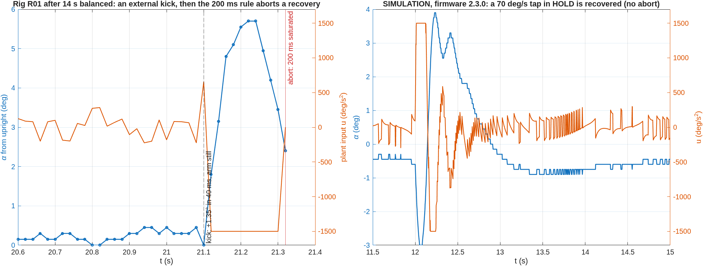
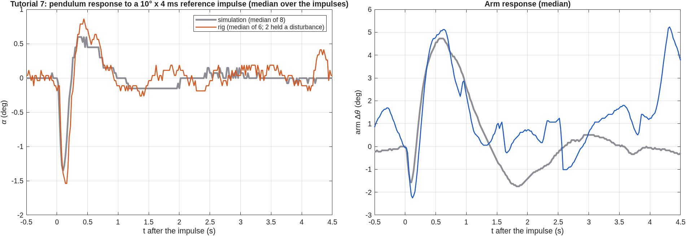
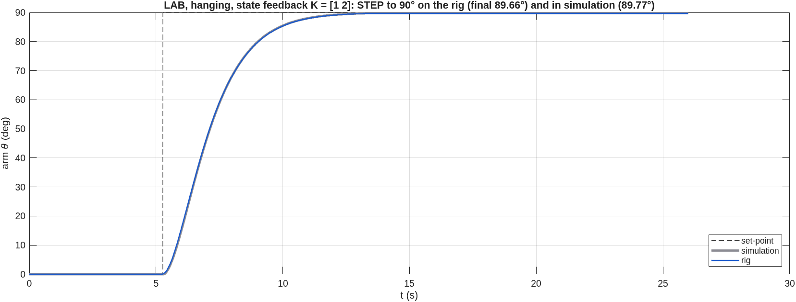
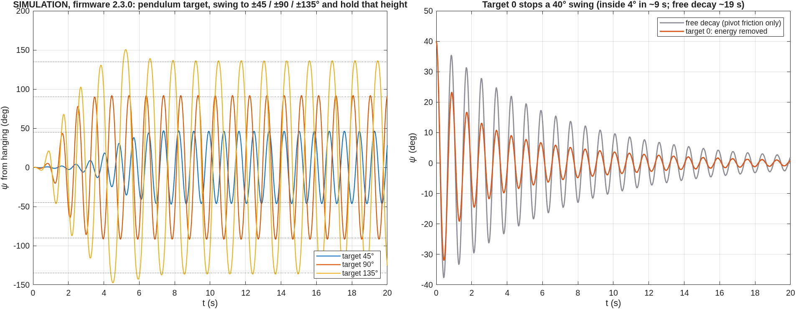

# Rig session 2026-10-21: swing-up, Tutorial 7, lab mode

Board 1 (ST-LINK …124223), firmware **2.2.0** (protocol 4). All runs were recorded
automatically by `enr312_lab`: raw data `data/raw/EXP0nn/*20261021*.csv` (read-only),
metadata `data/metadata/EXP0nn/*.yaml|json`, index `data/metadata/run_index.csv`, serial
transcript `results/evidence/rig_sessions/rig_20261021-194128.log.gz`. Figures:
`matlab/plotting/plot_session_20261021.m`, from the raw files and the simulation of the
same configuration. The simulation uses the Tutorial pendulum values (no free swing was
recorded in this session).

## Runs

| Run | What | Result |
|---|---|---|
| EXP024 R01 | swing-up | caught at 7.22 s, balanced 14 s (α rms 0.32°), then an external kick; aborted on SATURATION during the recovery |
| EXP024 R02 | swing-up | caught at 7.12 s while the pendulum still moved at 75 deg/s and the arm at −68 deg/s; fell (PENDULUM_LOST) |
| EXP024 R03 | swing-up | caught at 8.04 s, balanced 34.5 s (α rms 0.6°), then a disturbance; PENDULUM_LOST |
| EXP007 R01 | Tutorial 7, 300/30 | 6 of 8 impulses; two windows held an external disturbance; then PENDULUM_LOST |
| EXP009 R01 | LAB hanging, state feedback K = [1 2] | STEP to 90°: final 89.66° (simulation 89.77°); the pendulum was later swung by hand (no pendulum feedback in this mode) |

## What the data shows

### 1. The swing-up works on hardware, and the model predicts it

Caught upright in **3 of 3** attempts at 7.1–8.0 s. The rig's swing builds up almost
swing for swing like the simulation of the same gains with the Tutorial pendulum
values. The energy model with the learnt climb loss (δ) describes the real pendulum.

> **Note added 2026-10-22.** That simulation used the Tutorial pendulum constant
> ωg² = 57.01 for both the firmware and the simulated pendulum. Identification from the
> same day's data puts the real value at 47.6–49.5. The resemblance of the build-up was
> real, but it does not validate ωg². The consequences are in the
> [evening report](2026-10-21b_rig_session.md), section 1.

### 2. The arm sits off its set-point because "upright" is off by 0.6°

While balancing, the mean α was **+0.63°**, not 0, and the arm settled at **+23.3°**
instead of 0. In steady state the LQR requires k1(θ − r) + k3·α = 0, so
θ − r = −k3/k1 · α = 38.3 × 0.63° = **+24.0°**, against **+23.3°** measured.
The encoder's upright (hanging datum + 180°) is off the true balance point by
about 0.6°: either the datum was taken with the pendulum resting off vertical (pivot
friction, as seen in Tutorial 3 on 2026-10-12) or the rod's centre of mass is off its
axis. The same mechanism explains the arm drift of the Tutorial 5 runs on 2026-10-12.

### 3. Losses after a quiet balance are external kicks

R01 balanced with α inside 0.15–0.45° (one or two encoder counts) and the arm still.
Then α rose by 1.35° in 40 ms while the arm stayed put. Gravity at that angle
accelerates the pendulum by about 26 deg/s². This needs more than 800 deg/s², so it
was an external input: a touch, the cable, the table, or a missed step. A missed step
is possible because the arm angle is the count of *commanded* steps, so a slipping
motor jerks the arm without it showing in the data. The controller answered at full
input and α was already coming back (5.7° → 2.4°) when the 200 ms saturation rule
aborted the run. The same signature ended R03 and appears twice in the Tutorial 7
run. **Cause not identified.** Next session: tape a mark on the arm to check for lost
steps, keep cables free, film the rig.

### 4. R02 caught too fast
The catch rule allowed 100 deg/s. R02 caught at 75 deg/s with the arm moving, and the
set-point started walking the arm home at the same instant. The input saturated and the
pendulum fell.

### 5. Tutorial 7 and the lab step match the simulation

The median over the impulse windows gives a pendulum dip of −1.55° on the rig
against −1.35° in simulation, an overshoot of 0.85° against 0.60°, and an arm peak of
5.1° against 4.7°. A plain mean was dominated by the two disturbed windows, so the
analysis now uses the median. In the lab the state-feedback step to 90° is
indistinguishable from the simulation.

## Changes made because of this data (firmware 2.3.0)

| Finding | Change | Evidence (simulation / host tests, not yet the rig) |
|---|---|---|
| arm 23° off by a 0.6° upright offset | **auto-trim** in HOLD: learn the mean α (τ 8 s) and control on the rest | 0.6° offset: arm −0.03° (host), C −0.16° / MATLAB −0.14° (parity) |
| R01 aborted while recovering | upright HOLD saturation abort 500 ms (sequences keep 200 ms) | 70 deg/s tap recovered (figure 3, right) |
| R02 caught at 75 deg/s | catch only ≤ 60 deg/s; hold where caught 2 s, then walk home | 9 pendulum variants caught and balanced |
| "make the pendulum go to 90°" | **pendulum target** (`$amp`): 0 stops a swing, 0 < a < 180 swings to ±a, 180 swings up and balances | 45/90/135° → 46.2/91.8/136.3°; 40° swing stopped in 9 s (free decay 19 s) |

A pendulum can **rest** only hanging (0°) or upright (180°). Holding it still at ψ needs
a constant arm acceleration θ̈ = (ωg²/ωr²)·tan ψ, which the arm cannot sustain within its
travel, and which becomes infinite at 90°. So the pendulum target controls the swing
*height* (energy E* = 1 − cos a) instead: the pendulum swings to exactly ±a and keeps
that height.

## Controller tuning study (simulation)
`matlab/experiments/PEND/optimize_upright.m`, `results/tables/PEND_sim_optimize_upright.csv`.
The study is a robust fminsearch over the upright dual PID, on three plants with a 0.5°
datum offset, a go-to and a tap. It improves on the Tutorial 6 gains by only **3 %**: they
are already close to the model optimum. Changing the structure to the 4-state **LQR** is
**12 %** better and has **27 %** less pendulum error (α rms 0.67° vs 0.91°). The default
gains are unchanged. In the app the LQR is the recommended upright controller.

## Open
- Cause of the kicks (external contact, cable or lost steps): to be checked as above.
- No free-swing measurement yet: the simulation still uses the Tutorial ωg² and Q.
- Firmware 2.3.0 has not run on the rig yet.
