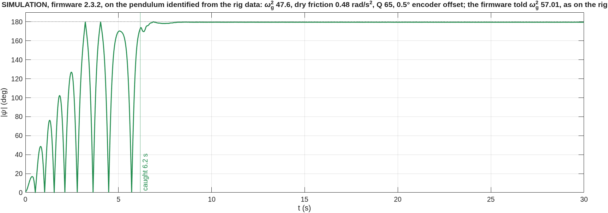
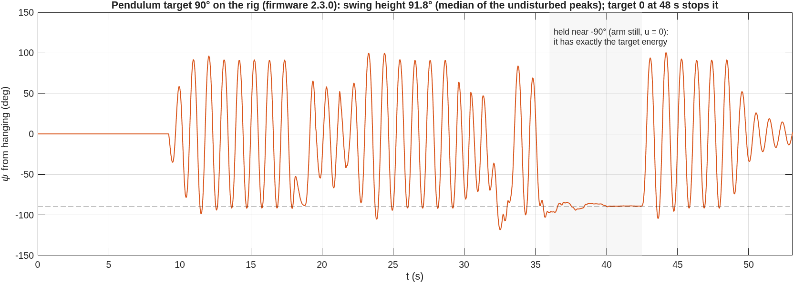
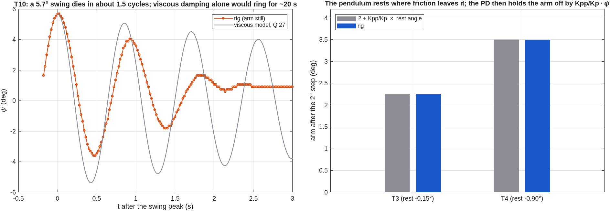
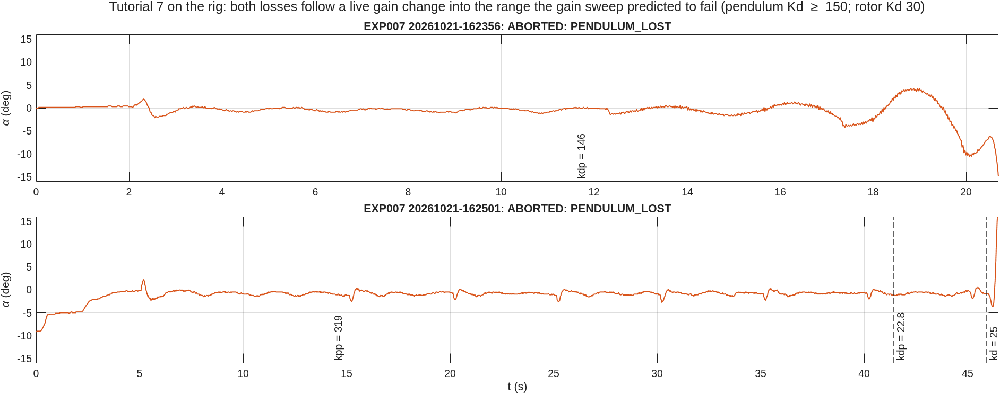

# Rig session 2026-10-21, evening: all ten tutorials, a pendulum target, and a swing-up that would not catch

Board 1, firmware **2.3.0** (protocol 5), 16:14–16:33 UTC. Sixteen runs, all saved by
the app as they happened:

- raw data: `data/raw/EXP0nn/*20261021-16*.csv` (read-only)
- metadata: `data/metadata/EXP0nn/`
- serial transcript: `results/evidence/rig_sessions/rig_20261021-214306.log.gz`

Every figure is generated from those raw files by:

- `matlab/plotting/plot_session_20261021b.m` (the session);
- `matlab/identification/identify_pendulum_20261021.m` (the pendulum);
- `matlab/experiments/PEND/swingup_versions_study.m` (the four firmware versions).

Simulations are labelled as such. The morning session (firmware
2.2.0, three swing-ups out of three) is in [2026-10-21_rig_session.md](2026-10-21_rig_session.md).

## Runs

| Run | What we did | What happened |
|---|---|---|
| EXP024 R04 | swing-up | caught at **38.9 s**, after passing the top about 30 times; then balanced 33 s with the arm home (auto-trim) |
| EXP024 R05 | pendulum target 90° | swung to 91.8° (median); stopped by the operator |
| EXP001 R01 | T1, open-loop move +20° | 20.03°, pendulum kicked 1.95° peak-to-peak |
| EXP002 R01 | T2, rotor PD 6.55 / 4 | overshoot 20 %, load offset 0.198° |
| EXP003 R01 | T3, design 1 | overshoot 35 %, control effort 22.3 |
| EXP004 R01 | T4, reference gains | "overshoot 85.7 %" (not real, see section 3) |
| EXP005 R01 | T5, inverted, Kp 9 / Kd 9 | balanced; arm hunting ±3.8° |
| EXP006 R01 | T6, PID 15 / 5 / 0.5 | balanced; arm wandered 10.5° |
| EXP007 R02, R03 | T7, 300 / 30, gains changed live | both lost the pendulum right after a gain change |
| EXP008 R01 | T8, PID 15 / 2 / 0.5 | balanced; load offset removed (0.13°) |
| EXP009 R02 | T9, K = [1 2] | settled in 6.24 s (simulation 5.94 s) |
| EXP010 R01 | T10, LQR K = [1 1.73] | settled in 4.58 s (simulation 4.39 s) |
| EXP021 R01 | lab hanging PID | the pendulum was not plucked, so there was nothing to stop |
| EXP024 R06 | swing-up | no catch in 40 s (timeout) |
| EXP024 R07 | swing-up | stopped by the operator during the build-up |

## 1. Why the pendulum would not go to 180° and stay there

> This section was corrected on 2026-10-22. The first version, written the same
> evening, blamed dry friction in the pivot. Identifying the pendulum from the same
> data (section 3) showed that the main cause was a wrong pendulum constant. Both
> versions are in the git history.

In the morning, firmware 2.2.0 caught the pendulum three times out of three, in about
7 s each. In the evening, 2.3.0 caught it once in three tries, and that once took 39 s.
The pump was not the problem: the pendulum reached the top again and again. The two
things that went wrong were the speed at which it arrived and the rule for catching it.

**What the data shows.** The left panel shows every pass over the top and how fast the
pendulum was moving.

- In 2.3.0 I had tightened the catch so that the LQR would only take over below 60 deg/s.
  The one morning catch that failed (R02) had been taken at 75 deg/s.
- The real pendulum went over the top at 75–120 deg/s, swing after swing, so 2.3.0 kept
  waiting for a slow pass that hardly ever came.

The right panel shows the four catches we have. The three that held were all coming
back towards upright. The one that fell (R02) was moving away, already falling over the
far side.

**Why the passes were fast.** The swing-up pumps until the pendulum's energy reaches
the energy of standing upright. It computes that energy from the angle and the angular
rate:

    E = ψ̇² / (2 ωg²) + 1 − cos ψ

That needs the pendulum constant ωg². On the rig the firmware was told 57.01, a value
the app derived from the Tutorial's pendulum geometry. Section 3 measures the real
pendulum at 47.6–49.5, 13–17 % lower. With ωg² too large, the first term comes out too
small: near the bottom, where nearly all the energy is in motion, the firmware believes
the pendulum has about 15 % less energy than it really has, so it keeps pumping. The
firmware learns a correction δ from each swing, but δ was not allowed below zero. It
could add energy, but it could not take any back. The result is a pendulum that arrives
at the top with energy to spare, which fits the fast passes we measured.

**Why the simulation did not warn us.** The app's simulation gave the simulated
pendulum the same ωg² it gave the firmware, so the energy estimate in the simulation
was always exact. A wrong constant cannot show up in a simulation that uses the same
wrong constant on both sides.

**Checking the explanation.** I replayed the four firmware versions in the simulation,
on the pendulum identified in section 3:

- ωg² 47.6 or 49.5;
- dry friction 0.48 rad/s²;
- a speed-dependent loss of Q 50–90;
- encoder offset 0 or 0.5°;
- three starting angles.

The older versions are today's simulation with their catch and learning rules put back
([`swingup_versions_study.m`](../../matlab/experiments/PEND/swingup_versions_study.m),
36 cases per row, table in `results/tables/PEND_swingup_versions.csv`).

| Firmware | Told ωg² 57.01 (as on the rig) | Told the measured 48.5 | Rig, 2026-10-21 |
|---|---|---|---|
| 2.2.0 | 19 of 36 | 36 of 36 | 3 of 3 |
| 2.3.0 | 8 of 36 | 36 of 36 | 1 of 3 |
| 2.3.1 | 18 of 36 | 36 of 36 | not run |
| 2.3.2 | 35 of 36 | 36 of 36 | not run |

With the wrong constant, the model ranks 2.2.0 well above 2.3.0, as the rig did. Three
tries per version cannot say more than that. With the measured constant, every version
catches every time. So the wrong ωg² was the main cause, and the 60 deg/s rule made it
worse.

**What changed.**

- **2.3.1** (built the same evening, never flashed) catches a pendulum that is coming
  back towards upright. In this model it is no better than 2.2.0, because it does not
  touch the cause.
- **2.3.2** lets δ go down to −0.3, so the firmware can take back energy that a too-large
  ωg² made it pump in. It catches in 35 of 36 cases even with the wrong constant.
- **The app** now offers the measured ωg² when the one in use is more than 8 % off. The
  right fix on any rig is to measure ωg² with FREE SWING before the first swing-up.

All of this is simulation. It becomes evidence when 2.3.2 runs on the rig with the
measured ωg².

## 2. The pendulum target: 90° works, and someone held it for a while

We asked for 90°. Over the stretches where nothing touched it, the swing peaks have a
median of **91.8°**, which is about one degree off. Setting the target to 0 at 48 s
braked the swing down to about 15° in five seconds.

Between 36 and 42.5 s the pendulum sits at −89° and does not move. The arm is still and
the motor command is zero. No pendulum can rest at −89° by itself. Gravity pulls it down
unless the arm accelerates sideways the whole time, and here the arm was not moving at
all. So someone or something was holding it there. It is a nice accident, though: the
controller sat quietly with u = 0, because at −89° and standing still the pendulum has
exactly the energy we asked for. The episodes around 18 s and 31–35 s look like pushes
too. I left all of them out of the 91.8°.

The pendulum target ran with the same wrong ωg² as the swing-up (section 1), and it
still landed within 2° of its target. Its learning step compares apex heights, and at
an apex the pendulum is momentarily still, so its energy there is 1 − cos ψ, which does
not involve ωg² at all.

This is also the answer to "can the pendulum go to 90° and stay there". It can swing to
90°. It cannot stay still at 90°, because holding it there would need the arm to keep
accelerating forever. The only angles where it can rest are 0° and 180°.

## 3. The pendulum, identified from the data: ωg², dry friction and a speed-dependent loss

No dedicated free swing was recorded that day. Two stretches of the recorded runs come
close to one
([`identify_pendulum_20261021.m`](../../matlab/identification/identify_pendulum_20261021.m),
table `results/tables/PEND_identification_20261021.csv`).

**A. A free decay inside T10.** After the arm settled at 20°, it did not move by a
single microstep for 10 s, and the pendulum, knocked to 5.7°, swung on its own. I fitted
two models to the 151 samples, both quantised like the 0.15° encoder:

| Model | ωg² | Friction | Fit error (rms) |
|---|---|---|---|
| dry (Coulomb) friction, plus optional viscous damping | 47.6 | c = 0.48 rad/s², viscous fit to zero | 0.33° |
| viscous damping only | 47.8 | Q = 4.4 | 0.73° |

The dry-friction model fits twice as well. The viscous model's Q of 4.4 would make the
pendulum stop within a few swings at any amplitude, which is not what the 92° swings
below show. The dry-friction fit is not perfect: it undershoots the second peak by 0.6°,
probably because the friction is not exactly constant. It does reproduce the two things
viscous damping cannot: the fast end of the swing, and the stop off-centre.

Dry friction holds the pendulum anywhere within ±c/ωg² = ±0.57° of its balance point.
The encoder's zero is taken with the pendulum at rest, so the zero itself can be up to
0.57° off true vertical.

**B. The 92° swings of R05.** A large swing is slower than a small one. The period is
T = 4K(m)/ωg with m = sin²(A/2), where K is the complete elliptic integral of the first
kind. In the three undisturbed stretches:

- amplitude 91.6–91.9°;
- period 1.061–1.063 s;
- ωg² = 49.4, 49.5, 49.5.

The arm moved 18–25° here, which perturbs the period a little.

The two methods agree to within 4 %, and both disagree with the 57.01 the firmware used.

**C. Losses at a large swing.** In the same stretches the swing height stayed constant,
so over each cycle the energy the arm put in equals the energy lost. The arm put in about
2.9 times what the dry friction from A takes out. The rest behaves like viscous damping
with Q ≈ 57–63, which is too weak to see in a 5.7° swing. Its physical source (air drag,
bearing load growing with speed) is not separated here.

**What friction explains.** Each tutorial run starts with the pendulum resting where
friction left it, slightly off the encoder's zero. The dual PD then holds the arm off by
(Kpp/Kp)·ψ_rest = (10/6)·ψ_rest:

| | prediction | measured |
|---|---|---|
| T3 (rest −0.15°) | 2.25° | 2.25° |
| T4 (rest −0.90°) | 3.50° | 3.49° |

The prediction uses the measured rest angle, so it holds whatever put the pendulum
there. Whether friction alone explains the rest angles is a separate question:

- T3's −0.15° is inside the ±0.57° band around the centre found in A (+0.32°).
- T4's −0.90° is 1.2° from that centre, outside the band.

Static friction is normally larger than the sliding friction measured in A, and the
datum may have moved between runs. These data cannot tell the two apart.

So T4's "overshoot 85.7 %" is not an overshoot: the arm went to 2° plus 1.5° of
friction offset and stayed there. The metric needs the rest angle subtracted before it
means anything.

## 4. The tutorials, rig against simulation

Grey is the simulation of the same gains, and blue is the rig.

| | simulation | rig |
|---|---|---|
| T1 move | 20.0° | 20.03° |
| T2 overshoot | 20 % | 20 % |
| T2 offset under a load | 0.153° | 0.198° |
| T3 overshoot | 35 % | 35 % |
| T9 settling | 5.94 s | 6.24 s |
| T10 settling | 4.39 s | 4.58 s |

Where friction does not enter, the rig and the model agree to within a few percent, and
T2 even reproduces the microstep staircase.

- The T2 offset error, 0.045°, is less than half of one microstep (0.1125°).
- In T1 the rig returned about 0.3 s earlier than the simulation. The move itself, its
  slope and the 20.0° plateau, is the same. I have not tracked down where the 0.3 s
  comes from; it does not change any metric.
- The T10 pendulum peak of 5.7° is the knock described in section 3. It is not the
  controller.

T5, T6 and T8 balanced, but the arm wandered 8–11°. This is the same upright offset
found in the morning: the encoder's "upright" is a fraction of a degree off the true
balance point, and the controller pays for that with arm angle. Firmware 2.3.0 trims
this out automatically in the swing-up's HOLD, but the tutorial sequences don't use the
trim. That is deliberate (they are the handout's controllers), and it means their step
metrics on this rig are dominated by the drift. T8 still shows the point of the
tutorial: under a constant load the integral pulled the offset back to 0.13°.

One thing that does not fit: T3 control effort was **22** on the rig and **48** in the
simulation. Sampling is not the cause, because the simulation still gives 48.5 when
scored at the rig's 50 Hz. My best guess is that the friction-stuck pendulum stops the
encoder from flickering between counts, so the derivative term sees less noise. I have
not checked this, so treat it as an open question.

## 5. Tutorial 7: the gain sweep predicted both losses

Both T7 runs were lost after a gain was changed live:

- R02: pendulum Kd raised to 146 at 11.6 s. The oscillation grew and the pendulum was
  lost at 20.7 s.
- R03: rotor Kd set to 25 at 45.9 s. Lost 0.6 s later.

The simulated gain sweep had marked pendulum Kd ≥ 150 and rotor Kd near 30 as the edge
of stability. Both losses happened just inside those edges. The rig behaved as the
analysis said it would.

## 6. The upright auto-trim works on the rig

In the morning (firmware 2.2.0) the balancing pendulum sat at α = +0.63° on average, and
the LQR held the arm at +23.3° to pay for it (−k₃/k₁·α predicts +24.0°). Firmware 2.3.0
learns that offset while it balances and controls it away. R04 is the first rig test of
that, since it caught at 38.9 s and balanced until it was stopped at 72 s:

| after the catch | arm, mean | α, mean |
|---|---|---|
| 0–2 s (held where it caught) | −27.5° | +1.23° |
| 4–12 s | +1.2 to +4.3° | +0.38 to +0.56° |
| 13–19 s | up to +20° | +1.0 to +1.2° (a disturbance) |
| 22–33 s | −2.3 to −0.3° | +0.64 to +0.72° |

The pendulum's mean α was still +0.68° at the end, which without the trim would have
held the arm near +26°. Apart from the disturbance, the arm stayed within 4.5° of home,
and within 2.5° over the last 11 s. The 20° excursion came
with a jump in α, so something disturbed the pendulum, and the arm came back
afterwards. One run is one run, but this is the behaviour the simulation predicted.

## What is still open

1. Record a free swing (T1 → FREE SWING) with the motor off and a 10–20° start. It
   should confirm ωg² ≈ 48 and the dry friction with a cleaner decay than the T10
   stretch.
2. Run 2.3.2 on the rig with the measured ωg². Pass: three swing-ups out of three,
   each caught in under 15 s.
3. EXP021: actually pluck the pendulum before RUN.
4. The cause of the T3 effort gap (22 against 48).
5. Make the T3/T4 step metrics subtract the resting arm offset.
