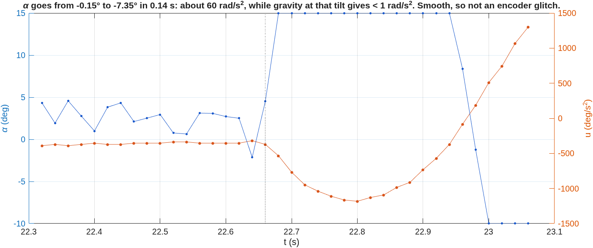

# Rig session 2026-10-21, late: free swing, firmware 2.3.2, swing-up caught at the first try

Board 1 (ST-LINK …124223), firmware **2.3.2**, flashed at 19:15 UTC. The flash tool
verified the image (SHA-256 `fb3fde2d…`, equal to `firmware/enr312/release/MANIFEST.txt`),
and the board answered `enr312-target-2.3.2`, state SAFE, no faults. Runs from
19:18–19:23 UTC:

- raw data: `data/raw/EXP001/*20261021-19*.csv` and
  `data/raw/EXP024/EXP024_20261021-192231_swing-up_R08.csv`
- metadata: alongside, in `data/metadata/`
- serial transcript: `results/evidence/rig_sessions/rig_20261022-004820.log.gz` (local
  time in the name)

Figures: `matlab/plotting/plot_session_20261021c.m`, from those raw files.

This session tests the two conclusions of the [evening report](2026-10-21b_rig_session.md):

1. the pendulum constant is ωg² ≈ 48, not the 57 the firmware had been given;
2. with the right ωg², the swing-up catches reliably.

## Runs

| Run | What we did | What happened |
|---|---|---|
| EXP001 R02, R04, R05 | T1, +5° open-loop move | 4.95° each time: 44 microsteps × 0.1125° |
| EXP001 R03, R06 | free swing, motor off | ωg² 48 ± 1, dry friction 0.33–0.40 rad/s² (below) |
| EXP024 R08 | swing-up, firmware told ωg² 48.5 | **caught at 3.88 s**, balanced 18.8 s, lost to a sudden kick |

## 1. The free swing confirms ωg² ≈ 48

The free swing is the measurement the evening report asked for: motor off, pendulum
lifted 9–12° by hand and let go.

**The app's fit failed at first.** It reported ωg² 0.12 and 30.9 for these two records,
which are nonsense. That fit assumed two things the real records break:

- *The release is at the start of the record.* The hand lifted R03 slowly for four
  seconds before letting go, and R06 holds three separate releases.
- *The damping is viscous.* With dry friction in the pivot, the optimiser ran away to
  Q ≈ 10¹³.

The fit now finds the release itself, as the start of the longest run of swing peaks
that never grows. It models dry and viscous friction together
(`matlab/identification/pendulum_free_swing_fit.m`). It still recovers ωg² and Q
exactly on synthetic viscous data (`test_pend_tools` 8/8, physics validation 14/14). The
saved metadata of R03 and R06 keeps the old, wrong numbers, because recorded files are
never edited. The numbers here replace them.

ωg² by three methods:

| Method | R03 | R06 |
|---|---|---|
| period from peak timing (corrected to small amplitude) | 0.903 s → **48.4** | 0.901 s → **48.6** |
| full periods from the zero crossings | 0.911 s → 47.6 | 0.905 s → 48.2 |
| model fit (dry + viscous friction) | 46.4 (rms 1.10°) | 47.8 (rms 0.24°) |

Dry friction does not change the period of the sliding motion, so the period is the
most direct measure. The model fit comes out 1–4 % lower; it trades ωg² against the
friction and the offset, and its R03 fit is visibly worse. Taken together:

- **ωg² = 48 ± 1.**
- That agrees with the evening's estimates from inside other runs: 47.6 (T10) and 49.5
  (92° swings).
- The Tutorial-derived 57.01 is 19 % too high.
- The equivalent simple-pendulum length is g/ωg² = 0.203 m. A uniform rod would be
  0.30 m long.

**Dry friction:** 0.33 and 0.40 rad/s² (the T10 decay gave 0.48). The fits find no
viscous part at these amplitudes, which agrees with the evening's finding.

## 2. Swing-up on 2.3.2 with the measured ωg²: caught at 3.88 s

- **Swing-up.** The swing dialog offered the measured ωg² (48.5), and the firmware ran
  with it. The pendulum was caught at **3.88 s, at the first try**: about half the time
  of the 2.2.0 catches (7.1–8.0 s), and ten times faster than the one 2.3.0 catch
  (38.9 s).
  - The simulation of this configuration (2.3.2, the identified pendulum) catches at
    **4.23 s**.
  - Its build-up is a little quicker than the rig's. The rig then reached the top one
    swing earlier, because a catch can happen on any pass that meets the rule.
- **Balance, after the catch.**
  - α stayed at −0.53° on average, rms 0.66°.
  - The arm was held where it caught (−45°) for 2 s and then walked home. It was
    within 5° of home by 18 s, while the upright trim learnt the offset.
- **Kick 1, at 19.6 s.** α jumped by 1.4° in 60 ms. The controller saturated briefly,
  swung the arm to +17°, and recovered.
- **Kick 2, at 22.66 s.** A larger one, and the pendulum was lost.

## 3. The kicks

At 22.64 s everything was quiet: α −0.15°, the arm still, u a few hundred deg/s². In
the next 0.14 s α ran to −7.35°.

- **Not gravity.** The jump needs about 60 rad/s² of angular acceleration of the
  pendulum. Gravity at 1° of tilt supplies less than 1 rad/s².
- **Not an encoder glitch.** α moves smoothly through every sample, where a glitch
  would jump by whole counts.
- **Not the controller.** It saturated at its 1500 deg/s² limit trying to catch the fall.

It is the same signature as the losses of balance in the morning session (cause open
there too). This is now the most important open problem on this rig. Three
explanations fit and the data cannot separate them:

1. something touched the pendulum or the cable;
2. the encoder cable pulls on the pendulum as the arm turns;
3. the stepper lost steps, so the arm jerked while the commanded position, which is
   all we log, stayed smooth.

The tests that would separate them:

- mark the arm, and compare its end position with the commanded one after a kick;
- film a run at 60 fps or faster;
- route the encoder cable with more slack.

## 4. What this session settles, and what it does not

**Settled:**

- **ωg² ≈ 48.** The Tutorial value of 57 was the main reason the evening swing-ups did
  not catch, as the evening report concluded from indirect data.
- **2.3.2 catches quickly with the measured value.** That is one run, so it shows the
  catch works, not how reliable it is.
- **The free-swing analysis works on real records.** It finds the release and fits the
  dry friction.

**Not settled:**

- The swing-up's reliability. Three more runs, with the pendulum untouched after the
  catch.
- The kicks (section 3).
- Everything else in the evening report's open list.
