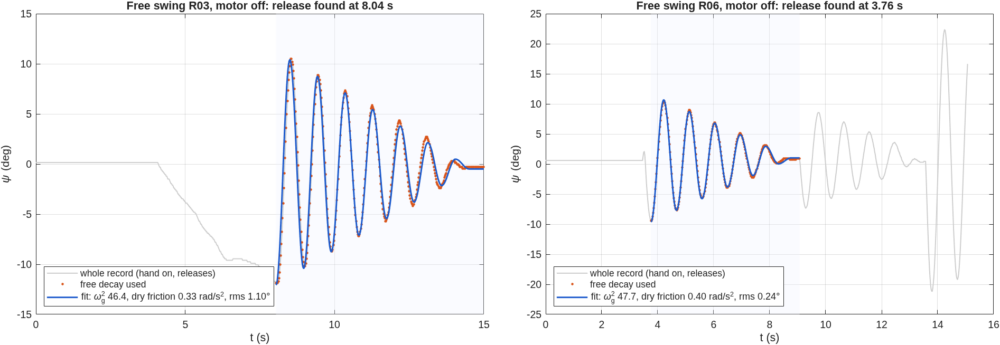

# Rig session 2026-10-21, late: free swing, firmware 2.3.2, swing-up caught at the first try

Board 1 (ST-LINK …124223), firmware **2.3.2**, flashed at 19:15 UTC. The flash tool
verified the image (SHA-256 `fb3fde2d…`, equal to `firmware/enr312/release/MANIFEST.txt`),
and the board answered `enr312-target-2.3.2`, state SAFE, no faults. Runs from
19:18–19:23 UTC:

- raw data: `data/raw/EXP001/*20261021-19*.csv` and
  `data/raw/EXP024/EXP024_20261021-192231_swing-up_R08.csv`
- metadata: alongside, in `data/metadata/`
- serial transcript: `results/evidence/rig_sessions/rig_20261022-004820.log.gz` (local
  time in the name)

Figures: `matlab/plotting/plot_session_20261021c.m`, from those raw files.

The pushes at the end of R08 were made on purpose by the operators, to test how much
disturbance the balance takes (section 3).

This session tests the two conclusions of the [evening report](2026-10-21b_rig_session.md):

1. the pendulum constant is ωg² ≈ 48, not the 57 the firmware had been given;
2. with the right ωg², the swing-up catches reliably.

## Runs

| Run | What we did | What happened |
|---|---|---|
| EXP001 R02, R04, R05 | T1, +5° open-loop move | 4.95° each time: 44 microsteps × 0.1125° |
| EXP001 R03, R06 | free swing, motor off | ωg² 48 ± 1, dry friction 0.33–0.40 rad/s² (below) |
| EXP024 R08 | swing-up, firmware told ωg² 48.5, then two pushes by hand | **caught at 3.88 s**, balanced 18.8 s; recovered from push 1, lost to the larger push 2 |

## 1. The free swing confirms ωg² ≈ 48

The free swing is the measurement the evening report asked for: motor off, pendulum
lifted 9–12° by hand and let go.

**The app's fit failed at first.** It reported ωg² 0.12 and 30.9 for these two records,
which are nonsense. That fit assumed two things the real records break:

- *The release is at the start of the record.* The hand lifted R03 slowly for four
  seconds before letting go, and R06 holds three separate releases.
- *The damping is viscous.* With dry friction in the pivot, the optimiser ran away to
  Q ≈ 10¹³.

The fit now finds the release itself, as the start of the longest run of swing peaks
that never grows. It models dry and viscous friction together
(`matlab/identification/pendulum_free_swing_fit.m`). It still recovers ωg² and Q
exactly on synthetic viscous data (`test_pend_tools` 8/8, physics validation 14/14). The
saved metadata of R03 and R06 keeps the old, wrong numbers, because recorded files are
never edited. The numbers here replace them.

ωg² by three methods:

| Method | R03 | R06 |
|---|---|---|
| period from peak timing (corrected to small amplitude) | 0.903 s → **48.4** | 0.901 s → **48.6** |
| full periods from the zero crossings | 0.911 s → 47.6 | 0.905 s → 48.2 |
| model fit (dry + viscous friction) | 46.4 (rms 1.10°) | 47.8 (rms 0.24°) |

Dry friction does not change the period of the sliding motion, so the period is the
most direct measure. The model fit comes out 1–4 % lower; it trades ωg² against the
friction and the offset, and its R03 fit is visibly worse. Taken together:

- **ωg² = 48 ± 1.**
- That agrees with the evening's estimates from inside other runs: 47.6 (T10) and 49.5
  (92° swings).
- The Tutorial-derived 57.01 is 19 % too high.
- The equivalent simple-pendulum length is g/ωg² = 0.203 m. A uniform rod with this
  ωg² would be 0.30 m long.
- The rod measures **0.26 m** with a ruler (2026-10-22), the Tutorial's length. A uniform
  0.26 m rod pivoted at its end would have ωg² = 3g/2L = 56.6, the Tutorial value. The
  rig's 48 means the pendulum's mass sits further from the pivot than a uniform rod's:
  for example a mass at the tip of about 28 % of the rod's (it gives
  (m/2 + M)/(m/3 + M) = ωg²L/g), or a pivot not at the very end of the rod. Mass on the
  pivot axis itself (encoder shaft, hub) changes neither J nor m·lc, so it cannot explain
  it. *(Corrected 2026-10-22: the first version of this paragraph blamed the hub.)*
  **Most likely cause (added 2026-10-22):** the rig carries a small black paper holder
  clipped at the end of the rod. With its centre 0.24–0.28 m from the pivot, a holder of
  0.47–0.19 times the rod's mass gives exactly ωg² = 48. To confirm, weigh the holder and
  the rod, or record a free swing without the holder: the prediction is ωg² ≈ 56.6. The
  arm coupling follows from ωr²/ωg² = r/g, which holds for any rigid pendulum:
  ωr² = 0.685.

**Dry friction:** 0.33 and 0.40 rad/s² (the T10 decay gave 0.48). The fits find no
viscous part at these amplitudes, which agrees with the evening's finding.

## 2. Swing-up on 2.3.2 with the measured ωg²: caught at 3.88 s

- **Swing-up.** The swing dialog offered the measured ωg² (48.5), and the firmware ran
  with it. The pendulum was caught at **3.88 s, at the first try**: about half the time
  of the 2.2.0 catches (7.1–8.0 s), and ten times faster than the one 2.3.0 catch
  (38.9 s).
  - The simulation of this configuration (2.3.2, the identified pendulum) catches at
    **4.23 s**.
  - Its build-up is a little quicker than the rig's. The rig then reached the top one
    swing earlier, because a catch can happen on any pass that meets the rule.
- **Balance, after the catch.**
  - α stayed at −0.53° on average, rms 0.66°.
  - The arm was held where it caught (−45°) for 2 s and then walked home. It was
    within 5° of home by 18 s, while the upright trim learnt the offset.
- **Two pushes, on purpose.** The operators then pushed the pendulum by hand to test
  the balance: a small push at 19.6 s, which it recovered from, and a larger one at
  22.66 s, which it did not.

## 3. Pushing it: how much disturbance the balance takes

Left panel:

- **The prediction.** The same firmware (2.3.2, the LQR that holds the pendulum after a
  catch), simulated on the identified pendulum. An instantaneous tap is added to the
  pendulum's angular rate. The controller recovers taps up to **100 deg/s** and loses the
  pendulum at 110 (`results/tables/PEND_sim_taps_swingup_lqr.csv`).
- **Push 1** gave the pendulum 49 deg/s. On the rig, α peaked at 2.4° and the arm swung
  21°. The simulation of a 50 deg/s tap gives 2.9° and 27°. It recovered, as predicted.
- **Push 2** reached 86 deg/s, which is inside the recoverable range for a tap. But it
  was not a tap: the hand kept pushing for about 0.14 s.
  - The pendulum accelerated at about 60 rad/s², against less than 1 rad/s² from gravity
    at that tilt, and reached −7.35° before the controller had any effect.
  - The controller ran at its 1500 deg/s² limit both ways, and the arm swung 95°.
  - α passed the 15° bound, and the firmware stopped the run (PENDULUM_LOST).

  A sustained push like this is outside what the tap study covers. Its true size is not
  in the 50 Hz data. Firmware 2.3.3 adds a 500 Hz crash recorder and the app a
  **PUSH MARK** button for exactly this; see below.

**Right panels.** α and the controller's command u around the two pushes. After push 1,
u saturates for about 0.1 s each way and settles within a second.

## 4. What this session settles, and what it does not

**Settled:**

- **ωg² ≈ 48.** The Tutorial value of 57 was the main reason the evening swing-ups did
  not catch, as the evening report concluded from indirect data.
- **2.3.2 catches quickly with the measured value.** That is one run, so it shows the
  catch works, not how reliable it is.
- **The free-swing analysis works on real records.** It finds the release and fits the
  dry friction.
- **The balance rejects a push of about 50 deg/s** with the response the simulation
  predicts.

**Not settled:**

- The swing-up's reliability: three more runs.
- The largest push it survives on the rig. The next test: pushes of increasing size,
  each marked with PUSH MARK, so that every one comes with a 500 Hz record.
- Everything else in the evening report's open list.

## 5. Added after this session: 500 Hz crash recorder (firmware 2.3.3)

The 50 Hz stream shows one sample per 10 control ticks, too coarse to see how a push
develops. Firmware 2.3.3:

- keeps every 500 Hz tick of the last 2 s in RAM
  (`firmware/enr312/src/enr312_crashrec.c`, 16 kB);
- sends 1.5 s before and 0.5 s after an event: after any run abort, or when the app's
  **PUSH MARK** is pressed (the `k` key);
- the app saves the record as `<run id>_500Hz_<n>.csv` next to the run, and logs the
  push in the run's events.

It has host tests and an end-to-end test on the emulator; it has not yet run on the rig.
