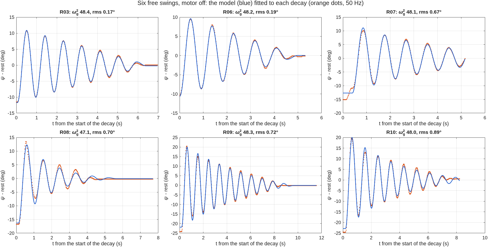
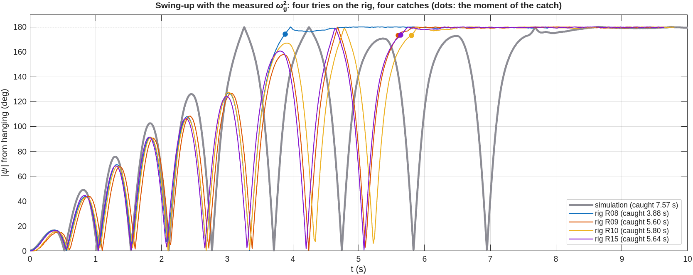
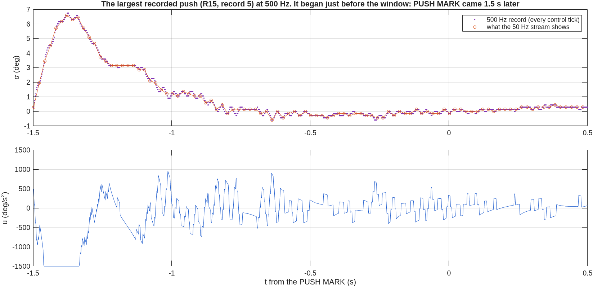

# Rig session 2026-10-21, last: four of four swing-ups, and a push test

Board 1, firmware **2.3.3** (500 Hz crash recorder), 20:53–21:01 UTC.

- Raw data: `data/raw/EXP001/*20261021-205*.csv` and `data/raw/EXP024/*20261021-2[01]*.csv`,
  with their 500 Hz records `*_500Hz_*.csv`.
- Serial transcript: `results/evidence/rig_sessions/rig_20261022-022011.log.gz` (local time
  in the name).
- Figures and tables: `matlab/plotting/plot_session_20261021d.m`.

The mechanics had been gone over first:

- set screws tightened;
- base levelled;
- encoder cable looped;
- rod measured: 0.26 m.

## Runs

| Run | What | Result |
|---|---|---|
| EXP024 R09 | swing-up, ωg² 48.5 | caught at **5.60 s**; balanced about 34 s untouched; then pendulum target 0 |
| EXP024 R10 | swing-up, then pushes | caught at **5.80 s**; four marked pushes; lost to a 115 deg/s push at 44 s |
| EXP024 R14 | pendulum target 0 while hanging | nothing to stop; no motion |
| EXP001 R07–R10 | free swings, motor off | ωg² 47.1–48.4 (below) |
| EXP024 R15 | swing-up, then pushes | caught at **5.64 s**; 14 pushes of 30–83 deg/s, all recovered; stopped at 65 s |

EXP021 (stopping a swing with the hanging PID) was not recorded in this session.

## 1. The pendulum constant: six free swings agree

**Why the app's fit failed again.** On the four new records it reported ωg² from 5 to
120 000. The records themselves are clean decays; the fit was not.

- The hand often held the pendulum at the top for up to a second before letting go. The
  fit began during the hold.
- In R10 the pendulum was caught and released again mid-record.
- With a starting guess a few percent off, fitting many cycles at once can lock onto the
  wrong phase.

**How the fit now works** (`matlab/identification/pendulum_free_swing_fit.m`):

1. **Release.** It finds the release as the moment the pendulum starts to fall: more than
   1.5° within 0.1 s. A free fall from 10° covers about 3° in that time; a hand drifts
   less than 0.5°.
2. **Held peaks.** A peak where it was held starts a new decay.
3. **Release instant.** The fit determines the exact instant itself.
4. **Starting period.** It is counted with a 0.3° dead band, so a pendulum resting on the
   level is not counted as crossing it.
5. **Growing window.** The fit runs over two periods first, then four, then the whole
   decay.

The synthetic checks are unchanged. Every rig free swing now fits with an rms error of
0.17–0.89°:

| | R03 | R06 | R07 | R08 | R09 | R10 |
|---|---|---|---|---|---|---|
| start (deg) | 11.5 | 10.5 | 15.1 | 16.7 | 24.2 | 24.5 |
| ωg², model fit | 48.4 | 48.2 | 48.1 | 47.1 | 48.3 | 48.0 |
| ωg², from the period | 48.0 | 47.3 | 48.3 | 47.4 | 48.0 | 47.9 |

(`results/tables/PEND_free_swings.csv`.) The period is interpolated between samples and
corrected to small amplitude by the fit. The two methods and six records give
**ωg² = 48.0 ± 0.5 rad²/s²**, the value the swing-ups ran with (48.5).

The split of the losses between dry and viscous friction is less certain:

- From 10° releases, dry friction alone fits: 0.35–0.40 rad/s², with no viscous part.
- From 15–25° releases, the fit prefers less dry friction plus some viscous damping
  (Q 6–25).

A single swing record cannot separate the two cleanly, because both take energy out of
every cycle. The energy balance at 92° (evening report, section 3C) needs both. The
model we use for simulation, dry friction 0.37 rad/s² plus Q 60, sits between these.

R07 reads near 720°, because the pendulum had been turned twice since its datum was set.
The angle wraps correctly, so the fit is unaffected. Zeroing the datums before every
free swing avoids it.

## 2. Swing-up: four of four with the measured ωg²

| Firmware, ωg² told | tries | caught | catch times |
|---|---|---|---|
| 2.2.0, 57.01 (morning) | 3 | 3 | 7.1, 7.1, 8.0 s |
| 2.3.0, 57.01 (evening) | 3 | 1 | 38.9 s |
| **2.3.2 / 2.3.3, 48.5** | **4** | **4** | **3.88, 5.60, 5.80, 5.64 s** |

The three runs of this session reach the top on the same swing, about 0.2 s apart. The
rig is now repeatable.

The simulation of this configuration (grey) is less faithful here:

- it pumps energy faster than the rig;
- it reaches the top earlier, at about 3.3 s, but too fast to catch;
- it catches only at 7.6 s.

So the model still underestimates the losses at large swing angles; the plant used is
dry friction 0.37 rad/s² plus Q 60. The firmware does not depend on that model: its
learnt correction δ adapts to the real pendulum, and on the rig it caught one or two
swings earlier than in simulation.

## 3. Balancing, untouched

| Run | quiet time | α mean | α rms | arm mean |
|---|---|---|---|---|
| R09 | 36.9 s | +0.38° | 0.42° | +1.1° |
| R10 | 33.8 s | +0.46° | 0.50° | +5.2° |
| R15 | 27.8 s | +0.21° | 0.28° | +3.8° |

The pendulum balances within half a degree rms.

The mean α is the offset between the encoder's "upright" and the true balance point. The
auto-trim learns it so that the arm does not have to pay for it. Without the trim, the
LQR would hold the arm at about 38 × α off home: +8 to +18° here. The arm stays at +1 to
+5°, so the trim takes out most of it. The rest is the trim's time constant (8 s) and its
deliberately slow learning.

## 4. The push test: 15 of 17 pushes recovered

**The prediction (grey).** The same firmware on the identified pendulum, simulated. An
instantaneous tap is added to the pendulum's angular rate. The LQR recovers taps up to
**100 deg/s**, with the peak angle growing from 0.6° (10 deg/s) to 8.4° (100 deg/s).

**The rig** (`results/tables/PEND_pushes_20261021.csv`).

How a push is measured: the peak pendulum rate within 200 ms of the push's onset, from
the 50 Hz stream. A hand push lasts 50–150 ms, and the controller starts braking the
pendulum within about 50 ms, so this rate *underestimates* the equivalent instantaneous
tap, by more for longer pushes.

The results:

- **15 pushes of 30–83 deg/s, all recovered.** Their peak angles follow the simulated
  curve within about 1°. The few above it are long, slow pushes: a low peak rate but more
  momentum than it suggests.
- **Lost, R08:** an 86 deg/s push that kept acting for about 0.14 s, carrying the pendulum
  past 7° before the controller could answer (late report).
- **Lost, R10:** a push of **115 deg/s**, beyond the simulated limit. The controller held
  its 1500 deg/s² limit for 500 ms, and the firmware's saturation rule stopped the run.

The rig recovers what the simulation says it should, and it fails where the simulation
says it would. The disturbance rejection of the balancing LQR is therefore understood to
within the accuracy of a hand push.

## 5. The 500 Hz records in use

Eight records arrived with their runs. Five contain a push above 30 deg/s. Their sizes,
taken from the 500 Hz samples over 20 ms windows, sit on the same curve (purple squares).

Three lessons for using it:

- **Press PUSH MARK within about a second after the push.** The record holds 1.5 s before
  the mark; several pushes here were marked later and fell outside it (as in the figure,
  where the push starts at the window's edge).
- **One record at a time.** While a record is being sent (about 2.2 s), new marks are
  ignored; about 18 marks gave 8 records. R10's abort produced no record, most likely for
  this reason: the abort came 2 s after a mark.
- **Short records.** A record sent soon after the previous one holds less than 2 s
  (813 and 937 samples here), because the buffer had just been re-armed.

At these push sizes the 50 Hz stream and the 500 Hz record agree (figure). The 500 Hz
record matters for the first tens of milliseconds of a push and for what the controller
does tick by tick, which the stream averages over 10 ticks.

## 6. What this settles

**Settled:**

- ωg² = 48.0 ± 0.5, from six free swings by two methods.
- With it, the swing-up caught 4 of 4 (3.9–5.8 s).
- The balance rejects pushes up to at least 83 deg/s (measured as above), as predicted.
- A 115 deg/s push, beyond the predicted limit, was lost.

**Open:**

- The split of the pivot losses between dry and viscous friction.
- The simulation's swing-up build-up runs about one swing faster than the rig's.
- EXP021 was not recorded.
- The recorder's one-at-a-time limit (section 5).
