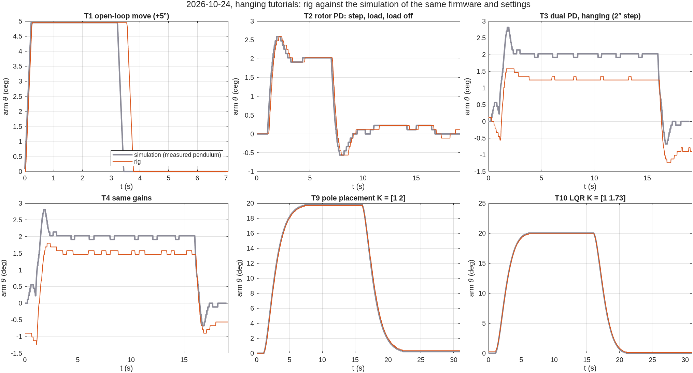
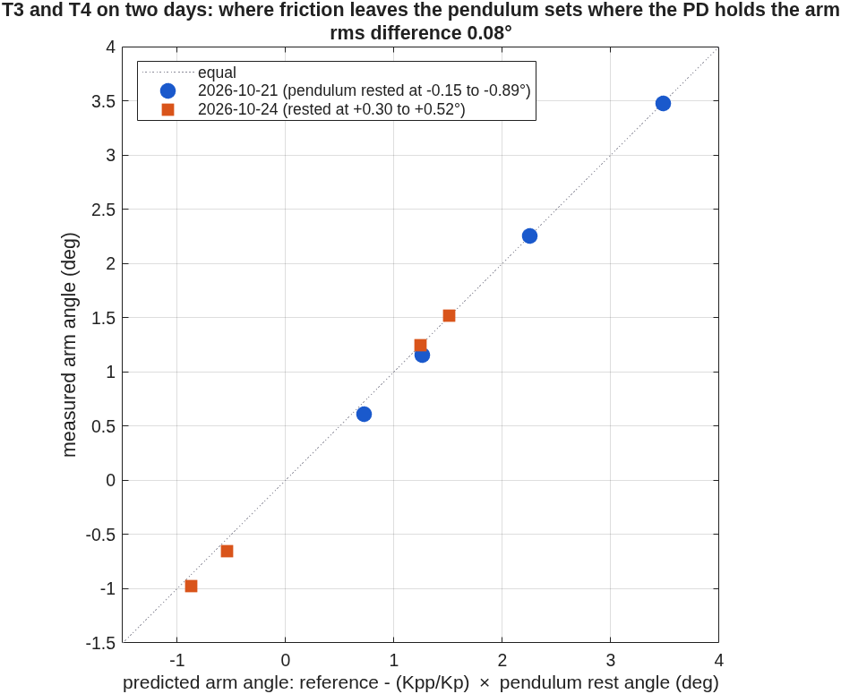
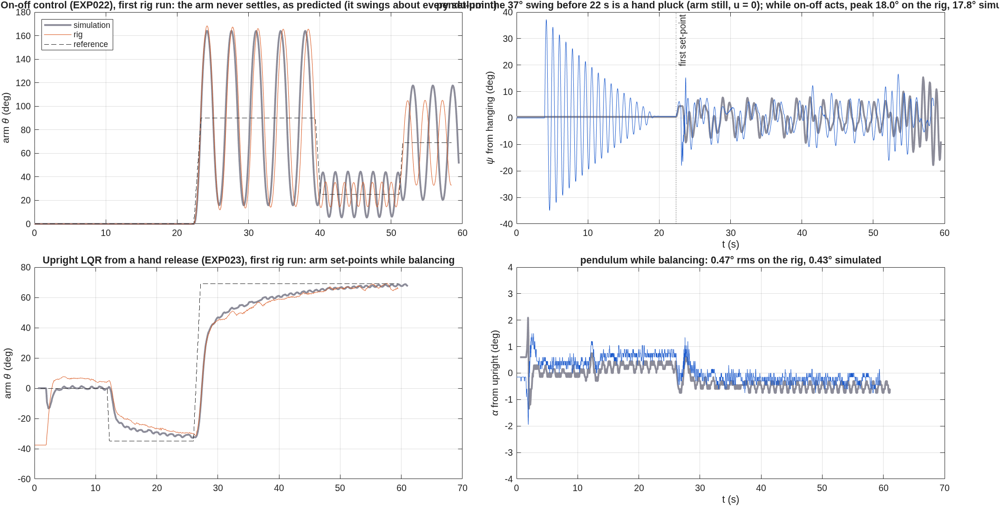
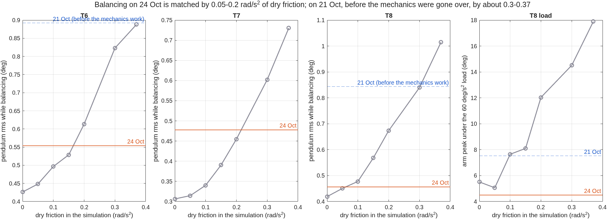
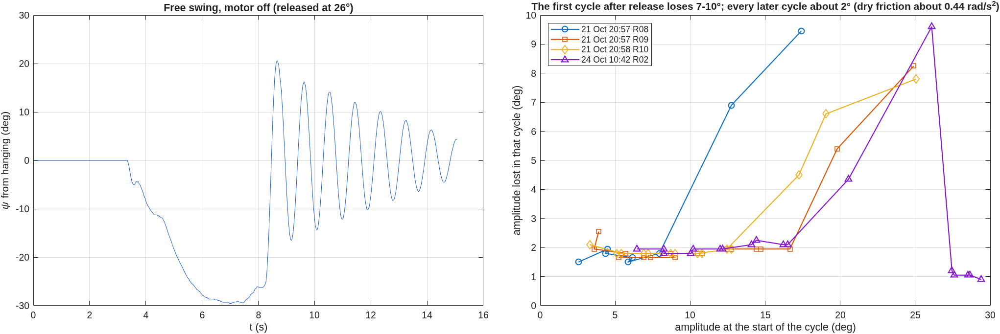
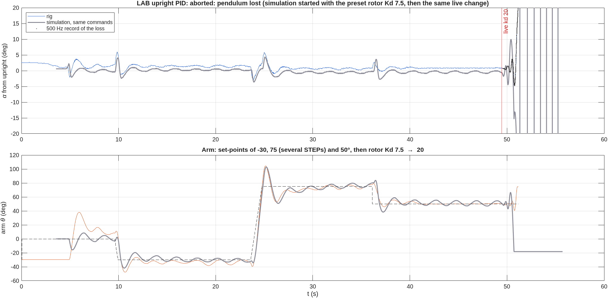
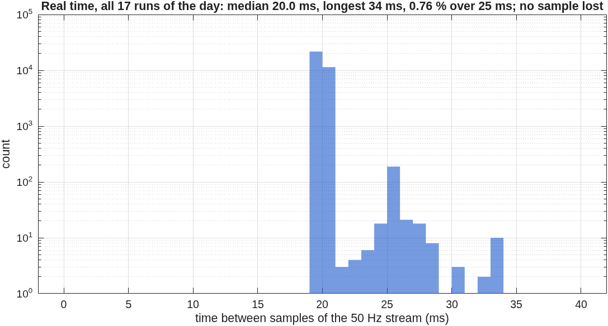

# Rig session 2026-10-24: every experiment in one sitting

Board 1, firmware **2.3.3**, 10:41–11:02 UTC. Seventeen runs: every tutorial, the swing-up and
four LAB modes, two of them on the rig for the first time.

- Raw data: `data/raw/EXP0*/*20261024-1*.csv`, two of them with 500 Hz records.
- Serial transcript: `results/evidence/rig_sessions/rig_20261024-161009.log.gz` (local
  time in the name).
- Figures and tables: `matlab/plotting/plot_session_20261024.m`. Every simulation in it
  runs the firmware's control code with the run's own settings and live commands.

The short version:

- **What was measured before came out the same.** The pendulum constant, the tutorial
  settling times, the friction offsets and the swing-up all repeated.
- **Two experiments ran on the rig for the first time:** on-off control and the LQR
  balancing from a hand release.
- **Three things the simulation had wrong were found and explained.** Balancing sees much
  less pivot friction than a free swing. The motor axis is tilted by about half a degree,
  which makes the arm creep. And a free swing with the motor off loses extra energy in its
  first cycle.
- **The app had real faults.** It started with the textbook pendulum. Its free-swing
  fit kept the textbook arm coupling. A run's saved settings were the ones at the end, not
  the start. All three are fixed (section 9).

## Runs

| Run | What | Result |
|---|---|---|
| EXP001 R01, R03 | T1, +5° open-loop move | 4.95° (44 microsteps), both |
| EXP001 R02 | free swing, motor off | ωg² 48.2 |
| EXP002 R01 | T2 rotor PD, Kp 5, Kd 2.5 | overshoot 29.4 %, offset under load 0.214° |
| EXP003 R01, EXP004 R01 | T3, T4 dual PD, hanging | arm stopped short of the 2° step (section 2) |
| EXP005 R01 | T5 dual PD, upright | balanced 30 s; pushed by hand, three PUSH MARKs |
| EXP006 R01 | T6 dual PID, upright | balanced, 40° step, then set-point 30° |
| EXP007 R01 | T7 impulses, upright | eight impulses, then set-point 30° |
| EXP008 R01 | T8 load with integral action | balanced through the load |
| EXP009 R01, EXP010 R01 | T9 poles, T10 LQR, hanging | settled in 6.24 s and 4.50 s |
| EXP024 R01 | swing-up, then set-points while balancing | caught at 3.88 s; balanced 75 s until STOP |
| EXP023 R01 | **first:** LQR upright from a hand release | balanced 59 s, set-points −35° and 69° |
| EXP022 R01 | **first:** on-off control, hanging | the arm never settles, as predicted |
| EXP009 R02 | LAB hanging state feedback | set-points 69°, 90°, −30°; pendulum plucked twice by hand |
| EXP006 R02 | LAB upright PID, set-points, then rotor Kd 7.5 → 20 live | lost 1.7 s after the change |

## 1. What repeated

| | 21 Oct | 24 Oct | Simulation |
|---|---|---|---|
| ωg² from a free swing | 48.0 ± 0.5 (six swings) | 48.2 | – |
| T1: +5° command | 4.95° | 4.95° | 4.95° |
| T9 settling | 6.24 s | 6.24 s | 5.94 s |
| T10 settling | 4.58 s | 4.50 s | 4.39 s |
| T7 averaged impulse response, pendulum | −1.55° | −1.45° | −1.62° |
| swing-up caught | 4 of 4 | 1 of 1 (3.88 s) | 6.75 s |

T2 ran with different gains from 21 Oct (Kp 5, Kd 2.5), so there is nothing to repeat.
Against its simulation: overshoot 29.4 % and 29.4 %, settling 1.82 s and 1.73 s, the
offset under the load 0.214° and 0.222°, with D/Kp = 0.20° predicted by theory.

The hanging tutorials against the simulation of the same firmware and settings:

**The swing-up** pumps the pendulum up swing for swing like the simulation (15°, 42°,
66°, 90°, 110°, 130°). The rig caught it the first time it reached the top, at 3.88 s.
The simulation arrives with a little more energy, goes over the top twice and catches it
at 6.75 s. After the catch, with the tilted motor axis of section 5, the simulated arm
follows the rig's through every set-point (`results/figures/2026-10-24_swingup.png`). The catch is the sensitive part;
on 21 Oct the simulation gave 4.2–7.6 s for catches the rig made in 3.9–5.8 s.

The open-loop swing of T1 is the one thing in this figure that does not match. Five
identical +5° moves on 21 and 24 Oct left the pendulum swinging 3.3–5.1° peak to peak.
The simulation gives 6.2°. The spread between identical runs is itself large. We don't
know the cause yet; the arm's real motion during the move is not measured, only commanded.

## 2. Friction decides where the hanging PD holds the arm, on both days

In T3 and T4 the pendulum comes to rest where dry friction leaves it, a fraction of a
degree off hanging. The PD then holds the arm off its set-point by (Kpp/Kp) × that rest
angle. On 21 Oct the pendulum rested on one side and the arm went past the 2° step. Today
it rested on the other side and the arm stopped short of it:

Over eight holds on two days the prediction is off by 0.08° rms. The arm stopping at 1.25°
of a 2° step is not a controller fault. That is also why T3 and T4 now show 0 % overshoot
and a "peak 78 % of the step" (section 9).

## 3. Two experiments on the rig for the first time

**On-off (EXP022).** The prediction written before the run was that on-off control
never settles on this rig: the arm accelerates flat out one way or the other, and
nothing slows it near the target. It did not settle. The arm swung about each set-point
the way the simulation does, period for period.

The pendulum's largest swing, 37°, came before the controller acted. The arm was still
and u was 0, so it was a hand pluck. It is not the 36° the prediction was about. While
on-off acted, the pendulum swung up to 18.0° on the rig and 17.9° in the
simulation.

**LQR from a hand release (EXP023).** It caught the pendulum from the operator's hand and
balanced it for 59 s, through two set-point changes, until STOP. The pendulum stayed
within 0.47° rms. A simulation on a level base gives only 0.21°; with the tilted motor
axis of section 5 it gives 0.43°. The arm crept to each new set-point; section 5 explains
that too.

## 4. Balancing feels much less friction than a free swing

The simulation used the pivot friction measured from free swings, 0.37 rad/s², for
everything. With it the simulated upright PID hunted far more than the rig:

- T8: the arm moved 18.8° under the load, against 4.5° on the rig.
- T8: the arm wobbled 27° while balancing, against 7.8°.

Running the same tutorials over a range of friction values:

- **Today** the pendulum's rms while balancing is matched by 0.05–0.2 rad/s². The T8 arm
  peak under the load, 4.5°, is below even the frictionless simulation's 5.1°.
- **The 21 Oct runs** were matched by about 0.3–0.37. Those were recorded before the
  mechanics were gone over that evening: set screws tightened, base levelled, encoder
  cable looped.

**What this means physically.** A ball bearing does not act like a constant friction
force when it barely moves. Before it slips, it flexes a little. Balancing is exactly
that regime: the pendulum moves a fraction of a degree, slowly. A free swing of 10–20°
slides the bearing every cycle, and the constant-friction model fits it well.

**Change.** The rig's parameters now carry a second value, `coulombUpright = 0.12`. The
simulator uses it for the balancing experiments (5, 6, 7, 8, 23) and keeps 0.37 for the
hanging ones and the swing-up. With it, and with the tilt of section 5, today's
balancing runs and their simulations agree (`results/tables/2026-10-24_rig_vs_sim.csv`):

| | Rig | Simulation |
|---|---|---|
| T6 pendulum rms | 0.55° | 0.55° |
| T6 settling after the 40° step | 14.5 s | 13.3 s |
| T7 averaged impulse response, pendulum | −1.45° | −1.62° |
| T8 pendulum rms | 0.46° | 0.48° |
| T8 arm peak under the load | 4.5° | 3.6° |
| T8 arm offset under the load, with Ki | 0.23° | −0.02° |

## 5. The arm creeps: the motor axis is tilted

While balancing, the arm moved to each new set-point quickly at first. Then it crept the
last part with a time constant of about 10 s. A simulation on a level base reached the
set-point in seconds.

We first suspected the firmware's upright auto-trim, which learns the encoder's offset
from upright over 8 s. The simulation runs the same trim and does not creep, so that was
wrong.

**What the data showed.** Within every upright run of the day, the pendulum's steady
lean changed with the arm's angle, by about 0.008° per degree of arm. Fitted with one
offset per run and a common slope:

| Run | Arm (deg) | Steady lean (deg) |
|---|---|---|
| EXP023 | −29.5 / 4.7 / 67.0 | +0.71 / +0.35 / −0.28 |
| EXP024 | 13.0 / 26.9 / 49.6 | +0.01 / −0.17 / −0.35 |
| EXP006 R01 | 0.6 / 29.7 | −0.11 / −0.35 |

(all of them: `results/tables/2026-10-24_steady_lean.csv`)

That is what a tilted motor axis does. If the axis leans by β, the "up" direction seen
in the pendulum's plane moves by β·sin θ as the arm turns. The pendulum must lean that
much to balance. The LQR holds the arm at k₃/k₁ ≈ 38° per degree of unexplained lean, so
a 0.5° change in the balance point is a large arm error. The auto-trim then removes it
at its own 8 s pace: that is the creep.

The fit gives **β = 0.57°**, 1 mm of height difference per 10 cm. With that tilt
added to the plant, the simulation reproduces the creep:

The same tilt, fitted only from the steady leans, also explains why the rig's 40° step
overshot less than predicted:

| Overshoot of the 40° step | Rig | Simulation, level base | Simulation, tilted 0.57° |
|---|---|---|---|
| T6 | 15.6 % | 36.4 % | 19.4 % |
| T8 | 29.2 % | 53.2 % | 34.9 % |

and why the hand-released LQR wobbled more than the level-base simulation: 0.47° rms on
the rig, 0.21° level, 0.43° tilted.

**Fix:** level the base. Put a spirit level (or a phone's level) on the arm and turn it
by hand through a full turn with the motor off. The bubble should not move. No firmware
change is needed. `rigParams.rotor.tiltDeg` records the tilt; the app's simulation
assumes a level base, the rig as it should be.

## 6. The free swing, motor off: an extra loss in the first cycle

The four free swings started from 17–26° with the motor off (21 Oct R08–R10 and today)
each lose 7–10° in their first cycle.
Every cycle after that loses about 2°, steadily, down to the smallest swings. A constant
loss per cycle is dry friction, here about 0.44 rad/s².

The first cycle is different. The LAB state-feedback run (EXP009 R02) shows why. There
the pendulum was plucked by hand twice while the motor was on and holding the arm. From
20° those swings lost 2.1° in the first cycle, like every later one. The arm is held by
the motor's detent alone when the motor is off. The likeliest explanation is that the
swing then moves the arm a little, which dissipates energy. The recorded arm angle is the
commanded one, so the data cannot show the arm moving directly.

**Consequence for the app.** The free-swing fit treats the whole decay as one model. On
today's swing it put all the loss into viscous damping: Q 14.7, no dry friction. The app
then used those numbers. The pendulum constant ωg² = 48.2 was right, because it comes
from the period, not from the decay. Section 9 lists the change.

**Test to confirm:** a free swing with the motor ARMED (holding, not moving). The app's
FREE SWING records with the motor off.

## 7. The lost PID run

The LAB upright PID balanced through three set-point changes, including steps of 75°.
1.7 s after the rotor Kd was raised from 7.5 to 20 live, the pendulum fell. The 500 Hz
record shows a growing oscillation with a period of about 0.4 s: from ±1° to the input's
±1500 deg/s² limit within about a second.

The simulation of the same run, with the same set-points and the same live change at the
same moment, follows the rig through all three set-points and loses the pendulum about
1.4 s after the change. Without the change it keeps balancing; started with Kd 20, it is
lost within 1.85 s. Rotor Kd 20 is outside the stable range on this rig. Tutorial 7 on
21 Oct was lost the same way at Kd 25.

The run's saved settings showed Kd 20, the value at the end. Section 9 changes that.

## 8. Real time

All 17 runs together give 33 387 samples of the 50 Hz stream. The median interval is
20.0 ms and the longest 34 ms. 0.8 % of the intervals are over 25 ms, and no sample is
missing. The three 500 Hz records are complete: 1000, 967 and 1000 samples, 2 ms apart.

## 9. What was wrong in the software, and what changed

Found by going through the session's data and the app with the people who ran it:

| Problem | Cause | Change |
|---|---|---|
| The session started with the textbook pendulum (ωg² 57) | the default plant was the Tutorial's | the app starts with this rig's measured pendulum; Tutorial values are a choice in **PENDULUM VALUES …** |
| After USE MEASURED PENDULUM, ωr² stayed 0.803 | only ωg² was replaced | ωr² = ωg²·r/g is recomputed from every source |
| The fit's friction 0 and Q 14.7 replaced the rig's | the fit was trusted for both | friction and Q are taken from a fit only when it separates them; a popup asks whether to use the new pendulum for the session |
| Saved settings were those at the end of a run | the live changes overwrote them | `config` is the settings at RUN, `config_at_end` after the live changes |
| "Overshoot 581 %" on T5, "−21 %" on T3 | a 2° step inside a ±5° hunt; stopping short counted as negative | step numbers are left out when the hunt is bigger than half the step; overshoot is never negative; a "peak % of step" row added |
| The app opened on T5; NEXT was hard to find | layout | opens on T1; **NEXT EXPERIMENT ›** under the mission buttons |
| Runs needed ABORT to end | STOP did nothing for T1, the free swing, or a motor left on | STOP ends any run gently (saved as STOPPED); with nothing running it reads MOTOR OFF |
| Run names were hard to read | file names shown | "24 Oct 10:46 · T5 Inverted · R01", and how the run ended in words |
| Upright simulations hunted too much | pivot friction | `coulombUpright` (section 4) |

No raw data was changed. The old runs keep their metadata as recorded. The analysis
rebuilds the starting gains of runs with live gain changes from the app's presets and
says so.

## 10. Open

- The T1 swing is 20–85 % smaller on the rig than in the simulation, with a large spread
  between identical runs.
- In T7 the averaged arm response is +5.7° on the rig and −3.8° in the simulation:
  a different size and the opposite sign, while the pendulum's response agrees.

## Next on the rig

1. Level the base (section 5). Then repeat EXP023 with set-points ±60°: the arm should
   reach each set-point within a few seconds.
2. A free swing with the motor ARMED, from 20°, and one with it off (section 6).
3. Repeat T6 and T8 to see whether the balancing friction stays near 0.12.
